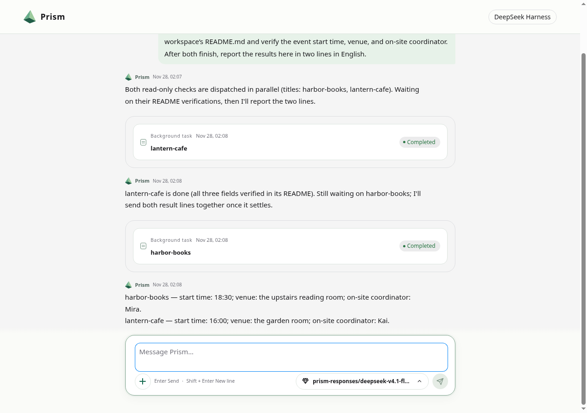

<div align="center">


# dsh-prism

**Just say what you need—Prism handles the projects and devices behind the scenes.**

English | [简体中文](README.zh_CN.md)

</div>

## What Prism does

Normally, working across multiple projects or machines means switching workspaces, tracking directories, and piecing answers together yourself. Prism hides all of that setup behind a single conversation.

You talk to Prism in the web chat or a connected messaging app, and it delegates the work to the right projects, keeps track of progress with collapsible task cards, and replies once the results are ready. Whenever you want to double-check how an answer was found, you can still open the underlying DeepSeek Harness records in read-only mode.



## Get started in four steps

You can try Prism with your own project folders or with the two sample folders (`harbor-books` and `lantern-cafe`) in [docs/examples](docs/examples). For the full step-by-step screenshots, see the [Quick start guide](website/docs/guide/start.md) or the [documentation site](https://prism.dsh-plug.in/guide/start).

1. **Install the seven required plugins.** In DeepSeek Harness (`0.2.3-alpha.2`), open **Plugins → Add plugin**, install each package from the table below in order, and choose **Enable now** after each one.
2. **Connect the chat and embedding models.** In **Settings → Models**, add a **Custom model API** provider using **OpenAI Responses** and the values from `BASE_URL` and `API_KEY`. Select `deepseek-v4.1-flash` with **High** effort in the DSH chat picker. The Prism orchestrator `0.2.1` passes only the provider and model ID to its sessions, so Prism's reasoning effort depends on the provider default. In **Settings → Prism/Memory → Remote API**, bind `BAAI/bge-large-zh-v1.5` using the values from `EMBEDDINGS_BASE_URL` and `EMBEDDINGS_API_KEY`.
3. **Add your project folders.** Open each project folder as a workspace in the DSH sidebar so Prism can find it by name. In **Settings → Prism/Configuration**, use the same description and prompt wherever you enable the same model. [Model descriptions and prompts](website/docs/guide/model-metadata.md)
4. **Start chatting**: Choose **Prism** in the sidebar and ask it to check both projects at once. To see the underlying steps at any time, switch back via **DeepSeek Harness** and open the read-only history in each workspace.

## Required plugins

| Install order | Package | Role |
| --- | --- | --- |
| 1 | `@dsh-prism/dsh-workspace-registry@0.1.2` | Keeps track of available projects and who is allowed to access them. |
| 2 | `@dsh-prism/dsh-orchestrator@0.2.1` | Coordinates conversation, planning, and execution across sessions. |
| 3 | `@dsh-prism/dsh-mesh-node@0.2.2` | Runs tasks on the device where each project lives. |
| 4 | `@dsh-prism/dsh-im-gateway@0.2.0` | Connects Prism to private chats on supported messaging apps. |
| 5 | `@dsh-prism/dsh-concierge-ui@0.2.2` | Provides the Prism chat view, task cards, and settings pages. |
| 6 | `@dsh-prism/dsh-memory@0.3.1` | Stores and retrieves long-term memory and media attachments. |
| 7 | `@dsh-prism/dsh-triggers@0.2.1` | Handles scheduled reminders and external events. |

Want to message Prism from Telegram, WeChat, Feishu/Lark, WeCom, QQ, OneBot, or Discord? See the [Messaging apps guide](website/docs/guide/im.md) ([online](https://prism.dsh-plug.in/guide/im)).

Prism shares the conversation across Web and approved private chats in each DSH profile. To pair devices and configure signaling or relay services, open **Settings → Prism/Connection**. [WebRTC Mesh guide](website/docs/develop/mesh.md)

[Memory and trigger configuration](docs/CONFIG.md#长期记忆与事件)

## For developers and contributors

- Architecture, design principles, and source checkout instructions: [Technical reference](docs/TECH.md)
- Configuration and migration for shared conversations, memory, triggers, and WebRTC. [Configuration and migration](docs/CONFIG.md)
- Run the VitePress documentation site locally from the `dsh-prism` root:

```sh
npm ci --prefix website
npm run docs:dev --prefix website
```

[Prism documentation](https://prism.dsh-plug.in/) · [Technical reference](docs/TECH.md)
