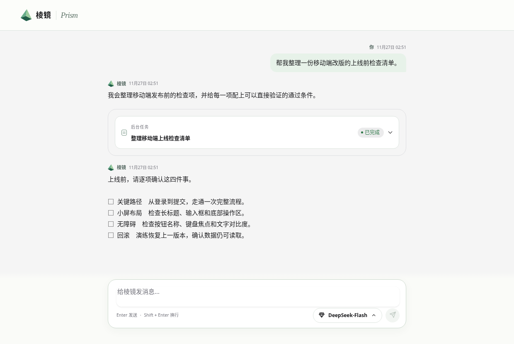

<div align="center">


# dsh-prism

**在一个对话里委托 DeepSeek Harness 跨项目、跨设备完成工作。**

[English](README.md) | 简体中文

</div>

## 在本地开始对话

运行棱镜需要 Node.js 24.9 或更高版本、npm、Git，以及对全部五个私有插件仓库具有读取权限的 Git 身份。官网及其公开源文件可直接阅读。在 DSH 中配置 DeepSeek 凭据，或在启动棱镜的环境中设置 `DEEPSEEK_API_KEY`。示例使用 `deepseek-official` 模型提供方。检出脚本会在本机生成 `runtime/` 目录，内含锁定版本的插件、启动器、示例配置和测试。下面的应用命令都在该目录运行。

```sh
git clone https://github.com/dsh-plugins/dsh-prism.git
cd dsh-prism
node scripts/checkout.mjs
cd runtime
npm ci
npm run build
npm start
```

打开 DSH 在终端打印的登录链接。示例允许代理检索和读取本次检出的工程。可以试着问「找出这个工程在哪里定义各层模型，帮我整理可选项」。发送按钮旁的模型选择器列出可选的对话模型与介绍，可在发送下一条消息前切换。



## 跟进任务

对话代理选定已授权的项目和规划模型。规划代理拆分步骤，再为每一步选择执行模型。任务卡会随进度更新，展开后点击「查看只读会话」即可阅读底层对话。聊天窗口接收对话代理主动发送给你的消息。

## 接入自己的项目或聊天应用

在 `runtime/` 中复制示例配置，把 `registry.projects[].workspace` 改为代理实际工作的目录，填写项目 ID、节点和权限，并将 `orchestrator.defaultProjectId` 指向已授权的项目。使用修改后的文件重新启动。

```sh
cp prism.example.json prism.config.json
```

```sh
npm start -- prism.config.json --host 127.0.0.1 --port 3080 --no-open
```

如需在聊天应用中使用棱镜，在 `im` 下配置对应通道。网关支持 Telegram、微信、飞书/Lark、企业微信、QQ 机器人、OneBot 和 Discord。使用微信或飞书时，运行 `npm run im -- login wechat --config prism.config.json`，或将命令中的 `wechat` 换为 `feishu`，按提示扫码登录。每个私聊保留自己的身份和对话历史。Web 界面、IM 命令和官网文档提供德语、英语、西班牙语、法语、日语、葡萄牙语、俄语和简体中文。[消息网关](https://github.com/dsh-plugins/dsh-im-gateway)

## 了解五个插件

下表链接指向插件的私有源码仓库，供已获授权的协作者访问。

| 插件 | 在对话中发挥的作用 |
| --- | --- |
| [dsh-concierge-ui](https://github.com/dsh-plugins/dsh-concierge-ui) | 展示对话、模型选择器、任务卡和只读会话查看器。 |
| [dsh-workspace-registry](https://github.com/dsh-plugins/dsh-workspace-registry) | 列出当前用户获准派发任务的项目。 |
| [dsh-orchestrator](https://github.com/dsh-plugins/dsh-orchestrator) | 按角色工具权限选用并启动正式 DSH 会话。 |
| [dsh-mesh-node](https://github.com/dsh-plugins/dsh-mesh-node) | 在存放项目的设备上运行派发的任务。 |
| [dsh-im-gateway](https://github.com/dsh-plugins/dsh-im-gateway) | 向私聊投递代理消息、任务状态和按需读取的会话记录。 |

## 在本地阅读文档

官网使用 VitePress。回到公开仓库的 `dsh-prism` 根目录（`runtime/` 的上一级），运行以下命令启动本地预览，或使用 `npm run docs:build --prefix website` 构建静态站点。

```sh
npm ci --prefix website
npm run docs:dev --prefix website
```

[棱镜使用指南](https://prism.dsh-plug.in/zh/) · [技术参考](docs/TECH.md)
