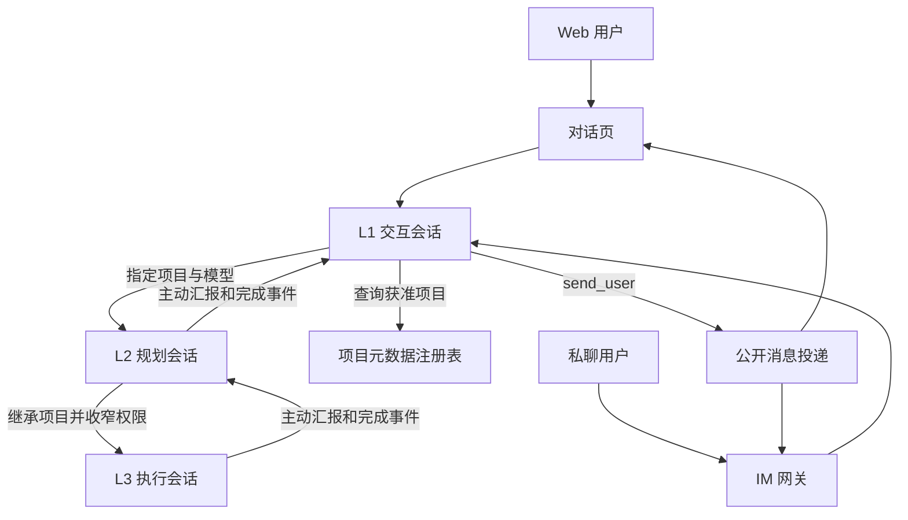

# 棱镜技术参考

## 启动与目录

网页安装使用 DSH 的插件管理器。棱镜采用本机已登记的 DSH 工作区，模型供应商在 DSH 模型设置中配置，各层的模型规则在「棱镜/配置」中管理。[当前网页安装指南](https://prism.dsh-plug.in/zh/guide/start)

### 开发者从锁定的源码启动

`dsh-prism` 公开保存官网、使用文档、版本锁与检出入口，阅读网站及构建官网无需私有仓库授权。运行以下源码检出流程需要能读取全部五个私有插件仓库的 Git 身份。请在公开仓库根目录执行 `node scripts/checkout.mjs`，脚本将锁定版本的五个插件和归档的工作区配置、启动器及测试检出到本机忽略跟踪的 `runtime/` 中。随后 `cd runtime`。该目录使用 npm workspaces 和 TypeScript 项目引用。`npm ci` 安装锁定依赖。`npm run build` 编译全部插件并打包 Web 客户端。`npm test` 构建并执行测试，集成测试会在隔离的临时目录中启动真实 DSH 进程。运行环境需要 Node.js 24.9 或更高版本、npm、Git，以及读取相应 Git 仓库的权限。宿主版本为 DeepSeek Harness `0.2.3-alpha.2`。

`npm start` 读取项目示例配置并启动 DSH Web。自定义部署时复制 `prism.example.json` 为 `prism.config.json`，再指定监听地址及端口。

```sh
npm start -- prism.config.json --host 127.0.0.1 --port 3080 --no-open
```

启动器将配置转换为 Cordis patch，创建三个角色预设并装载五个插件。配置中属于本机的相对目录以配置文件目录为基准，远程项目填写其执行设备的绝对目录。示例使用 `deepseek-official`。真实模型调用需要配置 DSH 凭据或 `DEEPSEEK_API_KEY`。集成测试使用可控模型提供方。

## 当前集成快照与 npm 版本

`plugins.lock.json` 固定维护者检出的五个源码修订。通过 DSH 前端安装时，网页界面使用 0.1.3，工作区注册表、编排器和 IM 网关使用 0.1.2，Mesh 节点使用 0.1.1。[当前 npm 安装顺序](../README.zh_CN.md#五个插件)

网页界面 0.1.2 版验收的独立源码测试通过 63 项，按当时的集成快照检出的完整 DSH 工作区宿主测试通过 68 项，两套测试存在重叠。工作区构建的五个压缩包逐个与对应单仓构建比对，内容相同。实际发布的五个 npm 包另行核对了其包名、版本、SHA-512 与 DSH 组合包声明。

维护者需要构建这些源码的压缩包时，在检出生成的 `runtime/` 中执行以下命令。

```sh
npm ci
npm test
mkdir -p ../tarballs
npm pack --workspaces --pack-destination ../tarballs
```

## 网页实测记录

网页界面 0.1.2 版的操作记录涵盖从公共 npm 安装精确版本、通过 OpenAI Responses 接入 `deepseek-v4.1-flash`、分层设置模型、查看七种 IM 账号配置及双工作区任务。完整录像完成后，分别从全新的中、英文 DSH 环境重复相同步骤，为图解取证。两个环境均使用自己的安装和模型设置。[双工作区操作](https://prism.dsh-plug.in/zh/guide/start) · [七种 IM 配置](https://prism.dsh-plug.in/zh/guide/im)

| 所见现象 | 操作与结果 |
| --- | --- |
| 安装 IM 网关时出现依赖脚本确认。 | 核对列表中的依赖，点“允许这些脚本并重试”，插件成功安装并启用。 |
| Mesh 节点的安装成功卡显示一段 README 首行 HTML。 | 已发布的 Mesh 0.1.1 带有这段包说明，版本与启用按钮可正常使用。该库的源码主分支已提供正确说明。 |
| 五个插件已经启用，打开设置却找不到“棱镜/配置”和“棱镜/IM”，侧栏也没有入口。 | 在已打开的 DSH 标签页刷新一次。之后可从侧栏进入棱镜，并能打开这两个设置项，继续完成全流程。 |
| 在目录选择器输入绝对路径后，曾出现仍停留在原目录的情况。 | 重新点“编辑路径”输入目标目录，核对面包屑的末尾目录名，再点“打开”。两个正式重置环境都顺利打开了两个项目。 |
| 独立中文试跑中，飞书表单曾自行返回账号列表。 | 从“添加 IM”重新进入飞书即可继续。本次完整录像和两种语言的独立截图流程均取得飞书官方码，随后从界面取消登录。 |
| 微信扫码显示“登录失败”。 | 本次环境连接微信官方 iLink 服务失败。界面提供“重新生成二维码”，只有取得官方码后才能继续扫码。飞书在同一环境取得了官方码并从界面取消登录。 |
| 打开旧版 DSH 插件时提示“这个包没有声明组合包”。 | 该历史问题曾用注册表 0.1.0 重现。本轮按安装表填写带版本的 npm 包名，五包均通过 DSH 插件管理器安装。 |


此前 0.1.1 版本的项目手工授权页、任务详情弹窗及相关回归记录保存在对应版本文档中。[0.1.1 前端操作实拍](https://github.com/dsh-plugins/dsh-prism/blob/131ed6734c1cae8a6dc6c039d412645de75b376d/website/docs/zh/guide/start.md) · [0.1.1 验收记录](https://github.com/dsh-plugins/dsh-prism/blob/131ed6734c1cae8a6dc6c039d412645de75b376d/docs/TECH.md)

## 从一句请求到执行结果



L1 模型由用户从 `orchestrator.models.L1` 选择。各层模型分别配置 `id`、`provider`、`description`、`prompt` 和 `promptMode`。上级通过 `list_models` 获取下一层模型介绍并选择模型。默认的 `append` 模式附加角色指令与模型提示词，`replace` 将模型提示词作为最终系统提示词。原生工具的放行由宿主独立检查，同一用户的消息在入队时记录选定的模型 ID。

独立源码配置以 `defaultProjectId` 指定默认项目。网页安装采用 DSH 登记的工作区，查询调用返回项目元数据，底层路径仅用于受信任的宿主派发。L1 可把跨项目请求分别交给不同项目的 L2。L2 继承 L1 为其选择的项目，按步骤派发 L3。L3 项目和节点来自它的直接上级，执行工具集合受该节点配置、项目策略和逐级收窄的权限约束。

代理通过 `send_child`、`send_parent` 主动收发消息。`report_progress` 和 `get_progress` 分别记录和查询进展。子任务完成时调度器将 `task_settled` 投递给直接上级，可以唤醒已空闲的会话。只有 `send_user` 会将 L1 的助手消息写入用户对话。任务卡单独接收进度状态，读取底层轨迹时校验当前用户和任务归属。

## 节点与会话

本地和跨机派发共用注册的 `prism-<nodeId>` Subagent Provider。协调器签发一次性派发凭据，Provider 返回执行节点上正式 DSH 会话的 ID。使用多个设备时，各自运行 DSH 并维护独立的 `DSH_HOME`。控制端和执行端按节点 ID、项目 ID 及独立 Mesh 令牌建立连接，远端根据自己的注册表、模型配置和权限上限重建执行参数。跨机调用使用 HTTPS，回环测试允许 HTTP。两端不需要共享 SQLite 或项目目录。

用户消息、模型选择、任务状态和待交付的代理消息存入 `conversations.sqlite`。每个逻辑会话串行执行，多个独立任务可并发。未开始的已提交轮次在重启后继续。已执行到中途的任务若失去运行者，由恢复逻辑记为失败，使操作者可以核对已产生的副作用。正式会话日志由 DSH 保存。启用已有会话发现所有权写锁冲突时，节点从旧日志 Fork，以事务更新逻辑会话绑定并记录旧会话的归档义务。只读查看使用 DSH 的查询接口。

## 插件技术索引

下表源码链接需要对相应私有仓库的读取权限。公开文档可直接在[棱镜官网](https://prism.dsh-plug.in/)阅读。

| 插件 | 配置段 | 技术文档 |
| --- | --- | --- |
| Web 对话界面 | 由启动器挂载 | [路由、前端组件与只读会话](https://github.com/dsh-plugins/dsh-concierge-ui/blob/main/docs/TECH.md) |
| 项目注册表 | `registry` | [项目记录与主体授权](https://github.com/dsh-plugins/dsh-workspace-registry/blob/main/docs/TECH.md) |
| 编排器 | `orchestrator` | [工具、模型和持久化](https://github.com/dsh-plugins/dsh-orchestrator/blob/main/docs/TECH.md) |
| 跨设备 Mesh | `mesh` | [两端配置和远程执行](https://github.com/dsh-plugins/dsh-mesh-node/blob/main/docs/TECH.md) |
| IM 网关 | `im` | [通道认证、命令和投递](https://github.com/dsh-plugins/dsh-im-gateway/blob/main/docs/TECH.md) |

## 官网和本地文档

官网的 VitePress 工程位于 `website`。在公开仓库根目录（`runtime/` 的上一级）运行 `npm ci --prefix website` 后，使用 `npm run docs:dev --prefix website` 查看本地文档，或用 `npm run docs:build --prefix website` 生成可部署的文件。[棱镜官网](https://prism.dsh-plug.in/)
