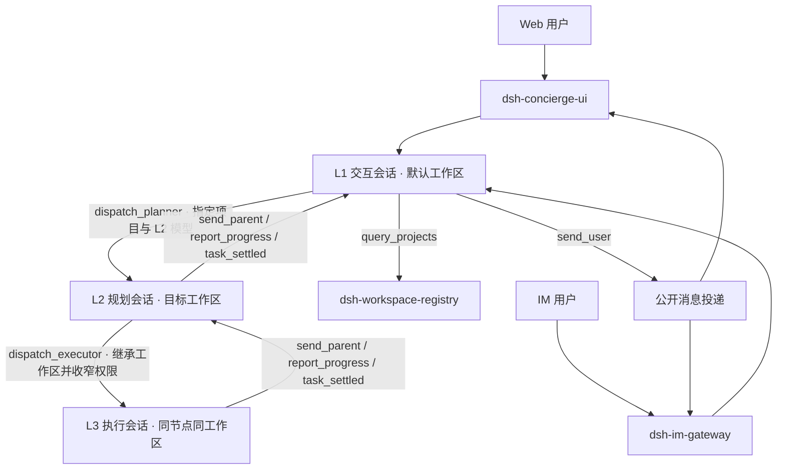

# 棱镜（dsh-prism）技术路线与架构参考

## 一句话设计理念

**对用户隐藏一切基础设施复杂度，在底层用严格的边界换取高自治与高可用。**

基于五个插件（`dsh-concierge-ui`、`dsh-workspace-registry`、`dsh-orchestrator`、`dsh-mesh-node`、`dsh-im-gateway`），棱镜在 DeepSeek Harness（DSH）之上构建了一套多层分布式协作架构：对 Web 与 IM 用户屏蔽底层工作区与多机拓扑，仅呈现极简对话流、折叠任务状态卡与只读检视入口；而在底层通过严格隔离、显式发信、动态点将、位置透明与遇锁自愈保证系统的安全与鲁棒。

## 六个核心原则与技术路线

1. **交互极简与渐进式披露（Zero-Workspace UX）**
   用户关心的是「做成一件事」，而非「代码在哪台机器的哪个目录」。系统通过单一对话流（`dsh-concierge-ui`）与 IM 入口（`dsh-im-gateway`）屏蔽工作区、路径与多机拓扑，将一句自然语言折射为后台多层协作；同时保留只读旁路检视能力，做到「平时零打扰，排查全透明」。

2. **严格权限天花板与上下文洁癖（Strict Isolation）**
   越靠近用户的层级，权限越克制、上下文越干净。系统采用「L1 交互 → L2 规划 → L3 执行」三层隔离：L1 绑定配置中的默认工作区，被彻底剥离文件读写与终端执行能力，只保留项目元数据检索（`query_projects`）与任务派发权——既守住 IM/Web 入口的越权与注入底线，也隔绝底层海量代码与日志对路由层注意力的污染。

3. **默认静默，显式发信（Silent-by-Default Actor）**
   打破传统大模型「有问必答、吐字即输出」的同步对话范式。L1 的自然语言生成仅作为内部思考，向用户输出可见内容必须显式调用 `send_user`。L1 与 L2、L2 与 L3 之间通过 `send_child` / `send_parent` 经持久队列双向主动发信，配合 `report_progress` / `get_progress` 与子任务终态的 `task_settled` 事件，使智能体具备异步事件处理、主动保持沉默与多任务并行协调的能力。

4. **能力自描述与动态点将（Self-Describing Routing）**
   拒绝把模型和任务写死。通过「分层模型池 + 独立能力介绍（`description`）+ 专属提示词覆写（`promptMode: "append" | "replace"`）」，把模型选择权下放给运行时：用户按偏好自由切换前端 L1 模型，而 L1/L2 则通过 `list_models` 读取下一层模型的「能力简历」在派发时动态择优，兼顾效果、延迟与成本。

5. **位置透明的分布式抽象（Location Transparency）**
   不让上层编排逻辑感知网络拓扑。`dsh-mesh-node` 将远程设备上的 DSH 实例封装为标准的 `prism-<nodeId>` Subagent Provider，使跨机派发与本地拉起子任务共用同一套接口；配合「L1 指定 L2 工作区、L3 强制继承 L2 工作区」的规则，将高频文件操作收敛在目标机本地，跨网只传轻量级控制信令与摘要。

6. **外轻内重，遇锁自愈（Virtual Facade & Copy-on-Conflict）**
   在接口层保持 Subagent 的轻量与简洁，在存储与运行层则全部落为正式的 DSH 会话，天然获得持久化、断点续跑与原生检视能力。同时将「逻辑智能体身份」与「物理会话实例」解耦——启用会话时若检测到 DSH 写锁冲突，不阻塞也不强抢，而是立即从可观测历史 Fork 新会话、原子更新逻辑绑定并记录原会话归档义务，以写时复制（Copy-on-Conflict）换取系统的永不卡死与可审计性。

## 整体协作链路



- **工作区治理**：网页安装场景下自动发现 DSH 侧栏已登记的本地工作区（以原生 UUID 为内部项目 ID，默认只读检索）；显式配置场景由 `registry` 管理 `id`、`nodeId`、`workspace`、`principals` 与 `permissions`。`query_projects` 仅返回授权元数据，物理路径只在受信宿主代码中解析。
- **权限交集**：L3 执行工具集合严格取「L3 角色白名单 ∩ 项目策略 ∩ L2 派发预算」的交集，提示词覆写不会扩大宿主强制执行的安全边界。
- **双层持久化**：用户消息、模型选择、任务状态与待投递 Actor 消息保存在 `conversations.sqlite`；完整执行轨迹由各自节点上的正式 DSH 会话日志保存。只读 Trace 查询通过同一条 Mesh 链路无锁读取，不占用写锁。

## 源码检出、构建与部署

`dsh-prism` 公开保存官网、使用文档、版本锁（`plugins.lock.json`）与检出脚本；阅读或构建文档无需私有仓库权限。若需从源码启动完整运行时（需要能读取五个私有插件仓库的 Git 权限，宿主版本为 DeepSeek Harness `0.2.3-alpha.2`，Node.js >= 24.9）：

```sh
# 1. 在公开仓库根目录检出锁定版本的五个插件到 runtime/
node scripts/checkout.mjs
cd runtime

# 2. 安装依赖、编译并运行测试（集成测试会在隔离临时目录启动真实 DSH 进程）
npm ci
npm run build
npm test

# 3. 复制示例配置并启动（默认使用 prism.example.json）
cp prism.example.json prism.config.json
npm start -- prism.config.json --host 127.0.0.1 --port 3080 --no-open
```

打包发布压缩包时，在 `runtime/` 下执行：

```sh
npm pack --workspaces --pack-destination ../tarballs
```

## 当前 npm 发布版本与五插件索引

通过 DSH 插件管理器安装时，请按依赖顺序安装以下版本（[安装图解](https://prism.dsh-plug.in/zh/guide/start)）：

| 安装顺序 | 插件包名与版本 | 配置段 | 技术文档（需仓库权限） |
| --- | --- | --- | --- |
| 1 | `@dsh-prism/dsh-workspace-registry@0.1.2` | `registry` | [项目记录与主体授权](https://github.com/dsh-plugins/dsh-workspace-registry/blob/main/docs/TECH.md) |
| 2 | `@dsh-prism/dsh-mesh-node@0.1.1` | `mesh` | [两端配置和远程执行](https://github.com/dsh-plugins/dsh-mesh-node/blob/main/docs/TECH.md) |
| 3 | `@dsh-prism/dsh-orchestrator@0.1.2` | `orchestrator` | [工具、模型和持久化](https://github.com/dsh-plugins/dsh-orchestrator/blob/main/docs/TECH.md) |
| 4 | `@dsh-prism/dsh-im-gateway@0.1.2` | `im` | [通道认证、命令和投递](https://github.com/dsh-plugins/dsh-im-gateway/blob/main/docs/TECH.md) |
| 5 | `@dsh-prism/dsh-concierge-ui@0.1.3` | 由启动器挂载 | [路由、前端组件与只读会话](https://github.com/dsh-plugins/dsh-concierge-ui/blob/main/docs/TECH.md) |

## 本地预览官网文档

官网基于 VitePress 构建，在公开仓库根目录执行：

```sh
npm ci --prefix website
npm run docs:dev --prefix website    # 本地预览
npm run docs:build --prefix website  # 构建静态站点
```

[棱镜官网](https://prism.dsh-plug.in/zh/)
