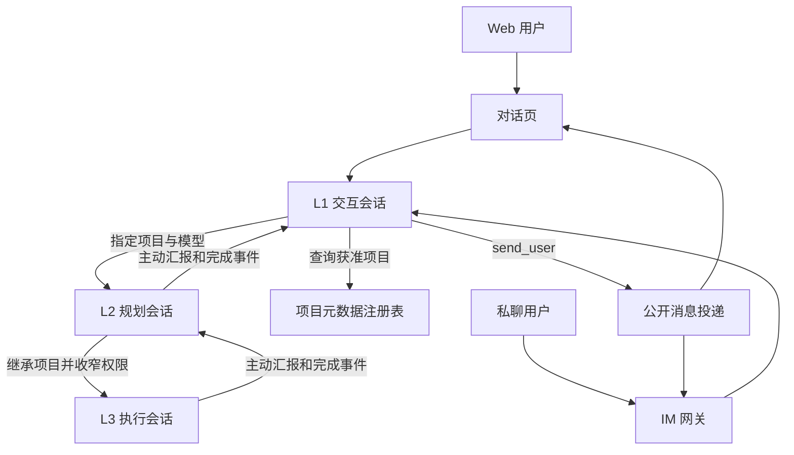

# 棱镜技术参考

## 启动与目录

网页安装使用 DSH 的插件管理器。棱镜采用本机已登记的 DSH 工作区，模型供应商在 DSH 模型设置中配置，各层的模型规则在「棱镜/配置」中管理。[当前网页安装指南](https://prism.dsh-plug.in/zh/guide/start)

### 开发者从锁定的源码启动

`dsh-prism` 公开保存官网、使用文档、版本锁与检出入口，阅读网站及构建官网无需私有仓库授权。运行以下源码检出流程需要能读取全部五个私有插件仓库的 Git 身份。请在公开仓库根目录执行 `node scripts/checkout.mjs`，脚本将锁定版本的五个插件和归档的工作区配置、启动器及测试检出到本机忽略跟踪的 `runtime/` 中。随后 `cd runtime`。该目录使用 npm workspaces 和 TypeScript 项目引用。`npm ci` 安装锁定依赖。`npm run build` 编译全部插件并打包 Web 客户端。`npm test` 构建并执行测试，集成测试会在隔离的临时目录中启动真实 DSH 进程。运行环境需要 Node.js 24.9 或更高版本、npm、Git，以及读取相应 Git 仓库的权限。宿主版本为 DeepSeek Harness `0.2.3-alpha.2`。

`npm start` 读取项目示例配置并启动 DSH Web。自定义部署时复制 `prism.example.json` 为 `prism.config.json`，再指定监听地址及端口。

```sh
npm start -- prism.config.json --host 127.0.0.1 --port 3080 --no-open
```

启动器将配置转换为 Cordis patch，创建三个角色预设并装载五个插件。配置中属于本机的相对目录以配置文件目录为基准，远程项目填写其执行设备的绝对目录。示例使用 `deepseek-official`。真实模型调用需要配置 DSH 凭据或 `DEEPSEEK_API_KEY`。集成测试使用可控模型提供方。

## 0.1.1 版压缩包验证记录

五个 `@dsh-prism` 包的 0.1.1 版均已发布到公共 npm，并通过各自 GitHub Actions 的可信发布工作流交付。本次从 npm 下载五个包，分别核对其 SHA-512 与已测试的候选构建一致。日常安装可以在 DSH 插件管理器直接输入带版本的包名。[前端安装顺序及包名](../README.zh_CN.md#五个插件)

维护者在包含对应 0.1.1 版五个插件的源码工作区内执行以下命令。工作区根目录应包含五个插件目录和集成测试，以上检出流程生成该目录时名称为 `runtime/`。使用旧版本锁会打包该锁指定的源码。构建机需要有相应源码的读取权限。

```sh
npm ci
npm test
mkdir -p ../tarballs
npm pack --workspaces --pack-destination ../tarballs
```

在本次测试的源码组合上，完整宿主测试 69 项全部通过，单包测试 64 项全部通过。两套测试存在重叠。命令产出的五个 `.tgz` 与分别构建插件后用于前端安装的压缩包逐个 SHA-512 相同。将这五个文件交给用户后，用户在 DSH 的 **插件 → 添加插件** 页面依次输入各压缩包在宿主上的路径，安装并启用即可。[网页安装步骤](https://prism.dsh-plug.in/zh/guide/start)

## 0.1.1 版前端工作流验收记录

使用新 DSH 配置档，在插件管理器中分别输入五个带 `@0.1.1` 版本的 npm 包名，通过原生设置接入 OpenAI Responses 和 `deepseek-v4.1-flash`，再给两个本地目录分别授权读取。单独检查每个执行步骤的只读会话，可以看到 `read` 返回的是各自项目的 README。[中文步骤与原始截图](https://prism.dsh-plug.in/zh/guide/start) · [English walkthrough](https://prism.dsh-plug.in/guide/start)

| 实测问题 | 修复及验证 |
| --- | --- |
| 安装 0.1.0 项目注册表时，DSH 提示“这个包没有声明组合包”。 | 五个 0.1.1 压缩包都提供打包后的 Cordis 配置层，并用 `dsh.bundle` 声明。DSH 在新配置档中逐个安装并启用成功。 |
| 从空白 DSH 环境开始时，没有前端入口登记棱镜可访问的项目。 | 在原生设置增加“棱镜”页，可添加项目 ID、绝对目录及工具授权。三个角色使用原生对话选定的模型。前端实测添加了两个独立目录，均只授予 `read`、`glob` 和 `grep`。 |
| 项目高级设置按逗号拆分授权身份，完整的 IM 身份无法保存。 | 改为每行一个身份。网页操作在保留 `web:owner` 的同时另存一条演示 IM 身份，重开项目核对整行后删除并保存。授权私聊与授予指定项目的访问权可以分别设置。 |
| 已有对话里的项目授权或目录变动后，新请求可能仍沿用旧的项目绑定。 | 新请求根据当前授权选择项目并保留对话历史。已有任务沿用原先绑定。回归测试覆盖项目撤销或重新绑定的情况。 |
| 在已得到两份读取结果后，模型仍会重复派发核对任务。 | 执行层可通过 `send_parent` 标记最终结果，父级收到完成通知时能直接利用该结果。最终前端验证中两个执行器各自读取项目文件，返回了可对照的时间、场地及负责人。 |
| 两个执行步骤均已完成，但 L1 只在内部会话生成普通文本，网页迟迟没有收到汇总。 | 所有子任务结算后，若仅发送过进度或尚未回复，另排一次收尾回合。仍无最终答复时，页面提示用户请求汇总已有结果。对话只展示显式 `send_user` 消息，内部轨迹与报告留在各自会话中。 |
| 读取未产生最终报告的子任务进度时，返回对象中的可选字段会影响真实宿主的 JSON 转换。 | `get_progress` 在有报告时返回 `result`，等待报告时省略此字段。已通过单包回归与真实 DSH 宿主的集成测试。 |

在五个英文安装成功卡上，DSH 均显示了 README 的首行 HTML，例如 `<div align="center">`。可以继续核对包名与 **版本 0.1.1**，再点 **立即启用**。

安装 IM 网关时还可能遇到 DSH 的依赖脚本确认。本次提示列出 `protobufjs@7.6.6`，确认“允许这些脚本并重试”后继续安装。该许可保存在当前 DSH 配置档中。

在原生设置的 **棱镜 → 消息渠道** 可选择七种平台。实测在 Telegram 停用、机器人令牌留空时保存了示例用户 ID，切换渠道并重新加载后核对该值，最后将其清空并保存。飞书官方服务返回了可扫描的登录二维码，操作者随后取消登录；演示素材遮盖了可扫描区域。微信 iLink 的请求在本次网络环境中失败，页面显示“登录失败”及“重新生成二维码”。本轮七个渠道均保持停用。[七个消息渠道的设置图解](https://prism.dsh-plug.in/zh/guide/im)

## 从一句请求到执行结果



L1 模型由用户从 `orchestrator.models.L1` 选择。各层模型分别配置 `id`、`provider`、`description`、`prompt` 和 `promptMode`。上级通过 `list_models` 获取下一层模型介绍并选择模型。默认的 `append` 模式附加角色指令与模型提示词，`replace` 将模型提示词作为最终系统提示词。原生工具的放行由宿主独立检查，同一用户的消息在入队时记录选定的模型 ID。

L1 绑定 `defaultProjectId`，查询调用返回项目元数据，底层工作区路径仅用于受信任的宿主派发。L1 可把跨项目请求分别交给不同项目的 L2。L2 继承 L1 为其选择的项目，按步骤派发 L3。L3 项目和节点来自它的直接上级，执行工具集合受该节点配置、项目策略和逐级收窄的权限约束。

代理通过 `send_child`、`send_parent` 主动收发消息。`report_progress` 和 `get_progress` 分别记录和查询进展。子任务完成时调度器将 `task_settled` 投递给直接上级，可以唤醒已空闲的会话。只有 `send_user` 会将 L1 的助手消息写入用户对话。任务卡单独接收进度状态，读取底层轨迹时校验当前用户和任务归属。

## 节点与会话

本地和跨机派发共用注册的 `prism-<nodeId>` Subagent Provider。协调器签发一次性派发凭据，Provider 返回执行节点上正式 DSH 会话的 ID。使用多个设备时，各自运行 DSH 并维护独立的 `DSH_HOME`。控制端和执行端按节点 ID、项目 ID 及独立 Mesh 令牌建立连接，远端根据自己的注册表、模型配置和权限上限重建执行参数。跨机调用使用 HTTPS，回环测试允许 HTTP。两端不需要共享 SQLite 或项目目录。

用户消息、模型选择、任务状态和待交付的代理消息存入 `conversations.sqlite`。每个逻辑会话串行执行，多个独立任务可并发。未开始的已提交轮次在重启后继续。已执行到中途的任务若失去运行者，由恢复逻辑记为失败，使操作者可以核对已产生的副作用。正式会话日志由 DSH 保存。启用已有会话发现所有权写锁冲突时，节点从旧日志 Fork，以事务更新逻辑会话绑定并记录旧会话的归档义务。只读查看使用 DSH 的查询接口。

## 插件技术索引

下表源码链接需要对相应私有仓库的读取权限。公开文档可直接在[棱镜官网](https://prism.dsh-plug.in/)阅读。

| 插件 | 配置段 | 技术文档 |
| --- | --- | --- |
| Web 对话界面 | 由启动器挂载 | [路由、前端组件与只读会话](https://github.com/dsh-plugins/dsh-concierge-ui/blob/main/docs/TECH.md) |
| 项目注册表 | `registry` | [项目记录与主体授权](https://github.com/dsh-plugins/dsh-workspace-registry/blob/main/docs/TECH.md) |
| 编排器 | `orchestrator` | [工具、模型和持久化](https://github.com/dsh-plugins/dsh-orchestrator/blob/main/docs/TECH.md) |
| 跨设备 Mesh | `mesh` | [两端配置和远程执行](https://github.com/dsh-plugins/dsh-mesh-node/blob/main/docs/TECH.md) |
| IM 网关 | `im` | [通道认证、命令和投递](https://github.com/dsh-plugins/dsh-im-gateway/blob/main/docs/TECH.md) |

## 官网和本地文档

官网的 VitePress 工程位于 `website`。在公开仓库根目录（`runtime/` 的上一级）运行 `npm ci --prefix website` 后，使用 `npm run docs:dev --prefix website` 查看本地文档，或用 `npm run docs:build --prefix website` 生成可部署的文件。[棱镜官网](https://prism.dsh-plug.in/)
