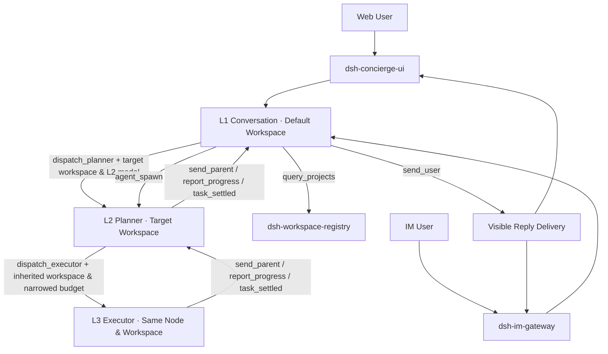

# Architecture and role isolation

Prism's architecture is built around a single idea: **hide all infrastructure complexity from the user, and trade strict internal boundaries for high autonomy and reliability.**

Instead of exposing workspaces, directory paths, or multi-machine topology in the chat UI, Prism fans out a single natural-language request across five cooperating plugins (`dsh-concierge-ui`, `dsh-workspace-registry`, `dsh-orchestrator`, `dsh-mesh-node`, and `dsh-im-gateway`) and three strictly isolated agent tiers.

## Six design principles

1. **Zero-Workspace UX**: Web and IM provide the conversation. The Web timeline shows task cards, and DSH Workspaces shows eligible read-only session histories.
2. **Strict Isolation**: The closer an agent is to the user, the tighter its permissions and the cleaner its context. L1 has zero file or shell tools—preventing prompt-injection escalation from IM/web inputs and keeping raw code or logs out of the routing context.
3. **Silent-by-Default Actor**: Unlike synchronous chat models where every generated token is immediately streamed to the user, L1's normal text output stays internal as scratchpad reasoning. Any visible reply or cross-tier signal must be triggered explicitly via tools, enabling asynchronous event handling, deliberate silence, and parallel task coordination.
4. **Self-Describing Routing**: Models and tasks are never hard-coded together. Each tier defines its own model pool with a capability description and optional prompt override, allowing L1 and L2 to pick the best model at runtime via `list_models`.
5. **Location Transparency**: Orchestration logic does not care whether a project lives locally or on a remote host. `dsh-mesh-node` wraps each node as a standard `prism-<nodeId>` Subagent Provider. Because L3 always inherits L2's workspace, heavy file I/O stays local to the owning node while only lightweight control signals and summaries cross the network.
6. **Virtual Facade & Copy-on-Conflict**: Each tier runs in a native DSH session. On a write-lock conflict, the runner forks a new session and updates the logical binding atomically. Read-only histories use separate sessions.

## Three-tier permission boundaries

Every role runs inside a formal DSH session behind a Subagent Provider, and the host enforces tool boundaries at both discovery and invocation time.

| Tier | Workspace & Context | Responsibility & Ceiling |
| --- | --- | --- |
| **L1 (Conversation)** | Bound to the configured default project | Greets the user, queries authorized project metadata from `dsh-workspace-registry`, chooses the target project and L2 model, and delegates. **No file read/write or shell execution tools.** |
| **L2 (Planning)** | Runs in the target project selected by L1 | Breaks down the task, dynamically chooses L3 models, dispatches execution steps, and can narrow L3 tool budgets. L2 can also send messages to authorized peers in the same Room. |
| **L3 (Execution)** | **Must inherit** its parent L2's node and workspace | Executes concrete steps locally. Available native tools are the intersection of the L3 role ceiling, project policy, and the budget granted by L2. |

## Silent-by-default messaging and events

Prism replaces synchronous turn-by-turn streaming with explicit, queue-backed actor communication:

- **Explicit user output**: L1 only publishes visible messages to the web UI or IM user when it calls `send_user`. Unwrapped model text remains inside the underlying DSH session.
- **Bidirectional tier messaging**: `send_parent` and `send_child` wake the target agent through its persistent message queue.
- **Progress and completion**: Agents report intermediate state with `report_progress`, parents poll on demand with `get_progress`, and when a child task reaches a terminal state, the runtime enqueues a `task_settled` event to wake its parent. L1 then decides whether to message the user or wait for other parallel tasks.
- **Independent UI updates**: Task cards and delivery status update independently of assistant replies.

| Tier | Orchestration tools |
| --- | --- |
| L1 | `query_projects`, `list_models`, `dispatch_planner`, `agent_spawn`, `send_child`, `get_progress`, `send_user` |
| L2 | `list_models`, `dispatch_executor`, `send_parent`, `send_child`, `get_progress`, `report_progress`, `peer_send` (when authorized in a Room) |
| L3 | `send_parent`, `report_progress` |

Next: [Models and workspaces](/develop/models) · [Mesh and sessions](/develop/mesh) · [dsh-orchestrator](https://github.com/dsh-plugins/dsh-orchestrator)
