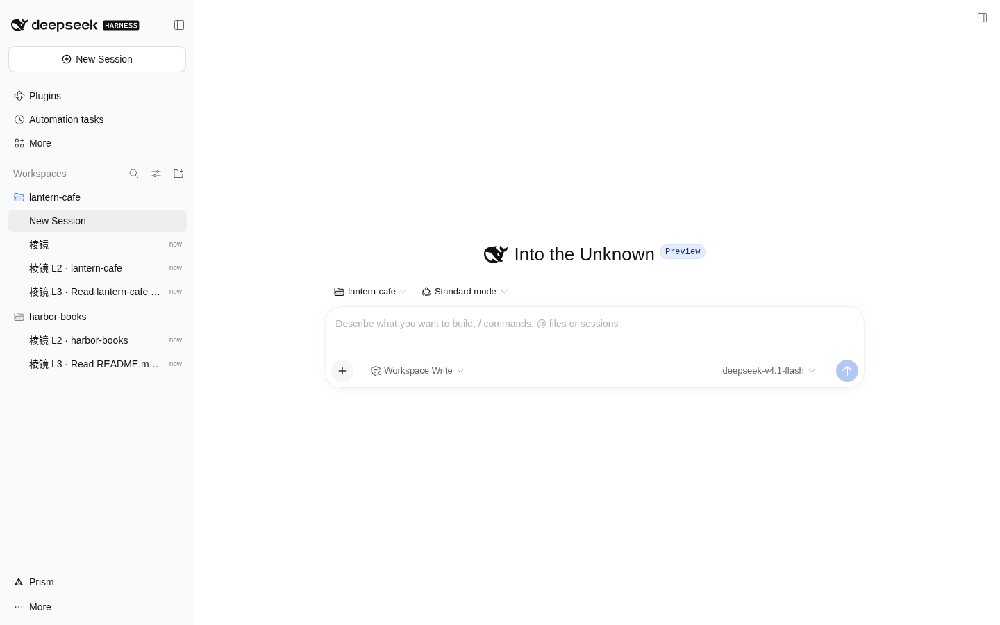

# Using the Prism conversation

Click **Prism** in the DSH sidebar to open the conversation view. You don't need to pick a workspace or remember where a folder lives—just describe what you want done and mention the project name when needed.

If you're trying Prism for the first time, check out the [Quick start guide](./start.md) for a two-project walkthrough.

## Switch models anytime

Open the model selector next to **Send** in the composer to see which conversation models are available and what each one is best at. Switching models takes effect from your next message without clearing your current draft.

Press **Enter** to send, or **Shift+Enter** for a new line. To change which models are available at each stage, open **Settings → Prism/Configuration** in DSH.

With the memory plugin enabled, use the plus button in the composer to attach images or videos. Images show a preview, and video cards show the file name and size. You can retry or remove a failed upload.

Prism follows the **Appearance** setting in DSH. In **System** mode it updates when the device switches between light and dark.

Web and approved private chats share a conversation within each DSH profile. Replies and progress go back to the originating channel. Project permissions are checked against the person who made the request. Approve only users who should share this context.

## Follow progress without clutter

When Prism delegates work to one or more projects, each task appears in the timeline as a compact card showing its title, status, and timestamp. While tasks run in the background, you can keep chatting or move on to other things—Prism will reply in the chat as soon as the results are ready.

## Inspect the source records when needed

If you want to verify how Prism reached a conclusion or check which files were read, click **DeepSeek Harness** at the top to switch back to the workspace view, then expand the project in the **Workspaces** sidebar:
- **棱镜**: Your main conversation
- **棱镜 L2**: Planning for that project
- **棱镜 L3**: Execution and tool calls (such as reading files)

All records are read-only, so you can inspect them safely without interrupting anything. Click **Prism** in the sidebar whenever you want to return to the conversation.

Next: [Set up a messaging account](./im.md) · [Architecture & roles](../develop/layers.md)
