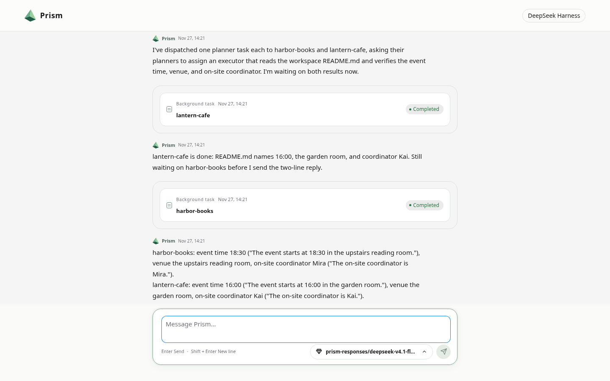
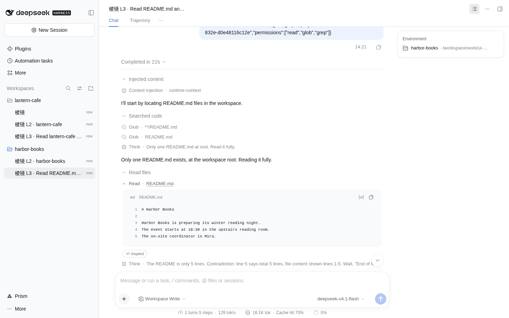

# Use the Prism conversation

Choose **Prism** in the DSH sidebar. Name the workspace and the result you want. For example, ask for one executor per workspace to read its README and report the event time, venue and coordinator. A two-project example includes the input files and a ready-to-send prompt. [Start with two workspaces](./start.md)

## Choose the next model

Open the model picker beside **Send** in the composer to see the permitted conversation models and their descriptions. Your selection applies to subsequent turns and preserves the current draft. Press Enter to send, or Shift+Enter to insert a line. To change which models a layer can use, open **Settings → Prism/Configuration** in DSH.

## Follow the task and check the evidence

Each delegated project appears in the timeline with its title, status and timestamp. Read the assistant's summary below the task cards. In this example, the bookshop and the café have different coordinators, rooms and event times.

Choose **DeepSeek Harness** and expand the appropriate workspace in the DSH sidebar. The read-only records are named **棱镜** for the conversation, **棱镜 L2** for planning and **棱镜 L3** for execution. Open the executor, expand the recorded process and select the `read` tool to see the path and lines returned from the file. Use the **Prism** shortcut to resume the conversation.

[Messaging accounts](./im.md) · [Roles and permissions](../develop/layers.md)
