# Configure messaging channels

Open **Settings → Prism** as the DSH owner, then find **Messaging channels**. Select a channel to see its settings. Each private conversation has its own messaging identity and history. The [web walkthrough](./start.md) uses the same Prism installation.

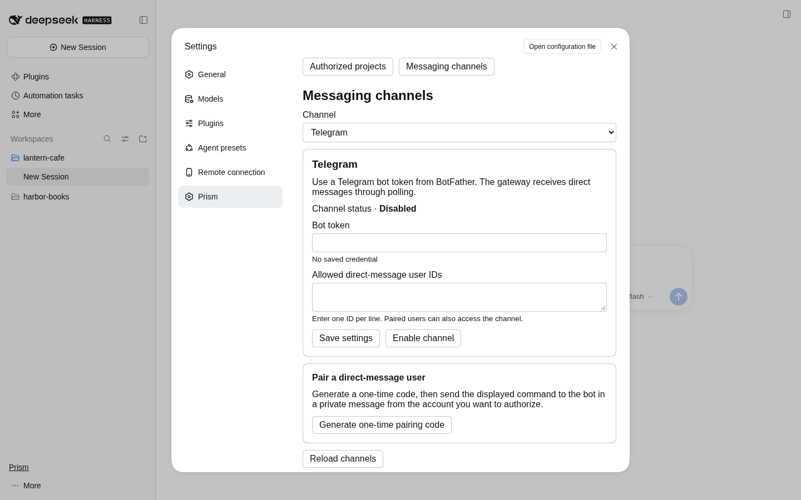

Channel access authorizes a private conversation. Project access is granted separately in **Settings → Prism → Authorized projects**. The sample grant for `web:owner` belongs to the DSH web user. To grant a private chat the same project, open **Edit → Advanced settings** on that project and enter its complete IM identity on a separate line under **Authorized identities**. Keep the quotes, commas and brackets together on that line, then save.

**Save settings** records the selected channel’s configuration. **Enable channel** starts its connection. To authorize known people, enter one platform **user ID** per line under **Allowed direct-message user IDs**. Reopening a stored secret shows its saved status. Leave the input blank to preserve it or use **Clear saved credential** to remove it.

The walkthrough opens all seven forms and leaves the channels disabled. It requests a Feishu sign-in code and cancels before authorizing an account. Sending and receiving messages with a live bot requires your own platform credentials.

## Telegram

Create a bot with BotFather and enter its token in **Bot token**. Add the Telegram user IDs that may send private messages. Choose **Save settings**. When you are ready, choose **Enable channel**. The gateway receives updates through long polling, so clear any existing webhook for that bot first.

To check that settings persist without connecting a bot, the demo leaves **Bot token** empty, temporarily saves an allowed example user ID, switches channels, reloads, and opens Telegram again. It then clears the example ID and saves. **Channel status** stays **Disabled** throughout.

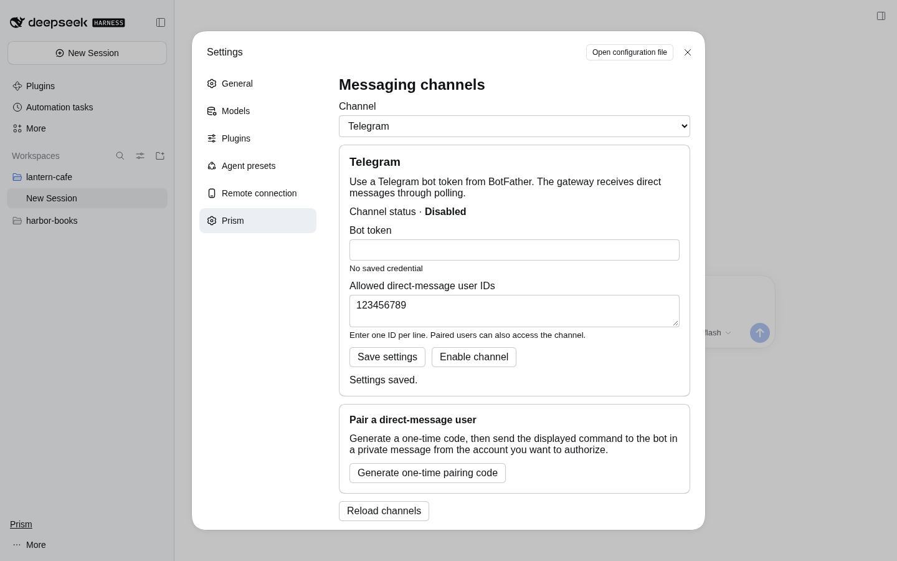

## WeChat

Choose **WeChat**, then **Generate QR code** under **Account registration**. On a host that can reach iLink, scan the code with WeChat, complete any verification requested by the platform and wait for the saved registration. Enable the channel when you want it to use that account.

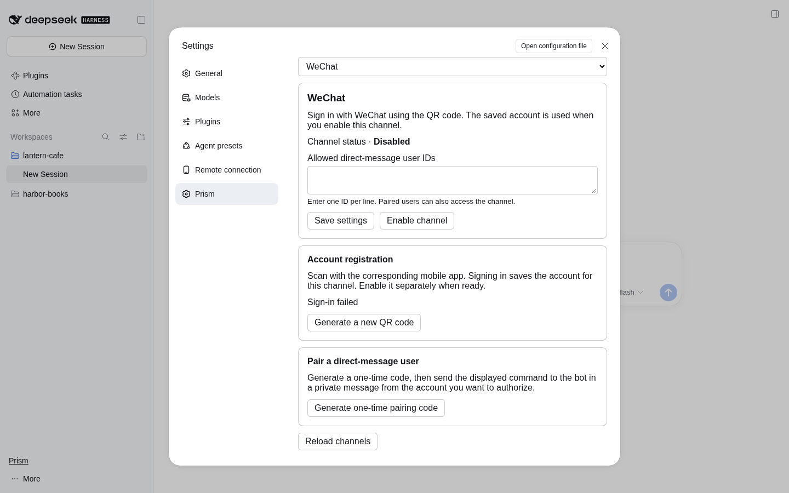

In this environment the request to the official iLink service failed. The panel displayed **Sign-in failed** and **Generate a new QR code**. This run ended at that screen.

## Feishu / Lark

Select **Feishu / Lark**. For QR registration, choose **Generate QR code**. The panel shows the platform’s sign-in code and expiration time. A real user would scan it in the matching mobile app and complete the platform’s authorization. In this run the gateway obtained an official code and the operator chose **Cancel sign-in**. In the screenshots and recording, the three QR corner markers remain visible around a label covering the scannable area.

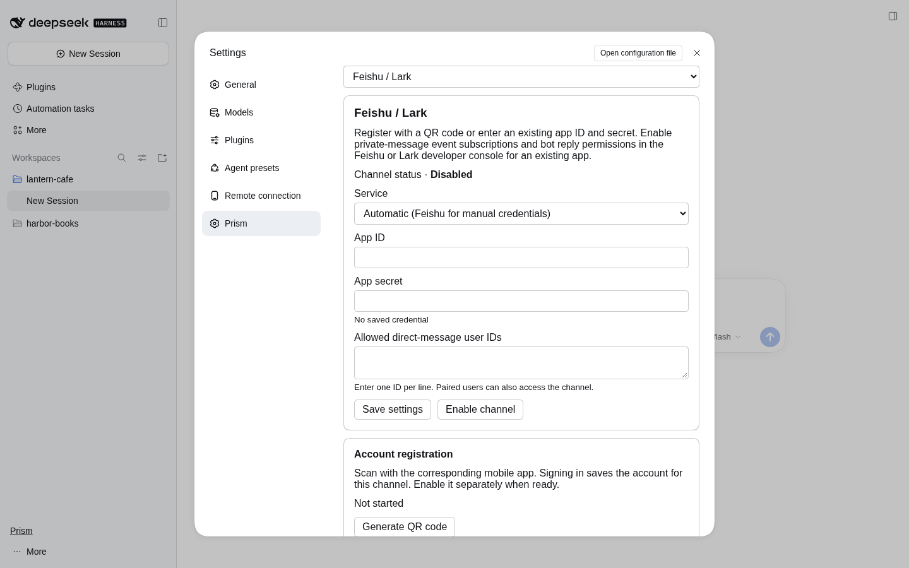

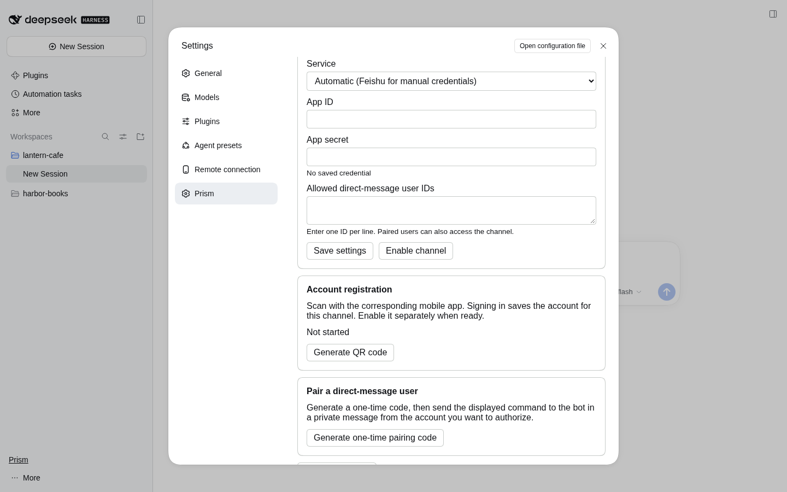

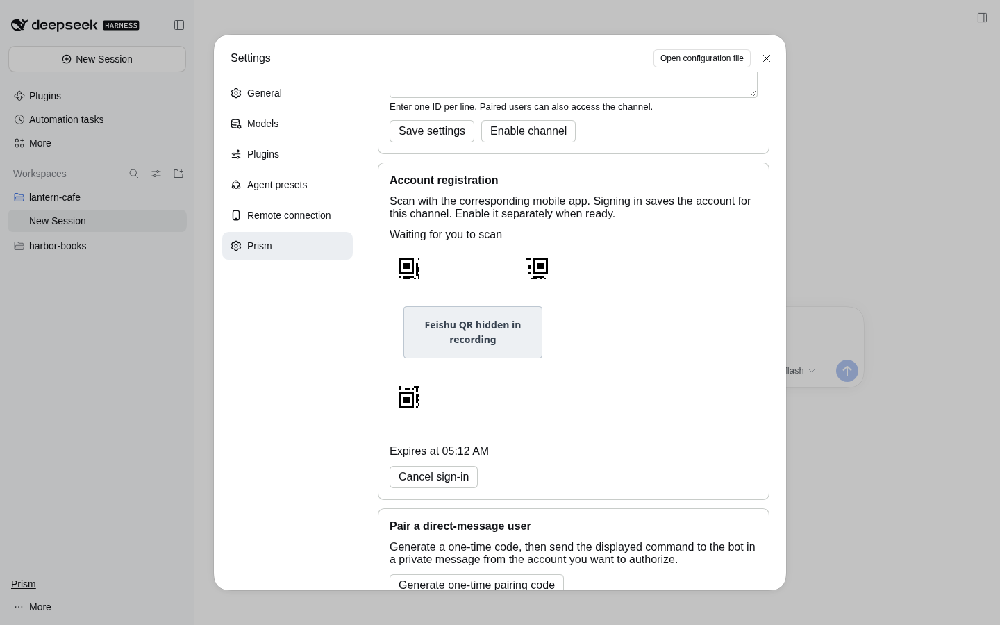

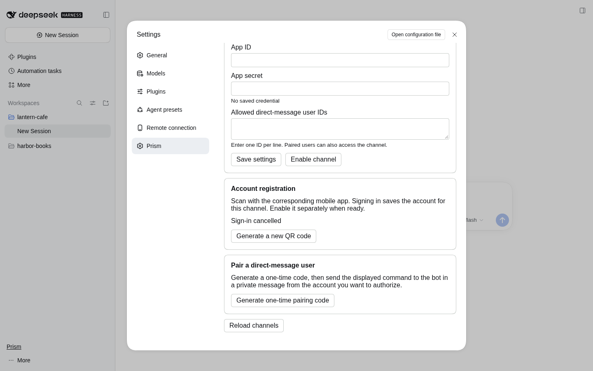

For an existing app, choose its **Service** region and enter its **App ID** and **App secret**. In the appropriate developer console, enable private-message event subscriptions and bot reply permissions. Save the channel configuration. **Enable channel** starts the connection when you are ready.

## WeCom

Use a WeCom intelligent bot that supports a persistent connection. Enter its **Bot ID** and **Bot secret**, then add the authorized platform user IDs. Save the settings before enabling the connection.

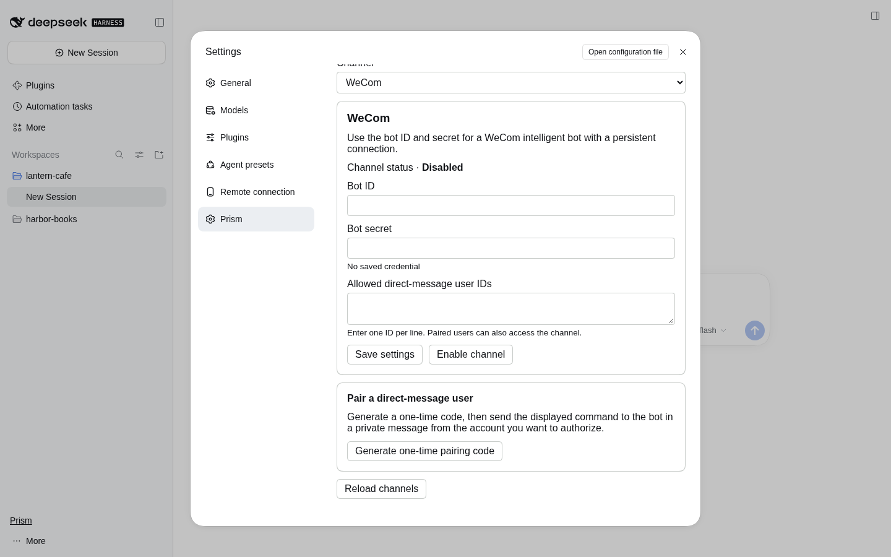

## QQ Bot

Enter the bot’s **App ID** and **App secret**. The form displays a **Callback URL** ending in `/prism/im/qq`. Configure the corresponding externally reachable HTTPS address in the QQ developer console so signed events reach the DSH host. Save and enable the channel when ready.

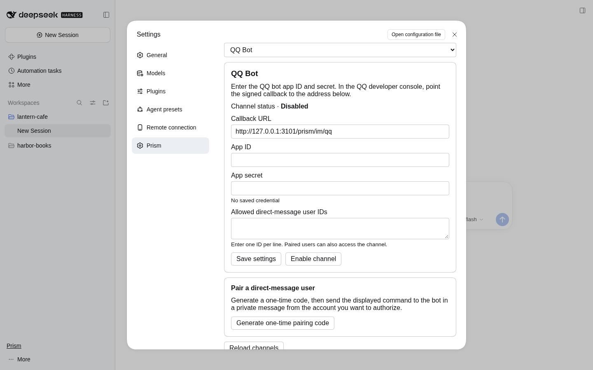

## OneBot

Enter the **OneBot account ID** and **OneBot HTTP API URL** for your OneBot v11 service. Provide its **Access token** and **Event-signing secret**. Configure the OneBot server to send events to the displayed callback path `/prism/im/onebot` on the reachable DSH host and use the matching signing secret. Then save and enable the channel as needed.

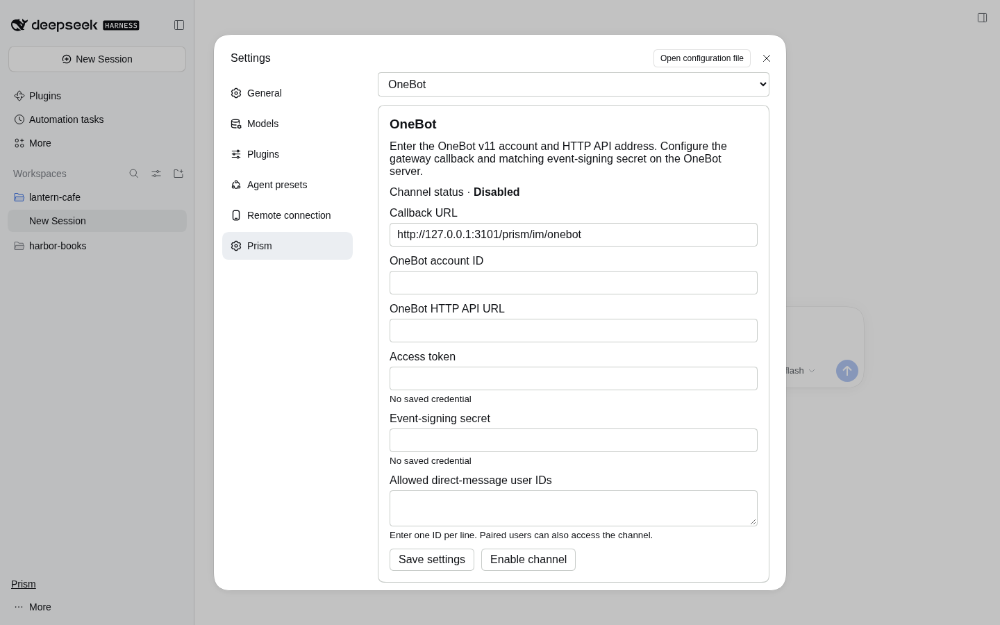

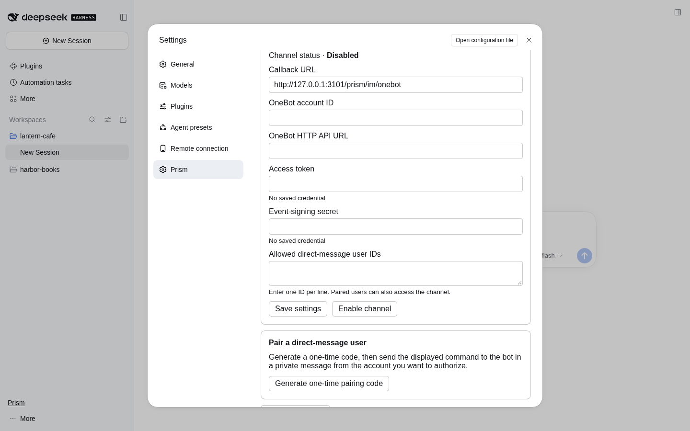

## Discord

Use the bot token from your Discord Developer Portal application. Enter it under **Bot token**, add the permitted Discord user IDs and save. Enable the channel when the bot is ready to receive direct messages.

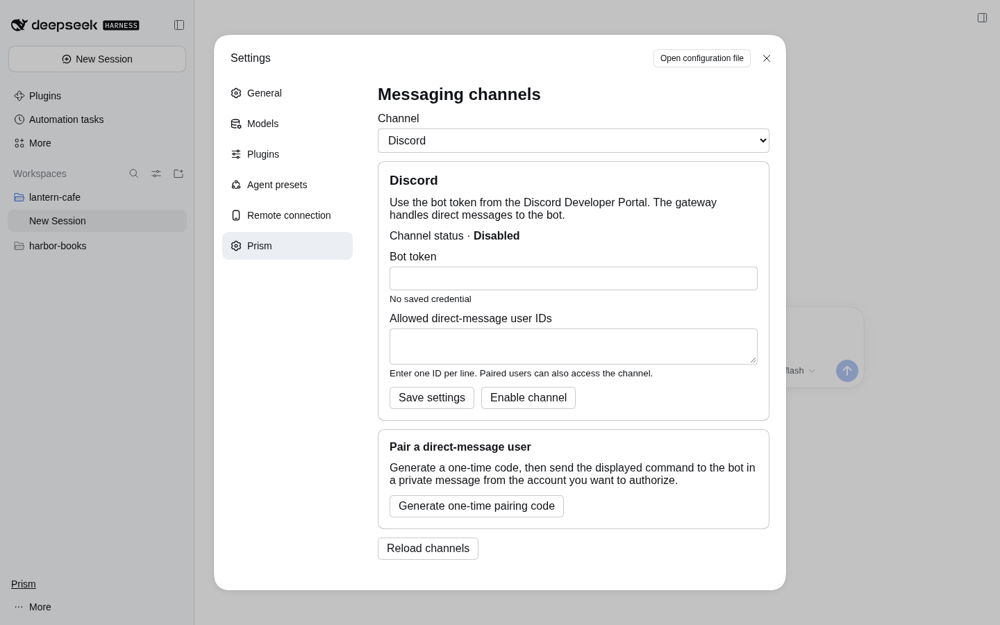

## Pair a private chat

To authorize one person with a code, open that channel’s configuration and generate a one-time pairing code. The recipient sends `/pair CODE` in a private chat with the bot within ten minutes. The walkthrough shows the pairing controls and leaves the codes unissued.

## Once a channel is connected

| Private chat command | Action |
| --- | --- |
| `/models` | List the available conversation models and descriptions. |
| `/model …` | Select a model by ID or displayed number. |
| `/tasks` | List tasks for this private conversation. |
| `/inspect …` | Read the session for a task ID. |
| `/language …` | Set a language such as `en` or `zh`. |
| `/pair …` | Redeem a one-time pairing code issued for the channel. |

[Work with a conversation](./chat.md) · [Gateway reference](../develop/api.md)
