# Set up a messaging account in DSH

As the DSH owner, open **Settings → Prism/IM**. **Add IM** lists account types you can configure. A saved account appears as a card. Open the card to edit the account or change its connection status. **Pending approvals** lists people asking to use a connected bot.

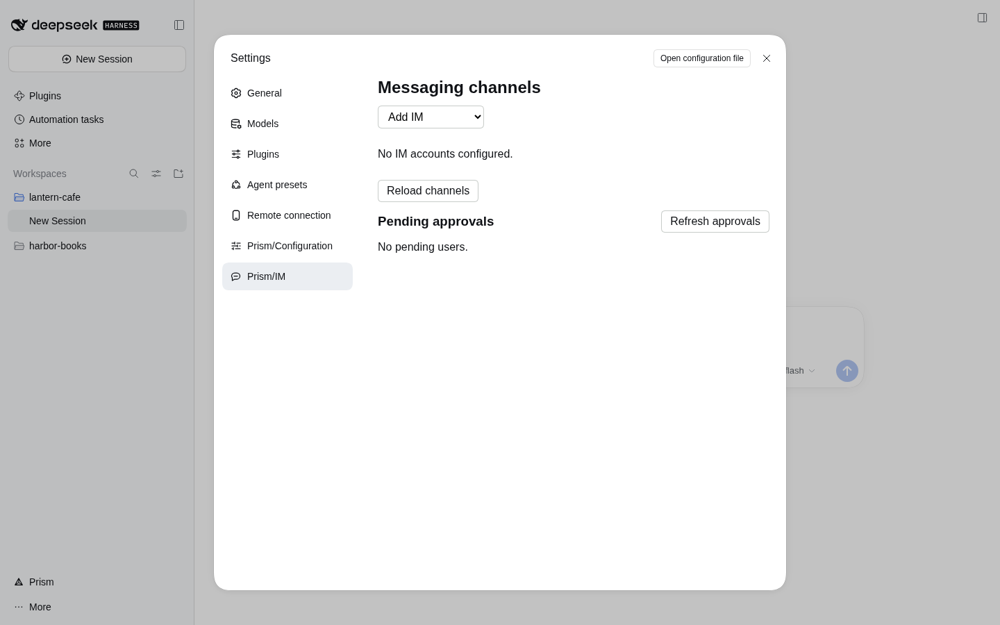

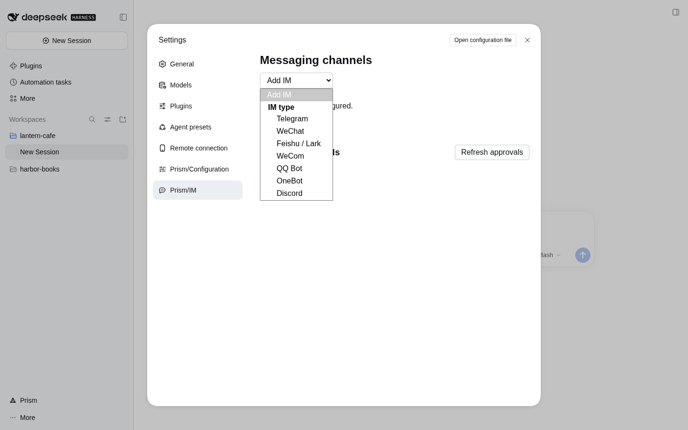

For channels other than Feishu/Lark, enter a **Username** so you can recognize the saved card. **Save settings** records the configuration. **Enable channel** starts the connection when credentials or registration are ready. Reopening a credential field shows its saved status. Use a blank secret field to keep its existing value.

The walkthrough opens all seven forms and keeps their connections disabled. It also reopens a saved Telegram account with no bot token.

## Telegram

Choose **Add IM → Telegram**. Enter the account name and the **Bot token** from BotFather. Save the settings, then enable the channel when you want the bot to receive private messages. Telegram uses long polling. If the bot already has a webhook, clear that webhook in Telegram first.

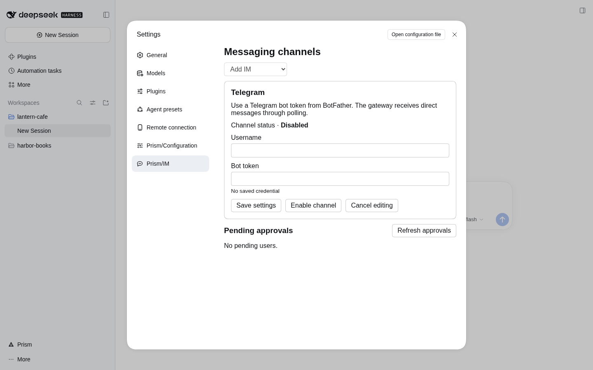

To test saving independently of a connection, enter **Prism demo** for the username, leave the token blank, and choose **Save settings**. Reload the channels, then open the saved card. The username is retained and the status stays **Disabled**.

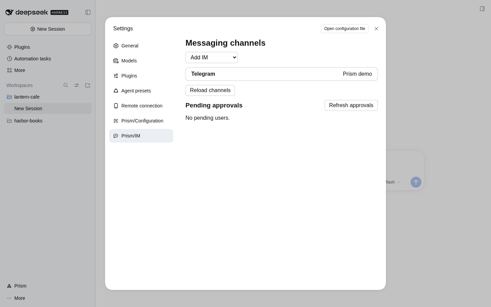

## WeChat

Choose **WeChat**. Under **Account registration**, choose **Generate QR code**. When the host can reach the official iLink service, use WeChat to scan the code and complete any verification requested by the platform. Save the settings and enable the channel when ready.

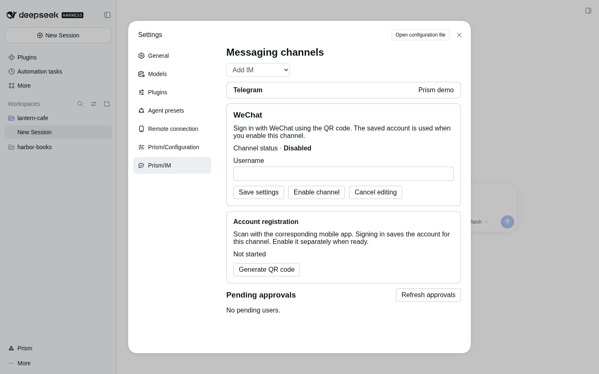

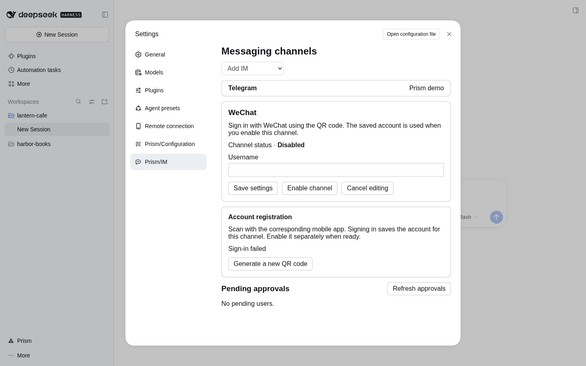

In this run the request to iLink failed. The page displayed **Sign-in failed** and offered **Generate a new QR code**.

## Feishu / Lark

Choose **Feishu / Lark**. The **Manual binding** tab accepts the **Service**, **App ID** and **App secret** of an existing bot application. In the corresponding developer console, enable private-message event subscriptions and bot reply permissions.

Open **QR binding** to register through the official authorization page. Choose **Generate QR code**. A person connecting a real account can scan with Feishu or Lark, then select an existing bot or create one. Binding and enabling the channel are separate actions.

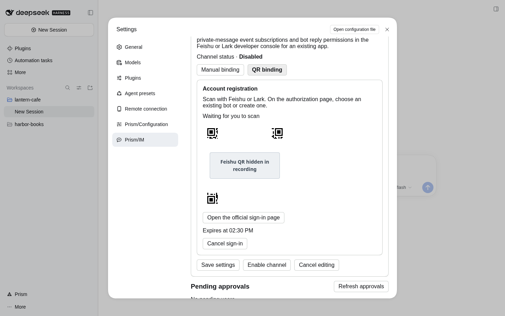

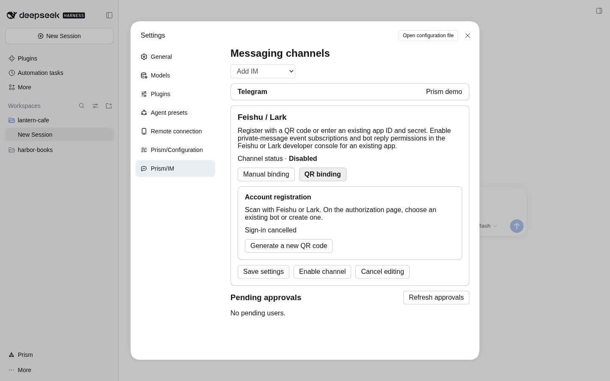

The gateway obtained an official code. The operator cancelled the sign-in before mobile authorization. The code is covered in the screenshots.

## WeCom

Choose **WeCom**. Enter a username and the **Bot ID** and **Bot secret** for a WeCom intelligent bot that supports a persistent connection. Save the settings before enabling the connection.

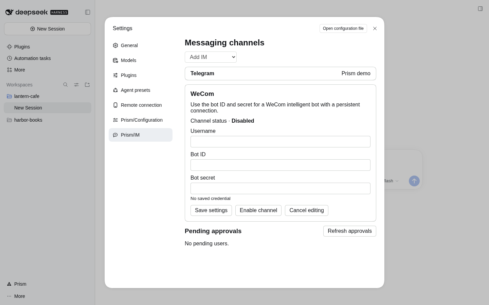

## QQ Bot

Choose **QQ Bot**, enter a username, **App ID** and **App secret**. Set the signed callback in the QQ developer console to the externally reachable HTTPS address of this DSH host ending in `/prism/im/qq`. The form shows the callback for the current host. Save and enable the channel when ready.

## OneBot

Choose **OneBot**. Enter a username, **OneBot account ID**, **OneBot HTTP API URL**, **Access token** and **Event-signing secret** for your OneBot v11 service. In OneBot, set the event callback to the DSH host’s `/prism/im/onebot` address and use the matching signing secret. Save the settings before enabling the connection.

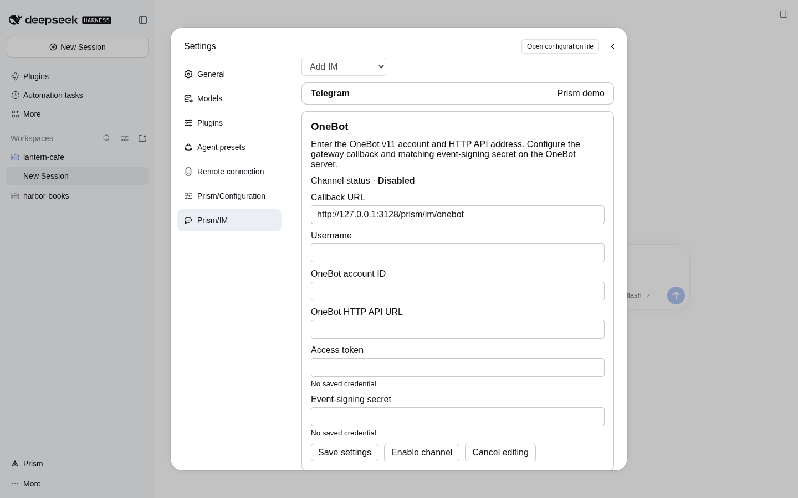

## Discord

Choose **Discord**, enter a username and paste the application’s **Bot token** from the Discord Developer Portal. Save the settings. Enable the connection when you want the bot to receive direct messages.

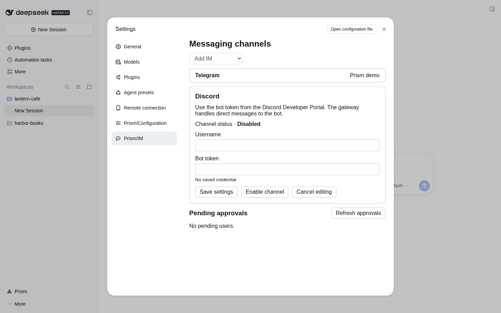

## Approve a person’s first message

When someone sends a first private message to a running channel, open **Pending approvals**. Review the channel, username and platform user ID. Choose **Approve** to authorize the private conversation and process the held first message, or **Reject** to decline it. Each approved private conversation has its own history. With native workspace discovery enabled, approved users can query the local DSH workspaces. [Workspace access](../develop/models.md)

The walkthrough used no connected IM account. This run verified the empty approvals list.

## Commands in an approved chat

Use `/models` to list conversation models and `/model ID` to select one. `/tasks` lists this conversation’s tasks, and `/inspect TASK_ID` opens a task’s read-only record. `/language en` changes the chat language to English.

[Use the web conversation](./chat.md) · [Install the plugins and run a two-workspace task](./start.md)
