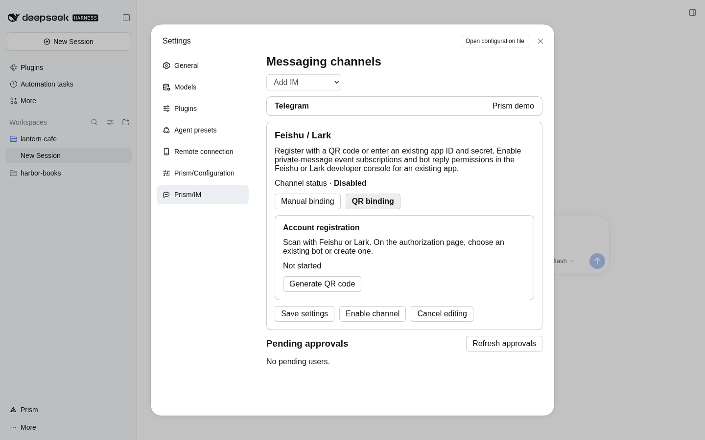
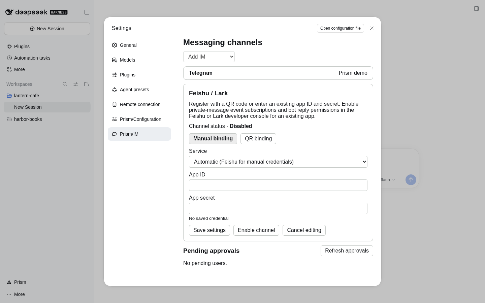
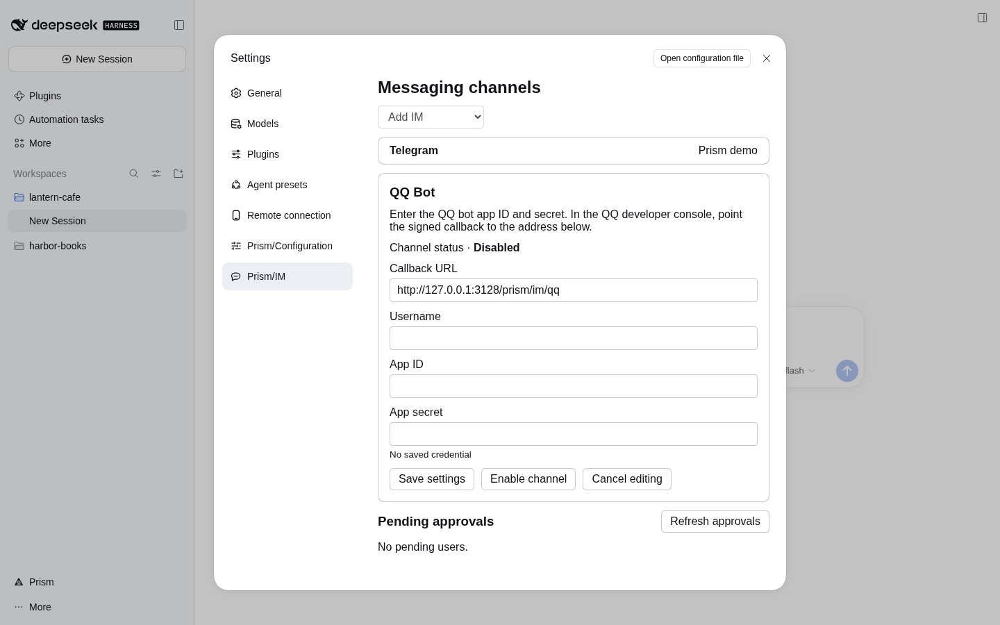

# Set up a messaging account

You can connect Prism to your everyday messaging apps so you can send requests and receive results right from a private chat.

As the DSH owner, open **Settings → Prism/IM**. Click **Add IM** to pick a platform. Saved accounts appear as cards—click any card to update its settings or turn the connection on and off. **Pending approvals** lists people who have messaged your bot for the first time and are waiting for access.

For every platform except Feishu/Lark, enter a **Username** so you can easily tell saved cards apart. Click **Save settings** to store your configuration, and **Enable channel** once your credentials or QR sign-in are ready. When you reopen a saved card, secret fields stay hidden—leave a secret field blank if you want to keep its current value.

## Supported platforms

### Telegram

1. Choose **Add IM → Telegram**.
2. Enter a **Username** and paste the **Bot token** you received from `@BotFather`.
3. Click **Save settings**, then **Enable channel** when you're ready to receive private messages.

> [!TIP]
> If this bot previously used a webhook, clear the webhook in Telegram first so Prism can receive messages cleanly.

### WeChat

1. Choose **Add IM → WeChat**.
2. Under **Account registration**, click **Generate QR code**.
3. Scan the QR code with WeChat and complete any on-screen verification.
4. Click **Save settings**, then **Enable channel** when ready.

### Feishu / Lark

You can connect Feishu or Lark in two ways:
- **QR binding (recommended)**: Switch to **QR binding**, click **Generate QR code**, and scan it with Feishu or Lark to select an existing bot or create a new one on the authorization page.
- **Manual binding**: Choose your **Service** (Feishu or Lark) and enter an existing app's **App ID** and **App secret**. Make sure private-message event subscriptions and bot reply permissions are enabled in your developer console.

After binding or saving, click **Enable channel** to start receiving private messages.

### WeCom

1. Choose **Add IM → WeCom**.
2. Enter a **Username**, along with the **Bot ID** and **Bot secret** of a WeCom intelligent bot that supports persistent connections.
3. Click **Save settings**, then **Enable channel**.

### QQ Bot

1. Choose **Add IM → QQ Bot**.
2. Enter a **Username**, **App ID**, and **App secret**.
3. Copy the `/prism/im/qq` callback URL shown in the form and set it as the signed callback in your QQ developer console (using your externally reachable HTTPS address).
4. Click **Save settings**, then **Enable channel**.

### OneBot

1. Choose **Add IM → OneBot**.
2. Enter a **Username**, **OneBot account ID**, **OneBot HTTP API URL**, **Access token**, and **Event-signing secret** for your OneBot v11 service.
3. In your OneBot settings, point the event callback to your DSH host's `/prism/im/onebot` address with the same signing secret.
4. Click **Save settings**, then **Enable channel**.

### Discord

1. Choose **Add IM → Discord**.
2. Enter a **Username** and paste your application's **Bot token** from the Discord Developer Portal.
3. Click **Save settings**, then **Enable channel**.

## Approve first-time users

When someone sends a private message to a connected bot for the first time, their message is held until you approve them. Open **Pending approvals**, check the platform, username, and user ID, and choose:
- **Approve**: Authorizes that private chat and immediately processes their first message.
- **Reject**: Declines the request.

Each approved private chat keeps its own conversation history and can access the local workspaces you've added in DSH.

## Chat commands

Once approved, you can use these quick commands in your private chat:
- `/models` — List available conversation models.
- `/model ID` — Switch to a specific model for upcoming messages.
- `/tasks` — View tasks started in this chat.
- `/inspect TASK_ID` — Open a read-only record of a task.
- `/language en` — Switch the bot's reply language (for example, `en` or `zh`).

Next: [Using the conversation](./chat.md) · [Quick start](./start.md)
