# Quick start: work across two projects

With Prism, you don't have to switch workspaces back and forth or gather information project by project. In this walkthrough, you'll ask Prism in a single chat to check event details across two separate project folders (`harbor-books` and `lantern-cafe`) and summarize both results together.

This guide uses DeepSeek Harness `0.2.3-alpha.2`. You can follow along with your own project folders, or grab the two sample folders from GitHub: [Sample folders on GitHub](https://github.com/dsh-plugins/dsh-prism/tree/main/docs/examples).

## 1. Install the seven required Prism plugins

Open your DeepSeek Harness link. On first launch, choose **Continue** on the preview notice and close the **Get started** dialog if it appears.

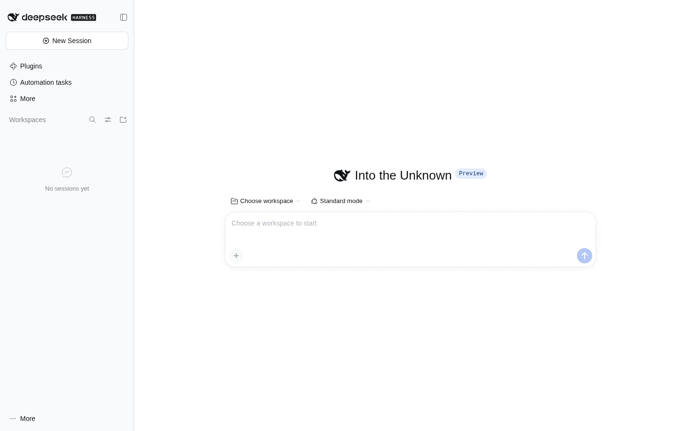

In the sidebar, go to **Plugins → Add plugin**. Enter each npm package and version from the table below in **Package name or address**, keep **Default registry**, choose **Install**, confirm the version, and click **Enable now**. Install and enable them in order:

| Order | Package and version |
| --- | --- |
| 1 | `@dsh-prism/dsh-workspace-registry@0.1.2` |
| 2 | `@dsh-prism/dsh-orchestrator@0.2.1` |
| 3 | `@dsh-prism/dsh-mesh-node@0.2.2` |
| 4 | `@dsh-prism/dsh-im-gateway@0.2.0` |
| 5 | `@dsh-prism/dsh-concierge-ui@0.2.2` |
| 6 | `@dsh-prism/dsh-memory@0.3.1` |
| 7 | `@dsh-prism/dsh-triggers@0.2.1` |

The table lists the current package versions. The screenshots show the same controls from an earlier release. The orchestrator starts when Mesh is enabled.

Screenshots of the first five plugin installations

If DSH asks for permission to run a dependency script during installation, review the listed dependency and choose **Allow these scripts and retry**.

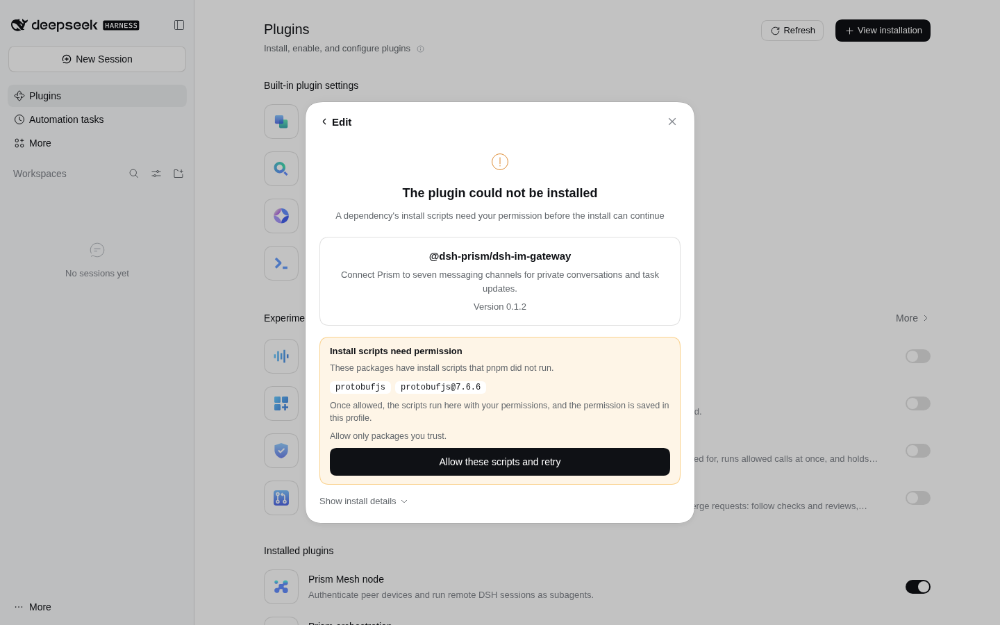

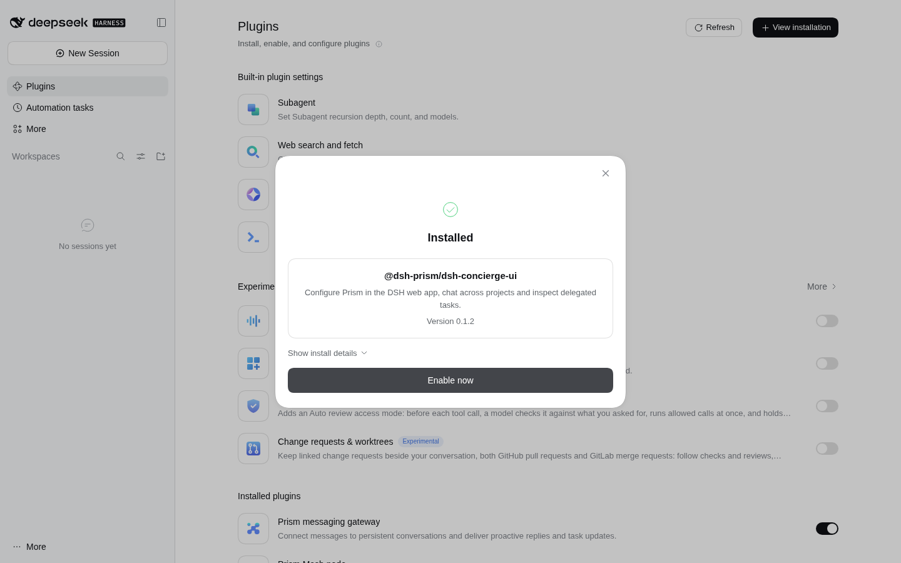

> [!TIP]
> If **Prism** is missing from the sidebar after you enable all seven plugins, reload the browser tab. This also clears the `missing or incompatible host boot descriptor` warning if it appears before the Prism client loads.

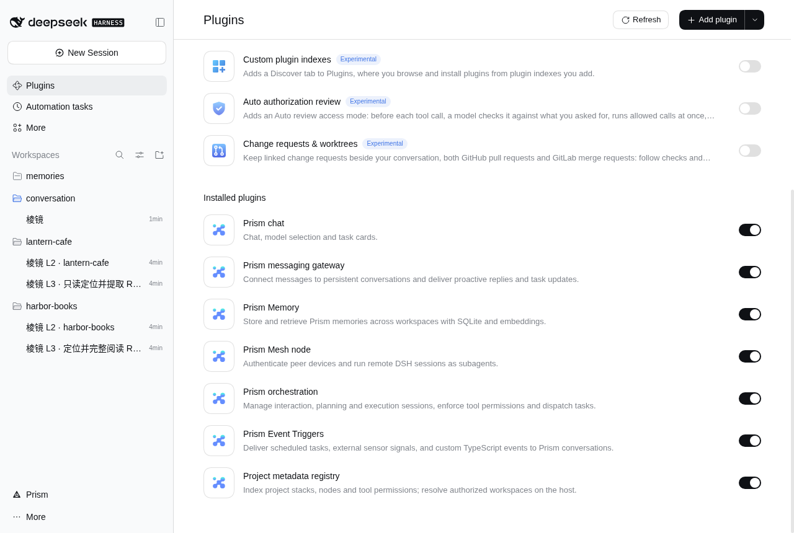

To connect another device, enter the same signaling address and connection code on both devices under **Settings → Prism/Connection**. [WebRTC Mesh guide](../develop/mesh.md)

### Set up long-term memory and event triggers {#optional-plugins}

The memory plugin stores information and media attachments. The triggers plugin handles scheduled reminders and external events. Enable both in the same DSH profile as the other Prism plugins.

Open **Settings → Prism/Memory → Remote API**. Enter the value of `EMBEDDINGS_BASE_URL` in **BASE_URL**, the value of `EMBEDDINGS_API_KEY` in **API_KEY**, and `BAAI/bge-large-zh-v1.5` in **MODEL_ID**. Confirm the binding and wait for initialization. The memory tools are available once the page displays the active model and its vector dimensions. Prism reloads the binding when DSH restarts.

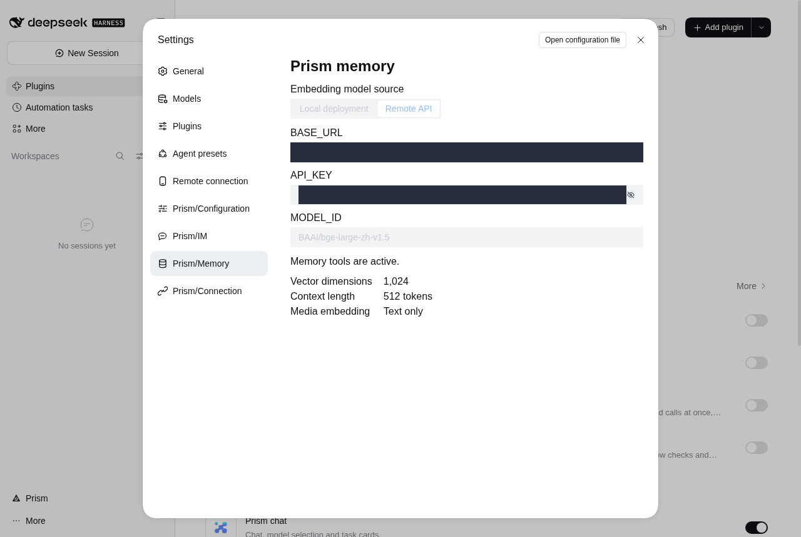

In the tested Responses setup, the `event_add` tool call sent Cron's `params` as a JSON string. The trigger rejected it with “Parameters must be a JSON object” and returned no subscription ID. [Observed tool call](./screens/frontend-verification/zh/cron-parameters.png)

## 2. Connect your model

Open the account menu and go to **Settings → Models → Add model provider → Custom model API**. Select **OpenAI Responses** as the API protocol. Give it an internal **Provider ID** (e.g., `prism-responses`) and a friendly **Display name** (e.g., **Prism Responses**) that will show up in your model menu.

Choose **Add model** and enter `deepseek-v4.1-flash` in **Model ID 1**. Enter the value of `BASE_URL` in **Base URL** and the value of `API_KEY` in **API key**, then click **Create provider**.

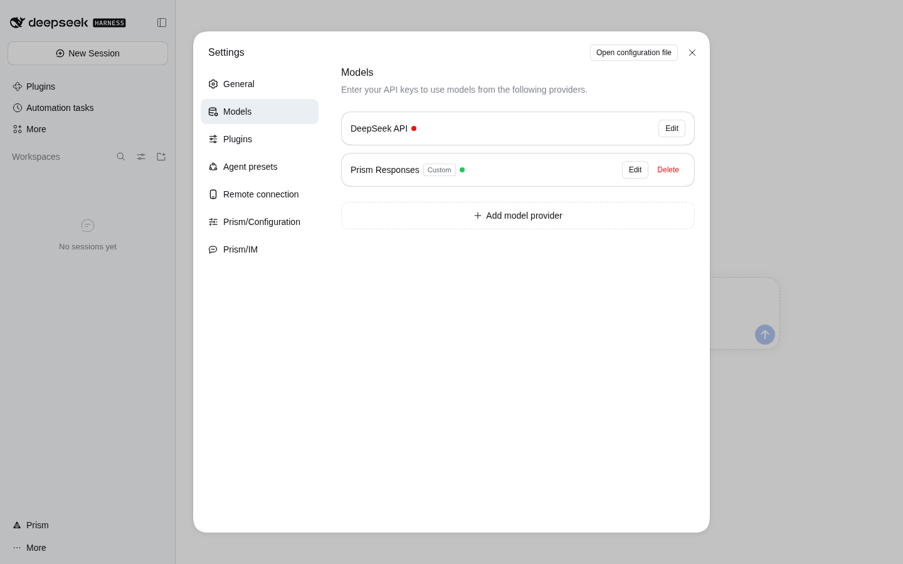

Edit the provider, open **Customized settings**, and expand **Model options** for `deepseek-v4.1-flash`. Turn on **Reasoning levels**, make sure the **High** row sends the API value `high`, and save. In the DSH chat model picker, select **Prism Responses → deepseek-v4.1-flash**, then select **Effort → High**. [DSH provider guide](https://github.com/deepseek-ai/deepseek-harness/blob/master/docs/user/guide/providers.md#reasoning-effort)

Prism orchestrator `0.2.1` passes the provider and model ID when it creates a session. The native DSH session displayed **High** in the frontend test, while Prism L1 and both projects' L2 and L3 sessions displayed **Default**.

Compare reasoning effort in DSH and Prism

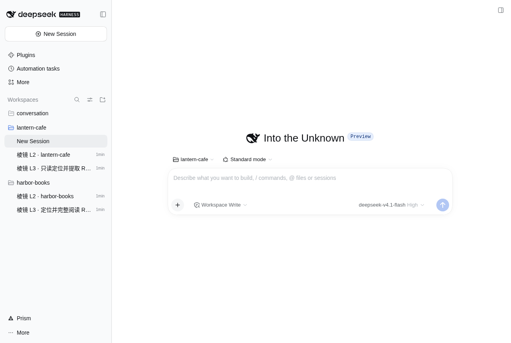

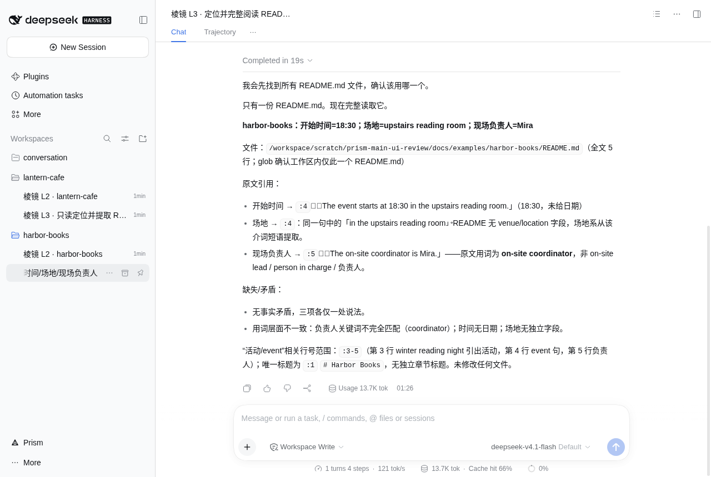

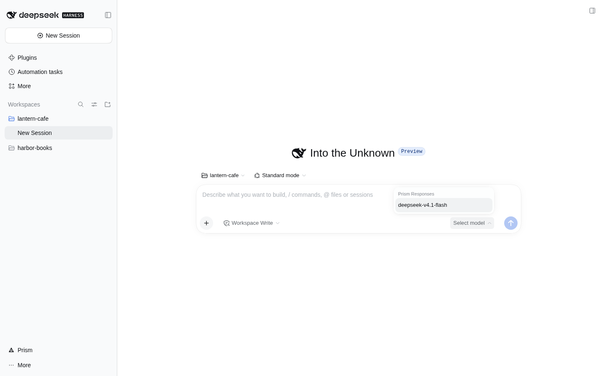

## 3. Add your project folders

In the DSH sidebar, click **Add workspace** next to **Workspaces**, select your first project folder (`harbor-books`), and click **Open** (or use **Edit path** to paste an absolute path and press Enter). Repeat for the second folder (`lantern-cafe`).

Prism automatically discovers any local workspace you've added in DSH and recognizes it by its display name, so you can refer to projects naturally in conversation.

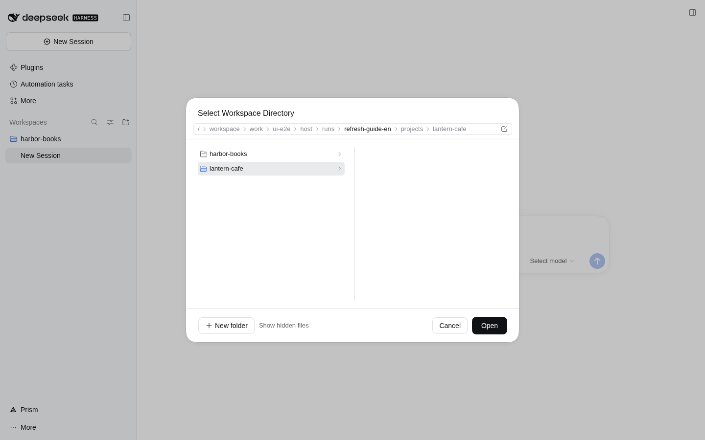

## 4. Choose models for each stage (optional)

Open **Settings → Prism/Configuration**. Here you can choose which models Prism is allowed to use at three stages:
- **L1 (Conversation)**: Talks with you and routes your requests.
- **L2 (Planning)**: Breaks down a task inside a project.
- **L3 (Execution)**: Reads files, runs checks, and gathers evidence.

Select `deepseek-v4.1-flash` for all three stages. If you leave a stage empty, Prism uses the DSH default model. Use the edit icon beside each model to enter its **Model description** and **Model prompt**, then save. Enter the same values in every stage where you enable that model. The description helps the parent agent select a subagent, and the prompt captures preferences specific to the model. If `gpt-6.2-sol` is available separately in your DSH installation, you can enable it using its own values. [Model descriptions and prompts](./model-metadata.md)

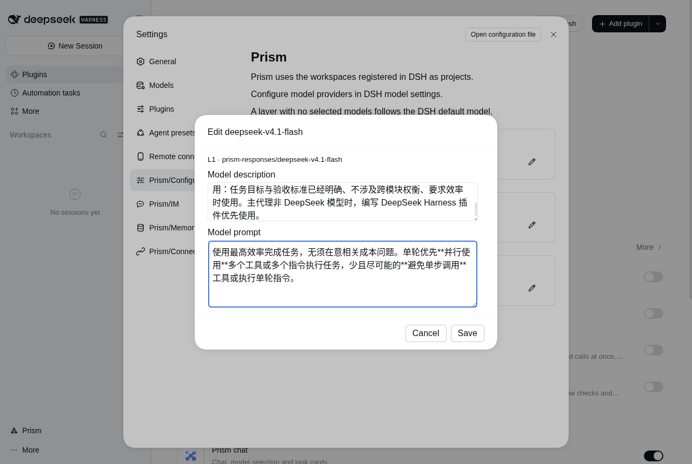

Model selection screenshots

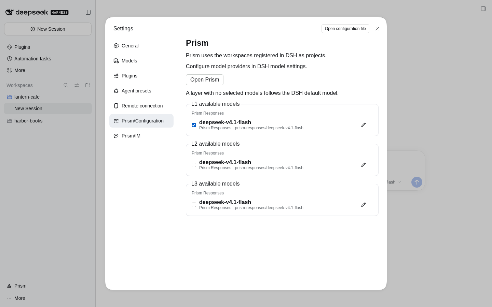

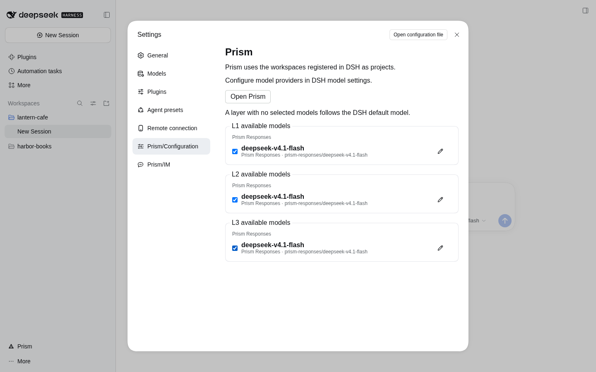

> [!NOTE]
> Want to chat with Prism from Telegram, WeChat, Feishu/Lark, or other messaging apps? You can configure them under **Settings → Prism/IM**. See [Set up a messaging account](./im.md).

## 5. Ask Prism to check both projects at once

Close Settings and click **Prism** in the DSH sidebar. Confirm that `deepseek-v4.1-flash` is selected in the chat composer, and send a message like this:

> Delegate one task to harbor-books and one to lantern-cafe. Use the respective project name as each task title. Have each planner assign an executor to use the read tool on its own workspace’s README.md and verify the event time, venue and on-site coordinator. After both finish, reply here in two lines, starting each with the project name.

Prism splits your request into two background tasks—shown as collapsible cards right in the timeline—and replies with a two-line summary once both are done:

Frontend verification with OpenAI Responses

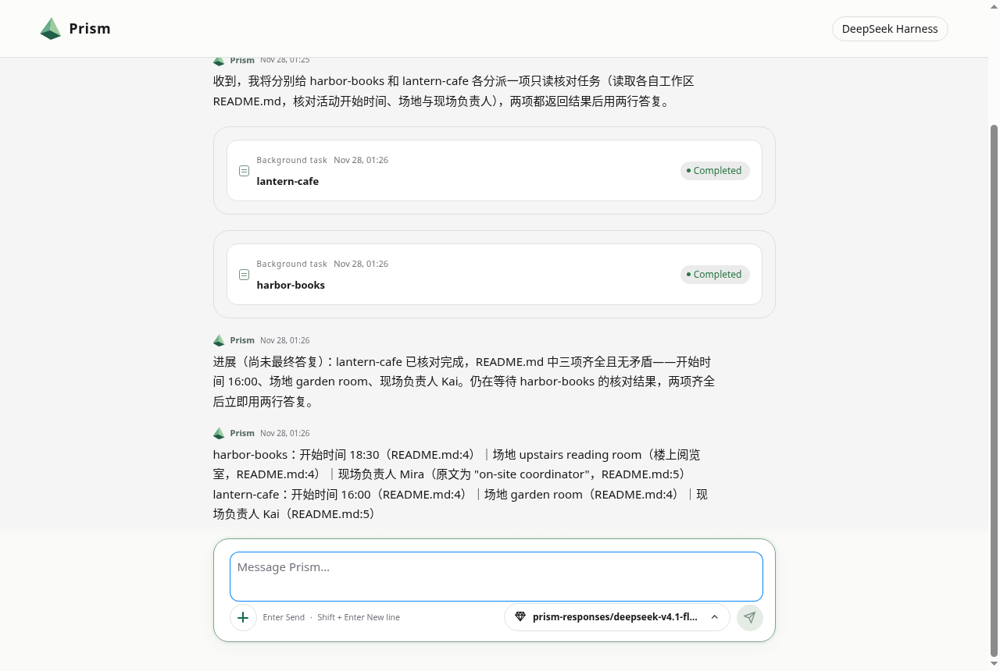

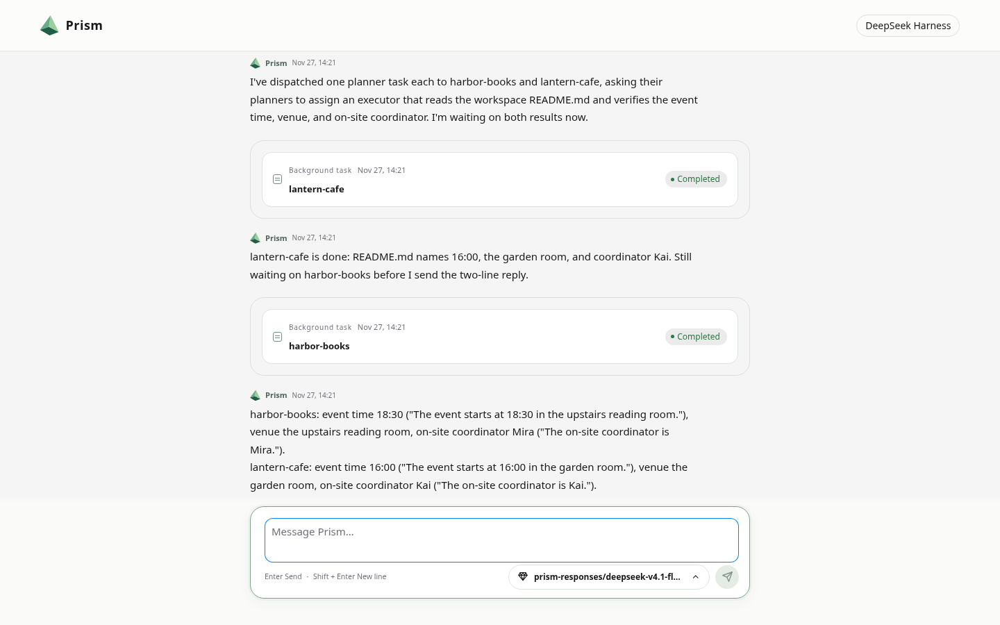

If you're using the sample folders, your summary should match these details:

| Project | Start | Venue | On-site coordinator |
| --- | --- | --- | --- |
| Harbor Books | 18:30 | Upstairs reading room | Mira |
| Lantern Cafe | 16:00 | Garden room | Kai |

## 6. Inspect the underlying details (optional)

Normally, you never need to leave the Prism chat. But if you want to verify exactly which files were read or how a task was carried out, click **DeepSeek Harness** at the top to switch back to the workspace view.

Expand each project in the **Workspaces** sidebar: **棱镜** is the main conversation, **棱镜 L2** is the planning session, and **棱镜 L3** is the execution session. Open any session to inspect its read-only history, or click **Prism** in the sidebar to jump right back to your chat.

Screenshots: inspecting read-only session histories in DSH

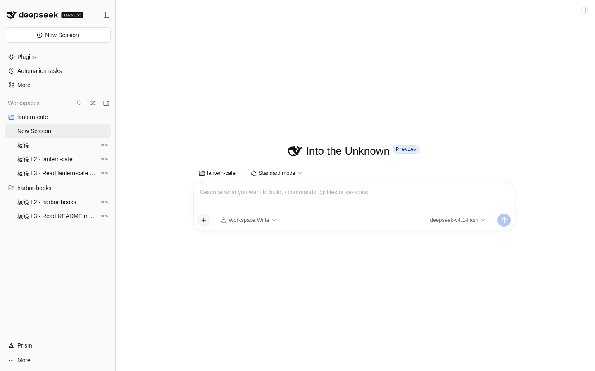

Next: [Using the conversation](./chat.md) · [Set up a messaging account](./im.md)

## Troubleshooting

- **"This package declares no bundle" during plugin installation**: Double-check that you entered the exact package name and version from the table in Step 1 (for example, `@dsh-prism/dsh-workspace-registry@0.1.2`), and click **Enable now** after installing each plugin.
- If **Prism** is missing from the sidebar after you enable all seven plugins, reload the DSH browser tab.
- **Folder picker stays on the previous directory after typing a path**: Click **Edit path** again, confirm the breadcrumb shows your target folder at the end, and then click **Open**.
