# Quick start: work across two projects

With Prism, you don't have to switch workspaces back and forth or gather information project by project. In this walkthrough, you'll ask Prism in a single chat to check event details across two separate project folders (`harbor-books` and `lantern-cafe`) and summarize both results together.

This guide uses DeepSeek Harness `0.2.3-alpha.2`. You can follow along with your own project folders, or grab the two sample folders from GitHub: [Sample folders on GitHub](https://github.com/dsh-plugins/dsh-prism/tree/main/docs/examples).

## 1. Install the Prism plugins

Open your DeepSeek Harness link. On first launch, choose **Continue** on the preview notice and close the **Get started** dialog if it appears.

In the sidebar, go to **Plugins → Add plugin**. Enter each npm package and version from the table below in **Package name or address**, keep **Default registry**, choose **Install**, confirm the version, and click **Enable now**. Install and enable them in order:

| Order | Package and version |
| --- | --- |
| 1 | `@dsh-prism/dsh-workspace-registry@0.1.2` |
| 2 | `@dsh-prism/dsh-mesh-node@0.1.1` |
| 3 | `@dsh-prism/dsh-orchestrator@0.1.2` |
| 4 | `@dsh-prism/dsh-im-gateway@0.1.2` |
| 5 | `@dsh-prism/dsh-concierge-ui@0.1.3` |

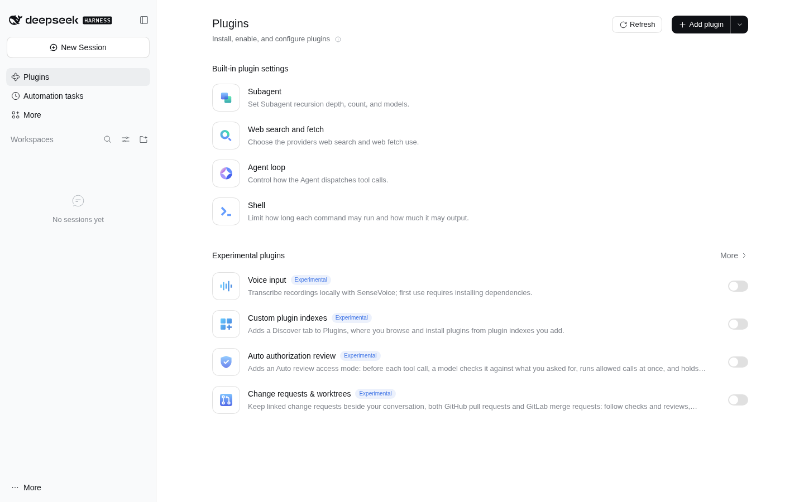

Screenshots: installing each plugin in order

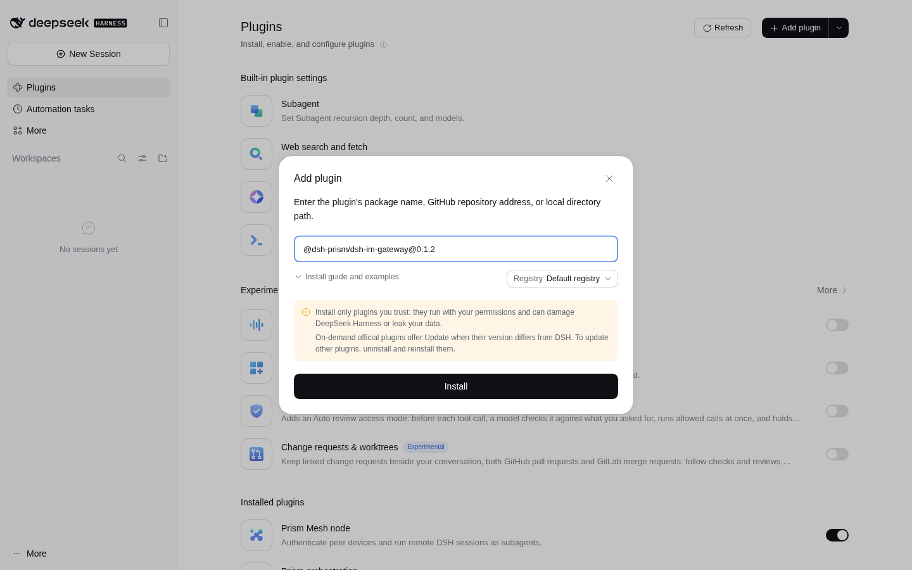

If DSH asks for permission to run a dependency script during installation, review the listed dependency and choose **Allow these scripts and retry**.

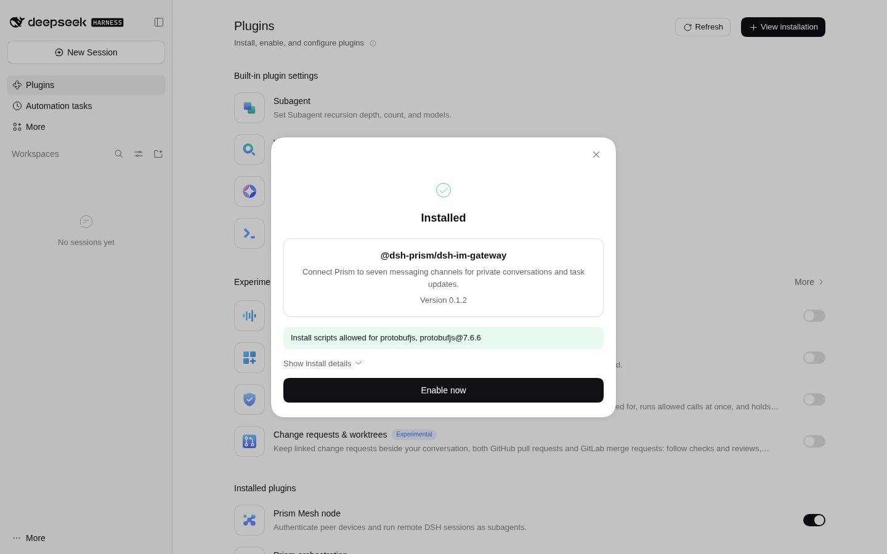

> [!TIP]
> If the **Prism** entry doesn't appear in the sidebar right after enabling all five plugins, simply reload the browser tab.

## 2. Connect your model

Open the account menu and go to **Settings → Models → Add model provider → Custom model API**. Select **OpenAI Responses** as the API protocol. Give it an internal **Provider ID** (e.g., `prism-responses`) and a friendly **Display name** (e.g., **Prism Responses**) that will show up in your model menu.

Choose **Add model**, enter `deepseek-v4.1-flash` in **Model ID 1**, fill in your **Base URL** and **API key**, then click **Create provider**.

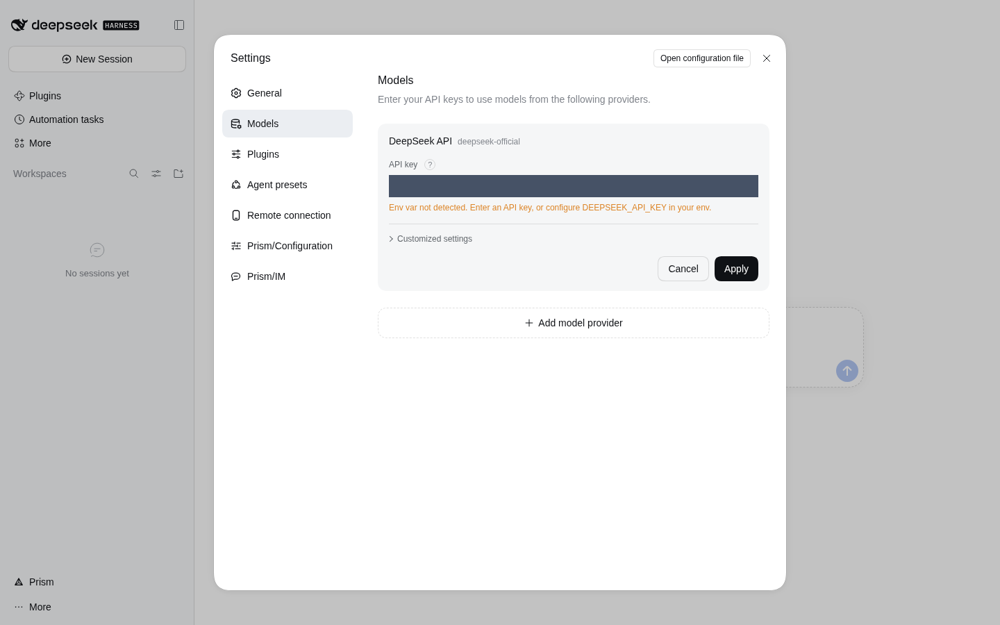

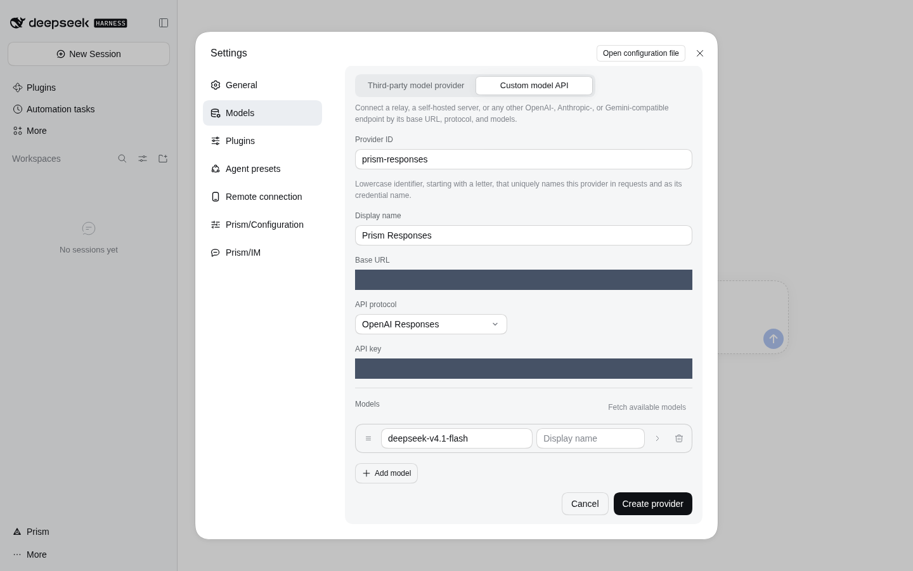

Next, open the model picker in a DSH chat and select **Prism Responses → deepseek-v4.1-flash** as your default model.

## 3. Add your project folders

In the DSH sidebar, click **Add workspace** next to **Workspaces**, select your first project folder (`harbor-books`), and click **Open** (or use **Edit path** to paste an absolute path and press Enter). Repeat for the second folder (`lantern-cafe`).

Prism automatically discovers any local workspace you've added in DSH and recognizes it by its display name, so you can refer to projects naturally in conversation.

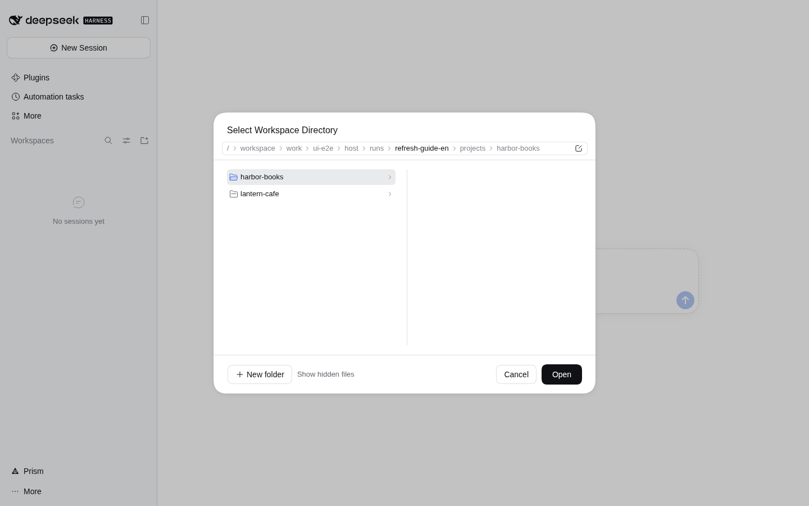

## 4. Choose models for each stage (optional)

Open **Settings → Prism/Configuration**. Here you can choose which models Prism is allowed to use at three stages:
- **L1 (Conversation)**: Talks with you and routes your requests.
- **L2 (Planning)**: Breaks down a task inside a project.
- **L3 (Execution)**: Reads files, runs checks, and gathers evidence.

Check the models you want to allow for each stage (if you leave a stage empty, it uses your DSH default model). You can also click the edit icon beside any model to customize its **Model description** (which helps Prism pick the right model for the job) and **Model prompt** (extra instructions for that stage), then click **Save**.

For this example, you can select `deepseek-v4.1-flash` across all three stages with these descriptions and prompts:

| Stage | Model description | Model prompt |
| --- | --- | --- |
| L1 (Conversation) | Coordinates work across projects | Return the requested result in the user's language and format. |
| L2 (Planning) | Plans work for a project | Reuse verified results and report completed work to the coordinator. |
| L3 (Execution) | Checks evidence in the workspace | Report what you verified, including the source file when relevant. |

Screenshots: configuring models and rules per stage

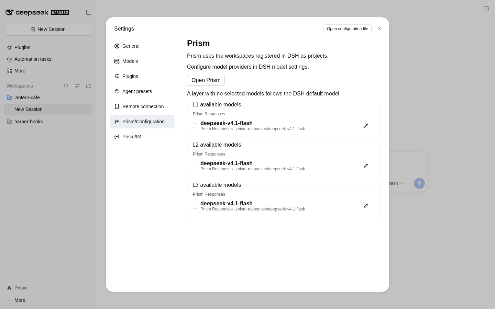

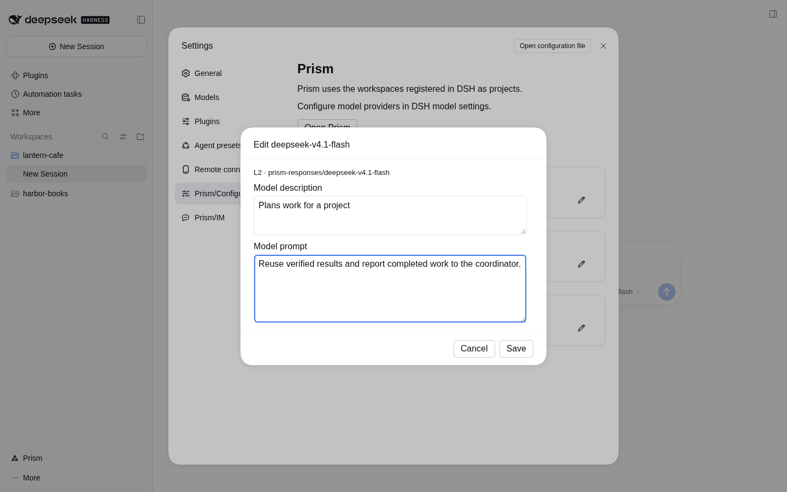

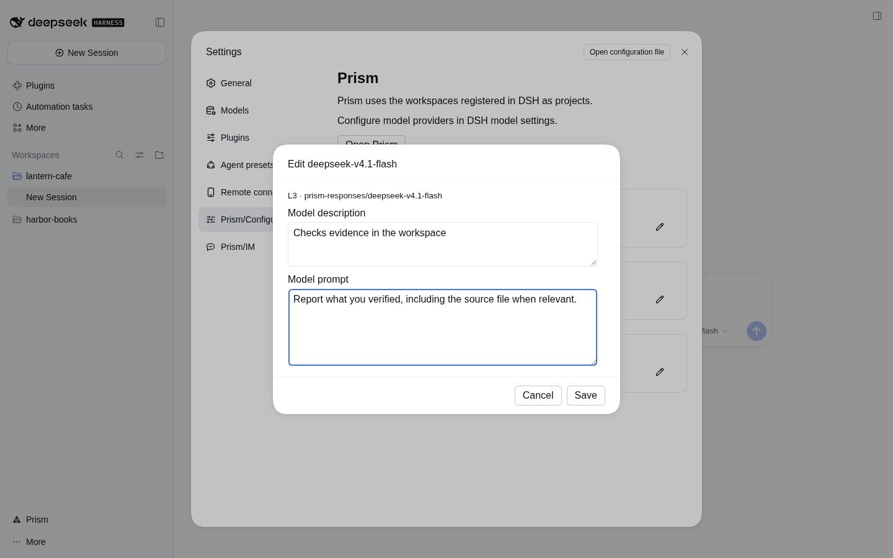

> [!NOTE]
> Want to chat with Prism from Telegram, WeChat, Feishu/Lark, or other messaging apps? You can configure them under **Settings → Prism/IM**. See [Set up a messaging account](./im.md).

## 5. Ask Prism to check both projects at once

Close Settings and click **Prism** in the DSH sidebar (or **Open Prism** in **Prism/Configuration**). Confirm that `deepseek-v4.1-flash` is selected in the chat composer, and send a message like this:

> Delegate one task to harbor-books and one to lantern-cafe. Use the respective project name as each task title. Have each planner assign an executor to use the read tool on its own workspace’s README.md and verify the event time, venue and on-site coordinator. After both finish, reply here in two lines, starting each with the project name.

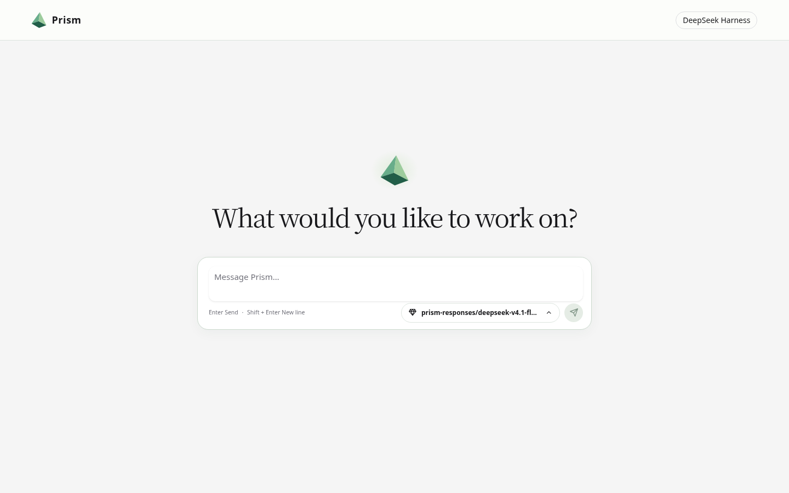

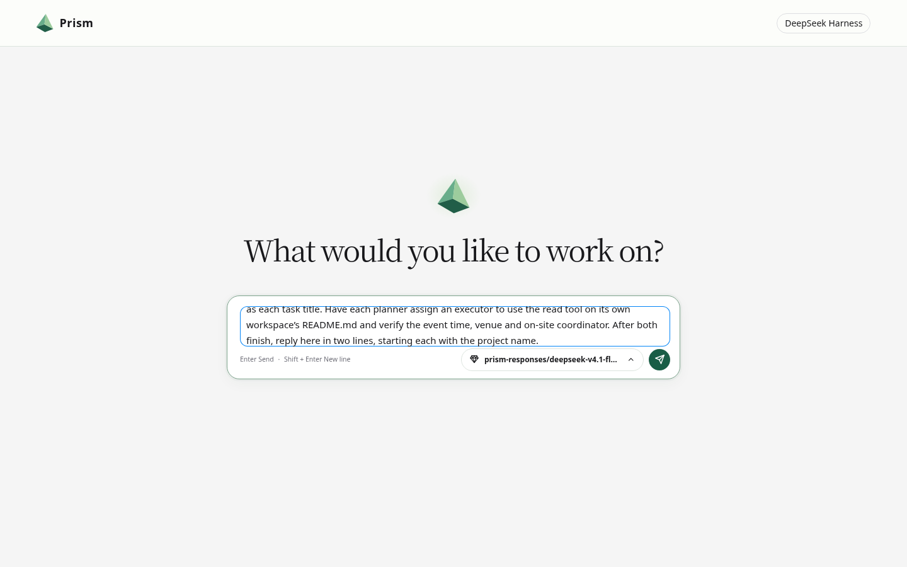

Prism splits your request into two background tasks—shown as collapsible cards right in the timeline—and replies with a two-line summary once both are done:

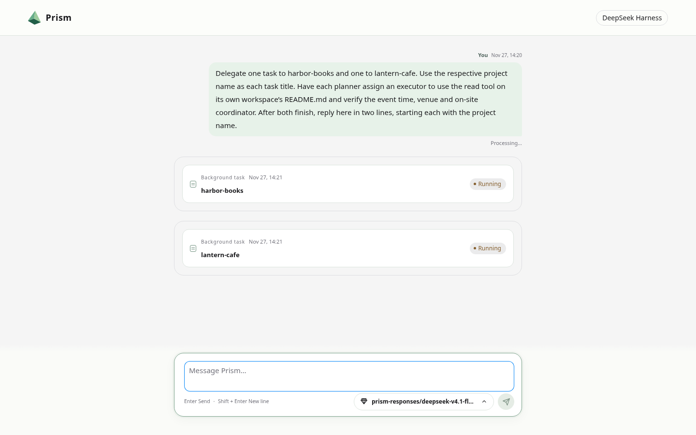

If you're using the sample folders, your summary should match these details:

| Project | Start | Venue | On-site coordinator |
| --- | --- | --- | --- |
| Harbor Books | 18:30 | Upstairs reading room | Mira |
| Lantern Cafe | 16:00 | Garden room | Kai |

## 6. Inspect the underlying details (optional)

Normally, you never need to leave the Prism chat. But if you want to verify exactly which files were read or how a task was carried out, click **DeepSeek Harness** at the top to switch back to the workspace view.

Expand each project in the **Workspaces** sidebar: **棱镜** is the main conversation, **棱镜 L2** is the planning session, and **棱镜 L3** is the execution session. Open any session to inspect its read-only history, or click **Prism** in the sidebar to jump right back to your chat.

Screenshots: inspecting read-only session histories in DSH

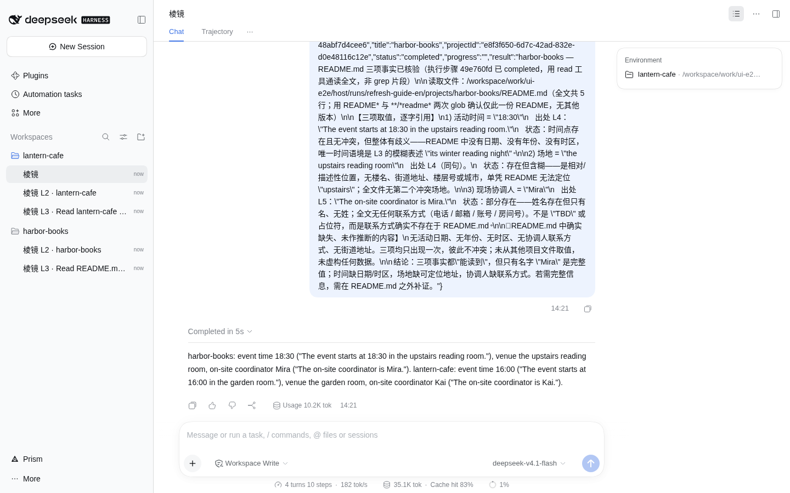

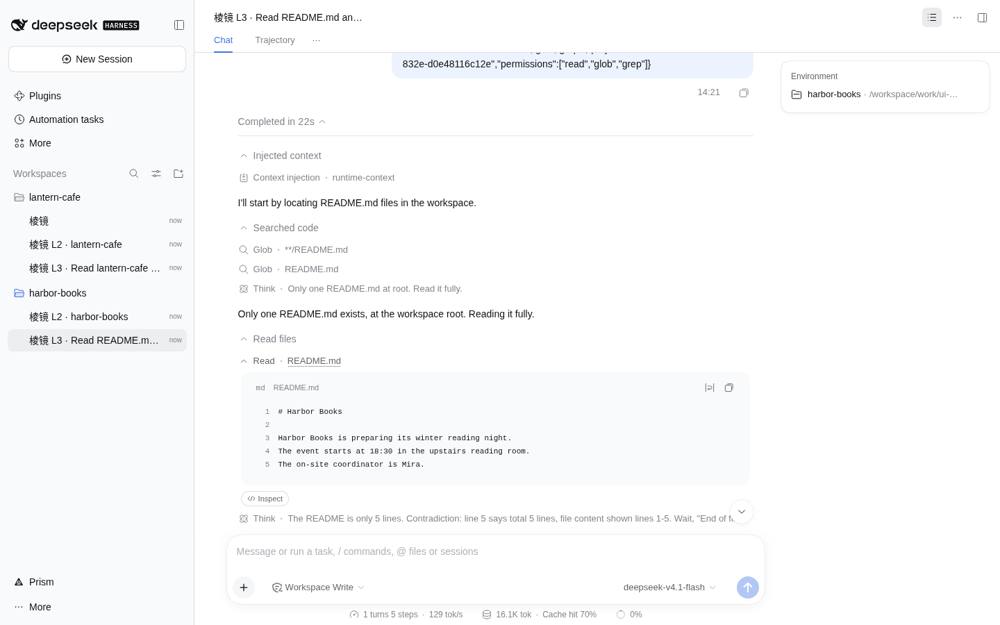

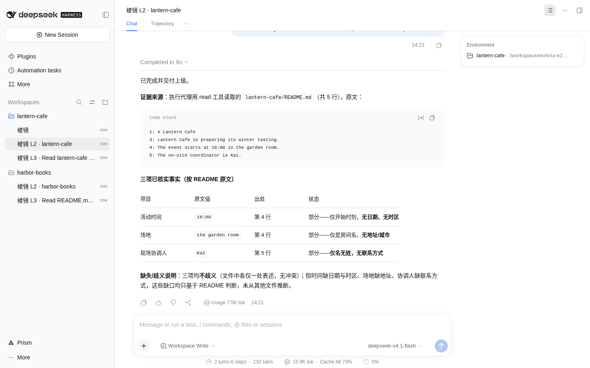

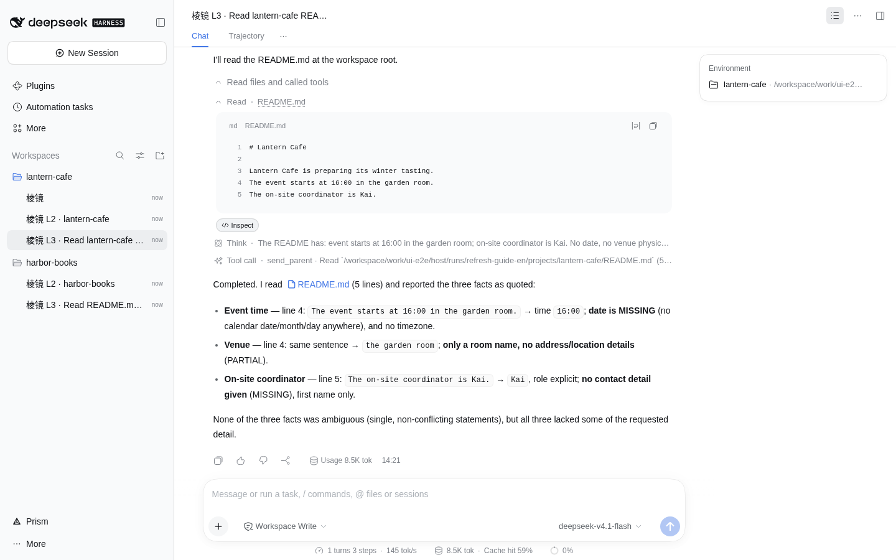

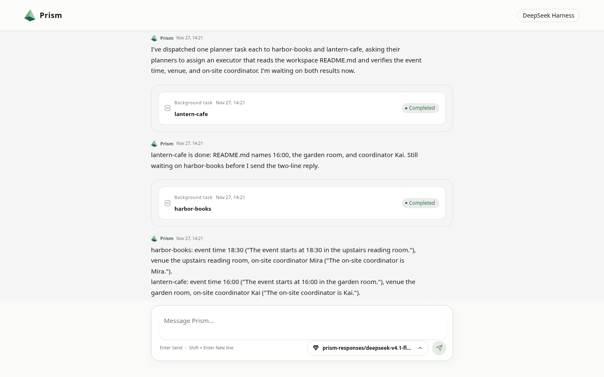

Next: [Using the conversation](./chat.md) · [Set up a messaging account](./im.md)

## Troubleshooting

- **"This package declares no bundle" during plugin installation**: Double-check that you entered the exact package name and version from the table in Step 1 (for example, `@dsh-prism/dsh-workspace-registry@0.1.2`), and click **Enable now** after installing each plugin.
- **Prism doesn't appear in the sidebar after installing all five plugins**: Reload the DSH browser tab once.
- **Folder picker stays on the previous directory after typing a path**: Click **Edit path** again, confirm the breadcrumb shows your target folder at the end, and then click **Open**.
