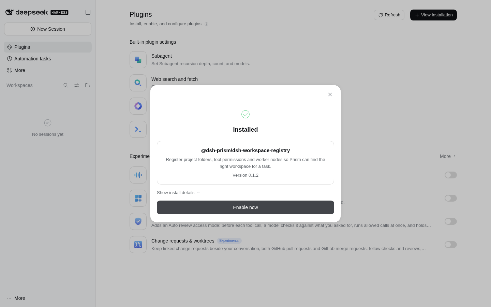
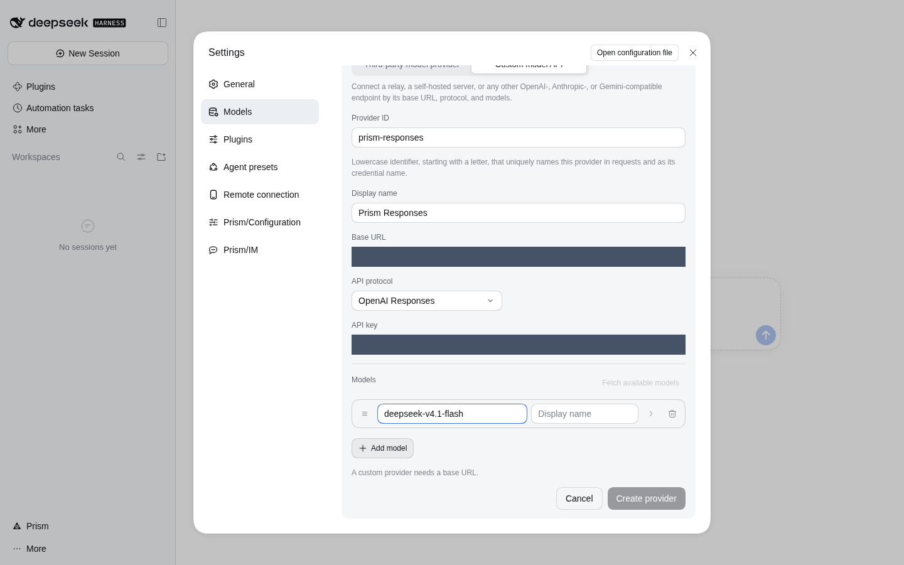
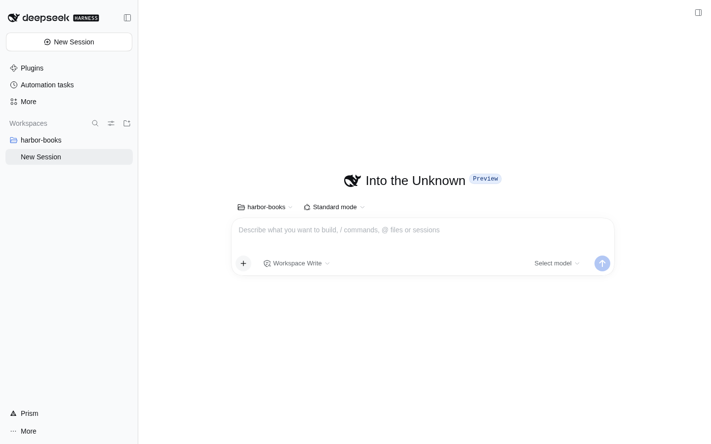
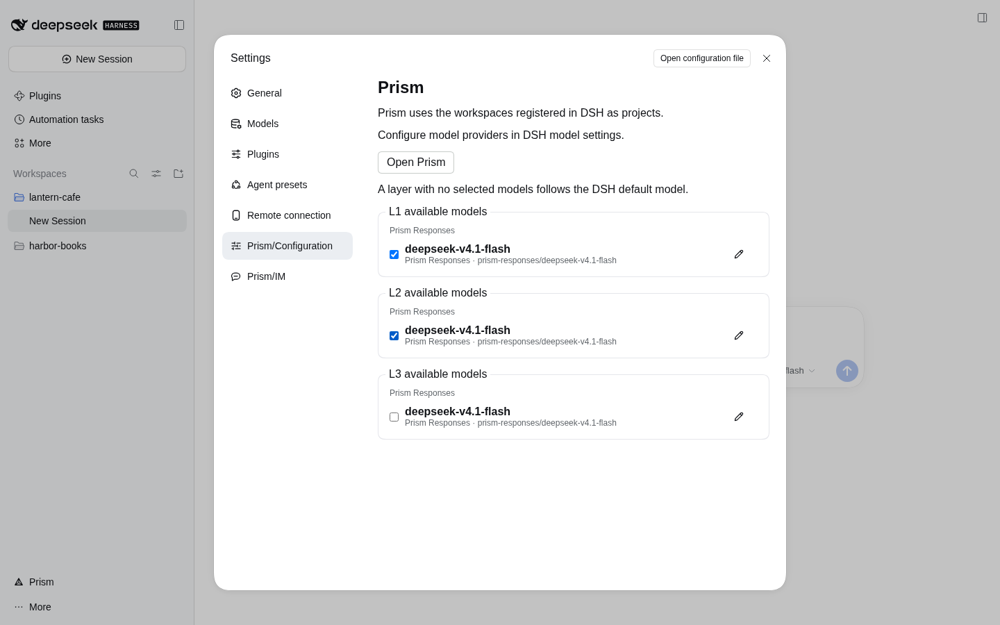
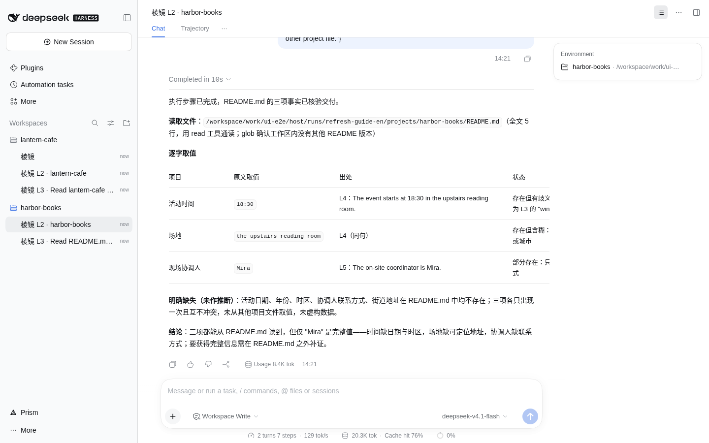

# Work across two DSH workspaces

Use Prism to read a different event brief in each workspace and report both results in one conversation. This walkthrough starts in a fresh DeepSeek Harness 0.2.3-alpha.2 profile. You need a DSH instance, the two project folders on that host, and an OpenAI Responses endpoint that serves `deepseek-v4.1-flash`. The repository includes both sample READMEs. [Sample folders on GitHub](https://github.com/dsh-plugins/dsh-prism/tree/main/docs/examples)

## Install Prism

Open your DSH sign-in link. On first launch, choose **Continue** on the preview notice. If the **Get started** dialog appears, close it.

In the sidebar, choose **Plugins → Add plugin**. In **Package name or address**, enter the full npm package and version. Keep **Default registry**, choose **Install**, check the version in the confirmation, then choose **Enable now**. Repeat in the order shown.

| Install in order | npm specification |
| --- | --- |
| 1 | `@dsh-prism/dsh-workspace-registry@0.1.2` |
| 2 | `@dsh-prism/dsh-mesh-node@0.1.1` |
| 3 | `@dsh-prism/dsh-orchestrator@0.1.2` |
| 4 | `@dsh-prism/dsh-im-gateway@0.1.2` |
| 5 | `@dsh-prism/dsh-concierge-ui@0.1.2` |

1. Install dsh-workspace-registry@0.1.2

2. Install dsh-mesh-node@0.1.1

3. Install dsh-orchestrator@0.1.2

4. Install dsh-im-gateway@0.1.2

DSH requested permission to run a listed dependency script. Review the dependency and choose **Allow these scripts and retry** to continue.

5. Install dsh-concierge-ui@0.1.2

If the Prism sidebar entry is missing after all five plugins are enabled, reload the DSH tab. In this run, the entry appeared after the reload.

## Connect the Responses model

Open the account menu and choose **Settings → Models → Add model provider → Custom model API**. Choose **OpenAI Responses** for the API protocol. **Provider ID** identifies the connection internally, and **Display name** is what you will see in the model menu. In this run they are `prism-responses` and **Prism Responses**.

Choose **Add model**, then enter `deepseek-v4.1-flash` in **Model ID 1**. Enter your provider’s endpoint in **Base URL** and its key in **API key**. This run used the values of `BASE_URL` and `API_KEY` as supplied. Choose **Create provider** and confirm the connection appears in the list. The private fields are covered in the figures.

## Open the two workspaces

In the sidebar, choose **Add workspace** beside **Workspaces**. Select the first project directory and choose **Open**. You can also select **Edit path**, enter an absolute directory path and press Enter to navigate to it. Repeat for the second folder. The example uses `harbor-books` and `lantern-cafe`.

Prism discovers these local workspaces from DSH and uses their display names to find the right projects. Each discovered workspace allows the executor to read a file, match paths and search text with `read`, `glob` and `grep`. The web owner and approved messaging users can query these workspaces.

In a DSH chat, open the model picker in the composer. Select **Prism Responses → deepseek-v4.1-flash**.

## Choose models for conversation, planning and execution

Open **Settings → Prism/Configuration**. The three panels list models available to **L1** (conversation), **L2** (planning) and **L3** (execution). Check a model in a layer to allow it there. An empty layer follows the DSH default model. Use the edit button beside a model to change its **Model description** and **Model prompt** for that layer, then choose **Save**.

The example selects **Prism Responses / deepseek-v4.1-flash** in all three layers. It saves and reopens each rule with the following settings.

| Layer | Model description | Model prompt |
| --- | --- | --- |
| L1 | Coordinates work across projects | Return the requested result in the user's language and format. |
| L2 | Plans work for a project | Reuse verified results and report completed work to the coordinator. |
| L3 | Checks evidence in the workspace | Report what you verified, including the source file when relevant. |

For a messaging account, open **Settings → Prism/IM**. The illustrated channel guide includes Telegram, WeChat, Feishu/Lark, WeCom, QQ Bot, OneBot and Discord. You can keep the channels disabled for the web task. [Set up a messaging account](./im.md)

## Ask each workspace for its event details

Close Settings and choose **Prism** in the DSH sidebar. **Open Prism** in **Prism/Configuration** opens the same conversation. Check that the composer shows `deepseek-v4.1-flash`, then send this request.

> Delegate one task to harbor-books and one to lantern-cafe. Use the respective project name as each task title. Have each planner assign an executor to use the read tool on its own workspace’s README.md and verify the event time, venue and on-site coordinator. After both finish, reply here in two lines, starting each with the project name.

Compare the two lines in the answer with the samples. Each event brief gives a different time, venue and coordinator.

| Workspace | Start | Venue | On-site coordinator |
| --- | --- | --- | --- |
| Harbor Books | 18:30 | Upstairs reading room | Mira |
| Lantern Cafe | 16:00 | Garden room | Kai |

## Check the native DSH session histories

Choose **DeepSeek Harness** to return to DSH. Expand each workspace in the **Workspaces** sidebar. **棱镜** identifies the conversation, **棱镜 L2** a planner and **棱镜 L3** an executor. Open the relevant session to read its history. The planning record shows the delegated work. In each workspace, open the execution record, expand the process and open the `read` tool details. Check both the path and the returned lines against the README in that workspace.

After the first visit, opening the DSH home address in the same browser returns to Prism. The **DeepSeek Harness** button opens the native DSH workspace. From there, the **Prism** sidebar entry returns to the chat. [Using the conversation](./chat.md) · [Model settings and workspace discovery](../develop/models.md)

## If installation or workspace selection stops

If DSH reports **This package declares no bundle**, check the full package and version in the installation table. The old `@dsh-prism/dsh-workspace-registry@0.1.0` reproduced that error. Use the published registry version from the table and choose **Enable now** after installation. The Mesh 0.1.1 success card can show a line of README HTML as its description. Check its name and version to identify the package.

If the folder picker still shows its original directory after you enter a path, use **Edit path** again and confirm that the last breadcrumb is the requested folder before choosing **Open**. [Verification notes](https://github.com/dsh-plugins/dsh-prism/blob/main/docs/TECH.md)
