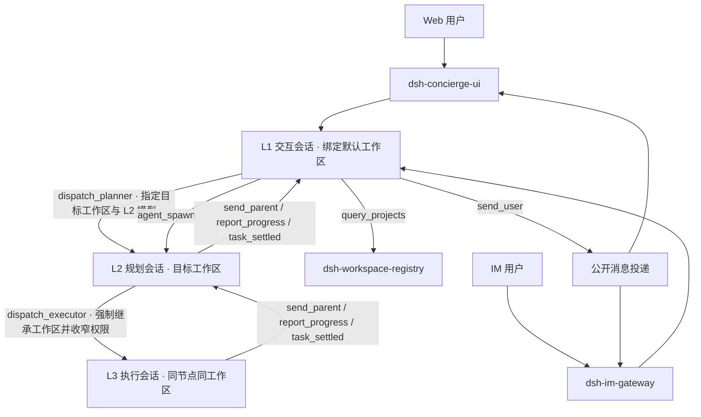

# 架构设计与分层隔离

棱镜（Prism）的设计理念可以归结为一句话：**对用户隐藏一切基础设施复杂度，在底层用严格的边界换取高自治与高可用。**

面对用户时，Web（`dsh-concierge-ui`）与 IM（`dsh-im-gateway`）只保留单一对话流和折叠任务卡；而在底层，五个插件协同工作，通过「L1 交互 → L2 规划 → L3 执行」三层隔离把自然语言需求拆解并安全落地。

## 六个核心设计原则

1. **交互极简与渐进式披露（Zero-Workspace UX）**：Web 和 IM 提供统一对话入口。Web 时间线显示任务卡，DSH 工作区显示符合条件的只读会话历史。
2. **严格权限天花板与上下文洁癖（Strict Isolation）**：越靠近用户的层级，权限越克制、上下文越干净。L1 被彻底剥离文件读写与终端执行能力，只保留元数据检索与调度权——既守住 IM/Web 入口的安全底线，也避免底层海量代码与日志污染路由层的注意力。
3. **默认静默，显式发信（Silent-by-Default Actor）**：打破传统大模型「吐字即输出」的同步对话范式。L1 的自然语言生成仅作内部思考，对用户或下级的任何影响都必须通过显式工具触发，从而天然支持异步事件处理、主动保持沉默与多任务并行协调。
4. **能力自描述与动态点将（Self-Describing Routing）**：拒绝把模型和任务写死。通过「分层模型池 + 独立能力介绍 + 专属提示词覆写」，用户自由切换前端交互模型，而 L1/L2 在派发时根据下级模型的「能力简历」动态择优，兼顾效果、延迟与成本。
5. **位置透明的分布式抽象（Location Transparency）**：上层编排逻辑不感知网络拓扑。`dsh-mesh-node` 将远程设备上的 DSH 实例封装为标准的 `prism-<nodeId>` Subagent Provider，使跨机派发与本地拉起共用同一套接口；配合「L1 指定 L2 工作区、L3 强制继承 L2 工作区」的规则，将高频文件操作收敛在目标机本地，跨网只传轻量级控制信令与摘要。
6. **外轻内重，遇锁自愈（Virtual Facade & Copy-on-Conflict）**：各层在 DSH 原生会话中运行。遇到写锁冲突时，运行器从可读取的历史创建新会话，并原子更新逻辑绑定。只读历史使用独立会话。

## 三层权限隔离

每个角色都运行在正式的 DSH 会话中，对外暴露标准 Subagent Provider 接口。宿主在工具发现和工具调用两个阶段同时实施权限检查，提示词无法突破宿主设定的权限上限。

| 层级 | 工作区与上下文 | 职责与权限边界 |
| --- | --- | --- |
| **L1（交互层）** | 绑定配置中的默认工作区 | 接待 Web/IM 用户，从 `dsh-workspace-registry` 查询该主体获准访问的项目元数据，决定目标项目和 L2 模型并派发任务。**无任何文件读写与终端执行工具。** |
| **L2（规划层）** | 在 L1 指定的工作区中运行 | 拆解项目内任务，动态挑选 L3 模型并派发具体步骤，可在派发时进一步收窄工具预算。|
| **L3（执行层）** | **强制继承**父级 L2 的节点与工作区 | 在目标机本地执行具体操作。可用原生工具取「L3 角色白名单 ∩ 项目策略 ∩ 上级派发预算」的交集。 |

## 默认静默与主动发信机制

棱镜将传统的同步流式输出替换为基于持久队列的显式 Actor 通信：

- **显式向用户发信**：L1 只有调用 `send_user` 才会把内容投递到 Web 对话或 IM 私聊；模型的普通文本输出只保留在底层 DSH 会话中作为内部思考过程。
- **上下级双向唤醒**：`send_parent` 与 `send_child` 通过持久队列异步唤醒接收方，不阻塞发送方执行。
- **进度与终态事件**：下级可通过 `report_progress` 上报阶段进展，上级可通过 `get_progress` 主动查看；当子任务进入终态时，调度器向直接上级投递 `task_settled` 事件。L1 收到事件后自主决定是立刻回复用户，还是等其余并行任务齐备后再汇总。
- **状态卡独立更新**：折叠任务卡与投递状态独立于助手文本消息更新，确保后台进度实时可见而不打断对话流。

| 层级 | 可用的编排工具 |
| --- | --- |
| L1 | `query_projects`, `list_models`, `dispatch_planner`, `agent_spawn`, `send_child`, `get_progress`, `send_user` |
| L2 | `list_models`, `dispatch_executor`, `send_parent`, `send_child`, `get_progress`, `report_progress`, `peer_send` (需 Room 授权) |
| L3 | `send_parent`, `report_progress` |

下一步：[动态点将与工作区治理](/zh/develop/models) · [Mesh 与遇锁自愈](/zh/develop/mesh) · [dsh-orchestrator](https://github.com/dsh-plugins/dsh-orchestrator)
