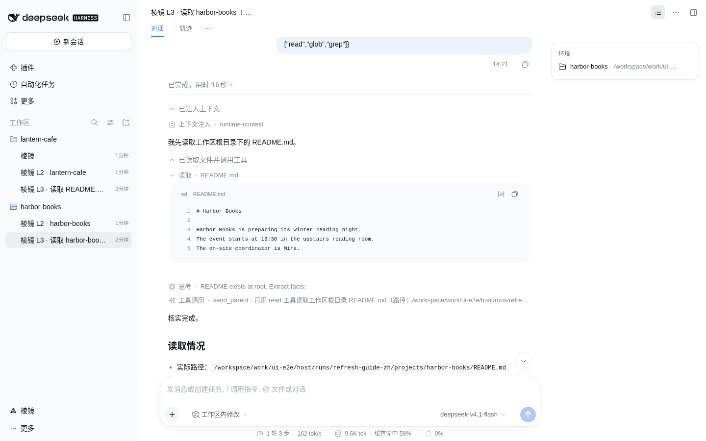

# 与棱镜对话

从 DSH 侧栏点击 **棱镜**，即可进入极简对话界面。在这里你不需要手动切换工作区或操心文件放在哪台机器上——直接说出你想做的事，需要指定项目时顺便提一句项目名称就行。

如果是第一次使用，可以先跟着[快速开始指南](./start.md)跑一遍双项目示例。

## 随时切换对话模型

点击输入框 **发送** 旁的模型菜单，就能看到当前可用的一线对话模型和各自的特点介绍。切换模型不会清空已经打好的草稿，会在下一条消息生效。

按 **回车** 发送消息，按 **Shift+Enter** 换行。如果想调整各环节允许使用的模型，回到 DSH 的 **设置 → 棱镜/配置** 即可修改。

启用[记忆插件](./start.md#optional-plugins)后，点输入框左下角的加号添加图片或视频。图片会显示缩略图，视频卡片会显示图标、文件名和大小。上传失败时可以在对应卡片上重试或移除。

棱镜页面跟随 DSH 的 **设置 → 外观**。选中 **跟随系统** 时，操作系统切换深浅色会同步更新棱镜。

同一个 DSH 配置档的 Web 和已获批私聊共享会话。答复和进度会发回请求来源，工作区权限按请求发起人校验。请批准可以共享同一会话上下文的用户。

## 平时零打扰，进度随时看

当棱镜把需求拆解给一个或多个项目处理时，时间线上的任务卡会直接显示标题、状态和时间。任务开始、取得新进展或遇到阻塞时，棱镜会向原发起渠道更新进度，完成后再发送结果。

## 需要排查时，一键查看底层过程

大部分时候你只需要看对话里的汇总结果。如果偶尔想核对“到底查了哪个文件、中间发生了什么”，点击顶部的 **DeepSeek Harness** 回到工作区界面，展开左侧 **工作区** 下的对应项目，就能看到只读的历史记录：
- **棱镜**：主对话记录
- **棱镜 L2**：该项目的任务规划过程
- **棱镜 L3**：具体执行与文件读取记录

所有记录都是只读的，放心点开核对即可。看完后点侧栏的 **棱镜**，就能回到原来的聊天窗口。

下一步：[接入即时通讯](./im.md) · [架构与技术路线](../develop/layers.md)
