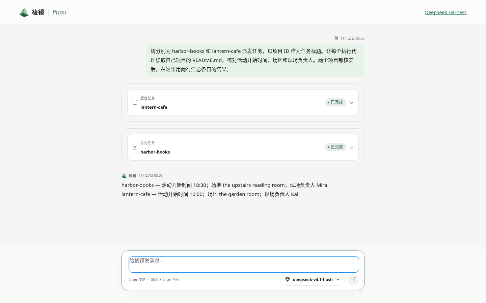
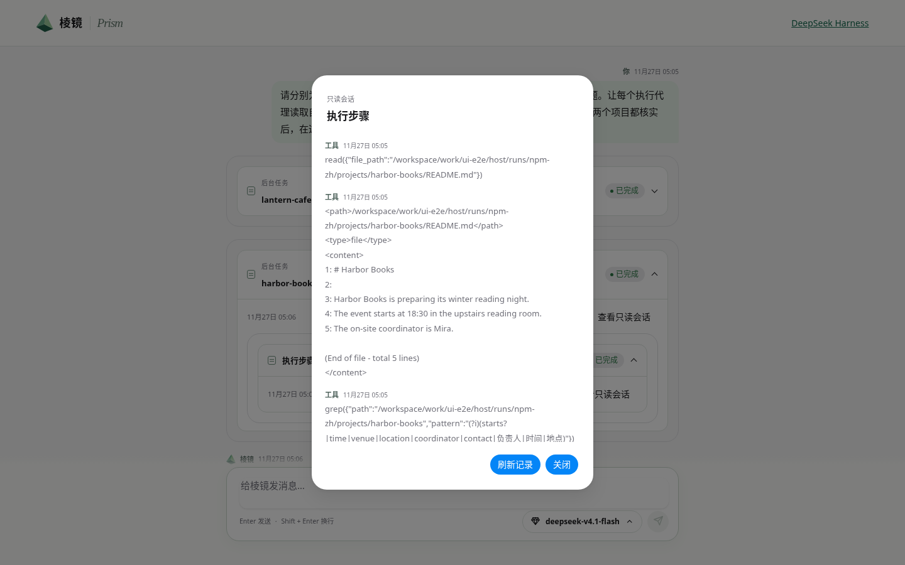

# 与棱镜对话

在网页里描述希望得到的结果，例如“检查移动端发布清单，列出还缺哪些验证项”。先在 **设置 → 棱镜** 登记并授权项目目录，对话代理即可按 ID 查找这些项目。[向棱镜授权两个项目](/zh/guide/start)

## 切换对话模型

模型选择器位于输入框右下角、发送按钮左侧。打开后可查看每个 L1 模型的能力介绍。切换后的模型用于后续轮次，草稿会保留。Enter 发送，Shift+Enter 换行。

## 跟踪任务

派发的任务会出现折叠状态卡。展开后可查看状态和执行步骤。若优先级变化，在原对话里补充说明即可。规划代理可以在其他步骤仍执行时汇报进展。

## 阅读底层会话

点击任务的只读会话入口查看已记录的对话与工具名，刷新可获取新记录。查看器验证任务归属，读取时无需获取写锁。同一 DSH 所有者的网页窗口共享对话；IM 身份使用各自的历史。

[接入即时通讯](/zh/guide/im) · [分层与权限](/zh/develop/layers)
