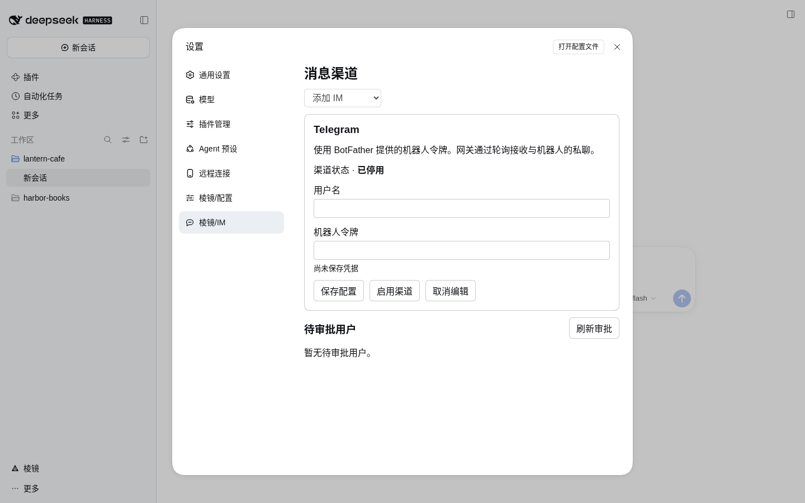
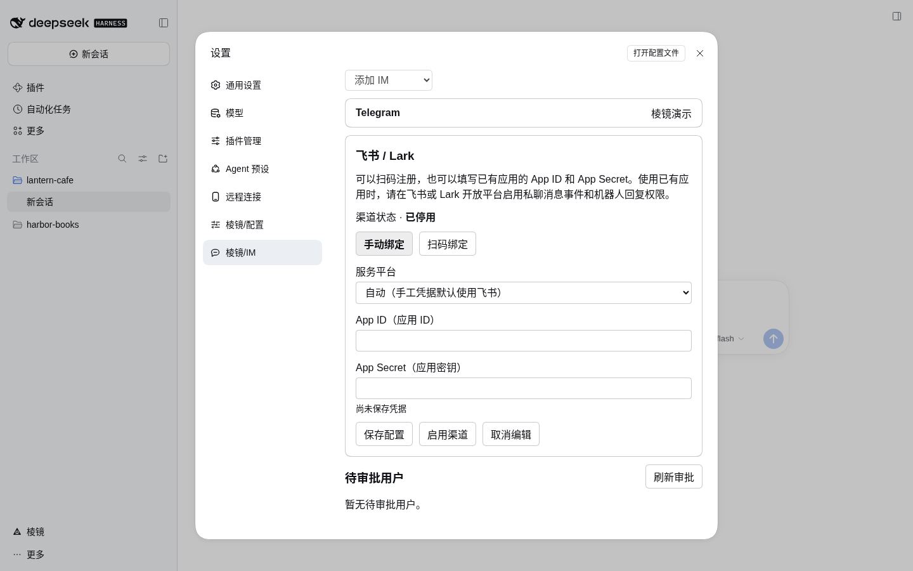
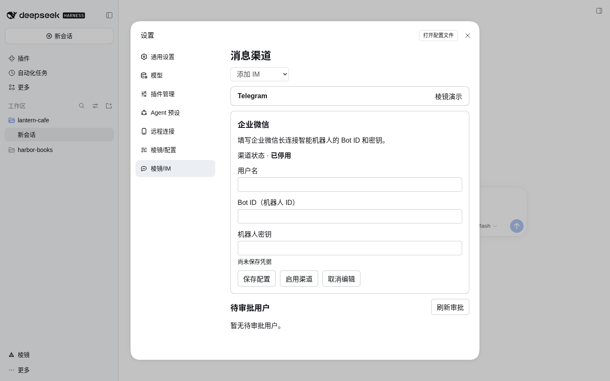
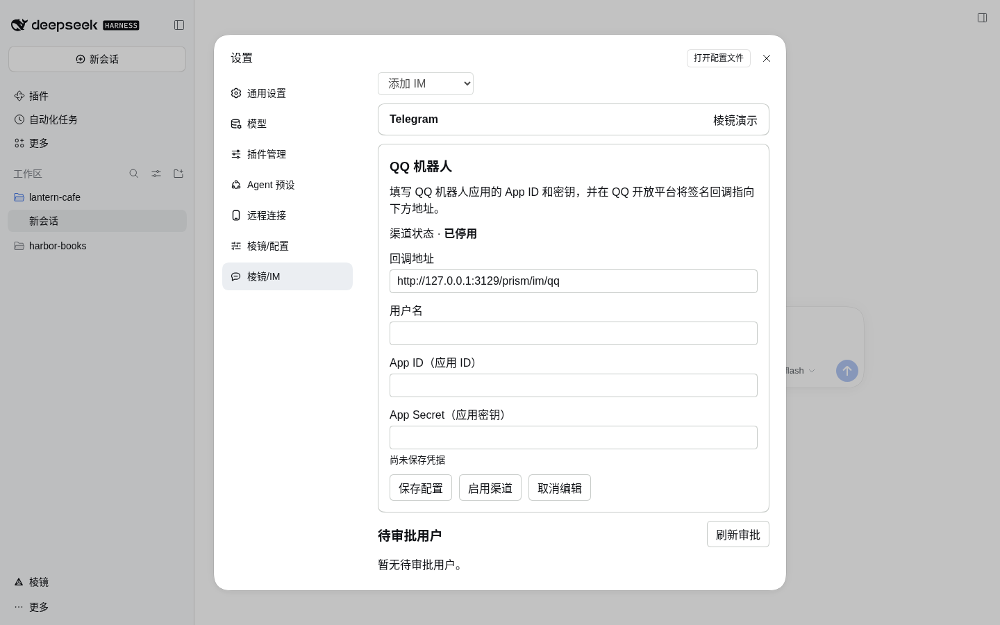
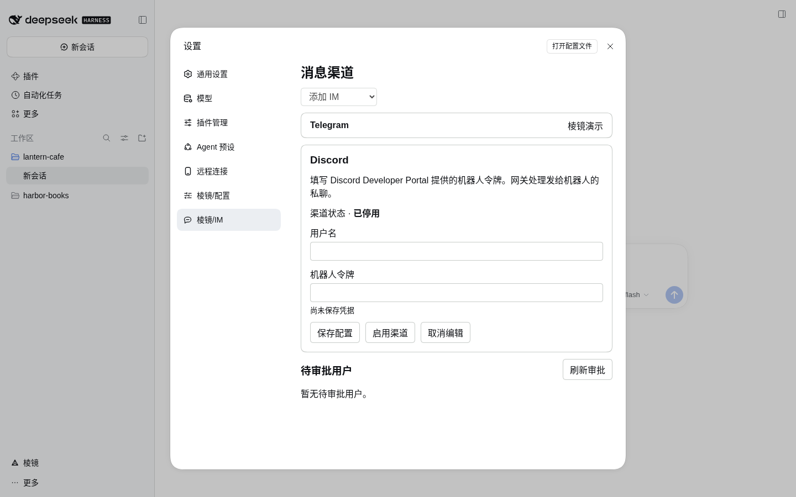

# 接入即时通讯

把棱镜接入你常用的聊天软件后，在私聊里就能直接提需求、查进度，等任务做完后棱镜还会主动把结果发给你。

以 DSH 所有者身份打开 **设置 → 棱镜/IM**，点击 **添加 IM** 选择渠道。保存后的账号会显示为卡片，点开就能修改配置或随时启停连接。**待审批用户** 面板则用于审核第一次给机器人发私信的人。

除飞书/Lark 以外，其他渠道都需要先填一个 **用户名**，方便你区分不同的账号卡片。填好信息后先点 **保存配置**，准备就绪再点 **启用渠道** 开始接收消息。再次打开已保存的卡片时，密钥字段会保持隐藏；如果不需要更换密钥，留空即可保留原有配置。

## 支持的渠道

### Telegram

1. 选择 **添加 IM → Telegram**。
2. 填写 **用户名** 和从 `@BotFather` 获取的 **机器人令牌**。
3. 点击 **保存配置**，需要接收私信时再点击 **启用渠道**。

> [!TIP]
> 如果这个机器人之前配置过 webhook，请先在 Telegram 端清除，否则会收不到新消息。

### 微信

1. 选择 **添加 IM → 微信**。
2. 在 **账号注册** 下点击 **生成登录二维码**。
3. 用微信扫码并按提示完成验证。
4. 点击 **保存配置**，然后 **启用渠道** 即可开始使用。

### 飞书 / Lark

飞书和 Lark 支持两种接入方式：
- **扫码绑定（推荐）**：切换到 **扫码绑定**，点击 **生成登录二维码**，用飞书或 Lark 扫码后，在官方授权页选择已有机器人或新建一个机器人。
- **手动绑定**：选择 **服务平台**（飞书或 Lark），填入已有应用的 **App ID** 和 **App Secret**，并在对应开放平台开启私聊消息事件订阅与机器人回复权限。

完成绑定或保存后，别忘了点击 **启用渠道**，机器人才会开始接收私信。

### 企业微信

1. 选择 **添加 IM → 企业微信**。
2. 填写 **用户名**，以及支持长连接的企业微信智能机器人的 **Bot ID** 和 **机器人密钥**。
3. 点击 **保存配置**，再点击 **启用渠道**。

### QQ 机器人

1. 选择 **添加 IM → QQ 机器人**。
2. 填写 **用户名**、**App ID** 和 **App Secret**。
3. 将表单中显示的 `/prism/im/qq` 回调地址（需使用外部可访问的 HTTPS 地址）填到 QQ 开放平台的签名回调配置中。
4. 点击 **保存配置**，然后按需 **启用渠道**。

### OneBot

1. 选择 **添加 IM → OneBot**。
2. 填写 **用户名**，以及 OneBot v11 服务的 **OneBot 账号 ID**、**OneBot HTTP API 地址**、**访问令牌** 和 **事件签名密钥**。
3. 在 OneBot 服务端把事件回调指向 DSH 宿主的 `/prism/im/onebot` 地址，并保持签名密钥一致。
4. 点击 **保存配置**，再点击 **启用渠道**。

### Discord

1. 选择 **添加 IM → Discord**。
2. 填写 **用户名**，填入从 Discord Developer Portal 获取的 **机器人令牌**。
3. 点击 **保存配置**，需要接收私信时点击 **启用渠道**。

## 审批第一次私聊的用户

有人首次向已启用的机器人发私信时，消息会先暂存，等待你确认。打开 **待审批用户**，核对渠道、用户名和平台用户 ID：
- 点击 **同意**：授权该私聊，并立即处理对方发来的第一条消息。
- 点击 **拒绝**：拒绝本次请求。

每个获批的私聊都拥有独立的对话记录，并可以查询你在 DSH 里添加的本地工作区。

## 在私聊里使用的快捷命令

获得授权后，你可以在私聊中发送以下命令：
- `/models` — 查看当前可用的对话模型
- `/model 模型ID` — 切换后续对话使用的模型
- `/tasks` — 查看当前私聊发起的任务列表
- `/inspect 任务ID` — 查看某个任务的只读执行记录
- `/language zh` — 切换机器人回复语言（如 `zh` 或 `en`）

下一步：[与棱镜对话](./chat.md) · [快速开始](./start.md)
