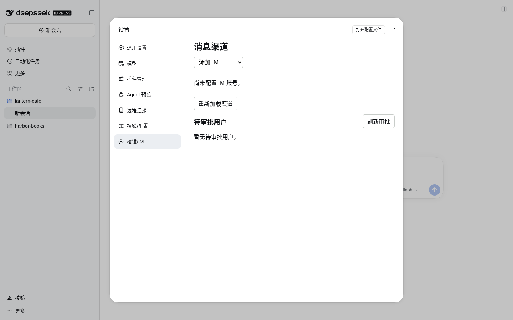
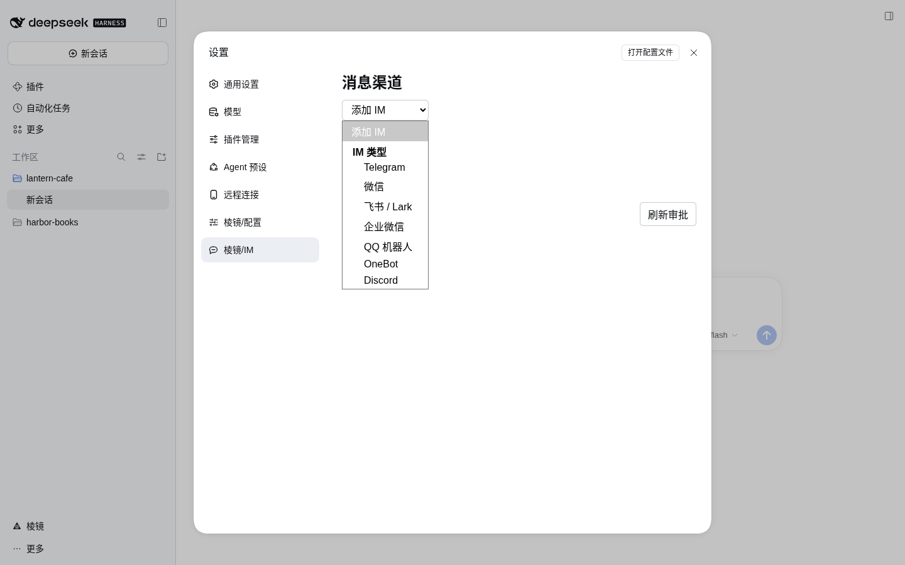
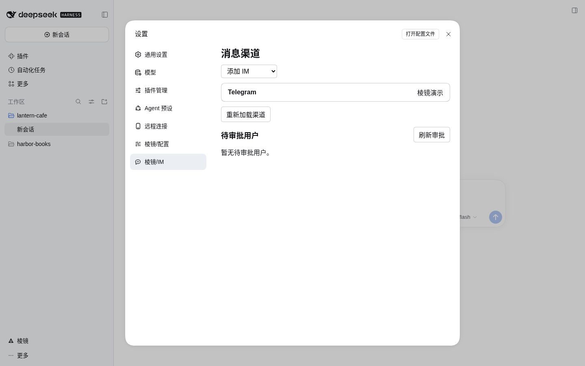
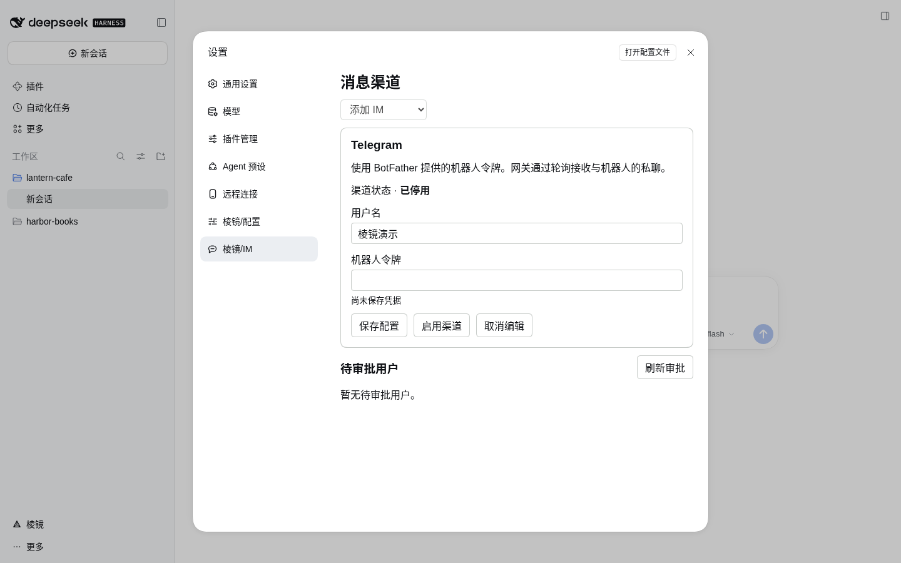
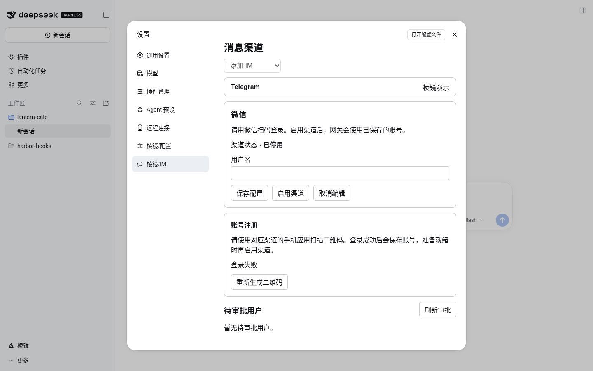
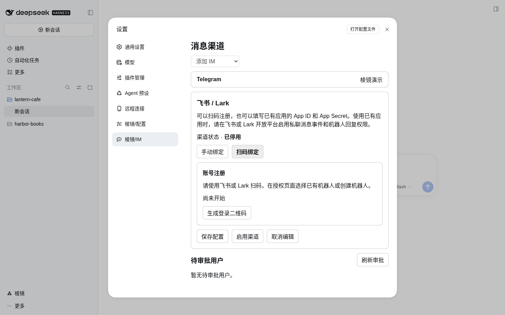
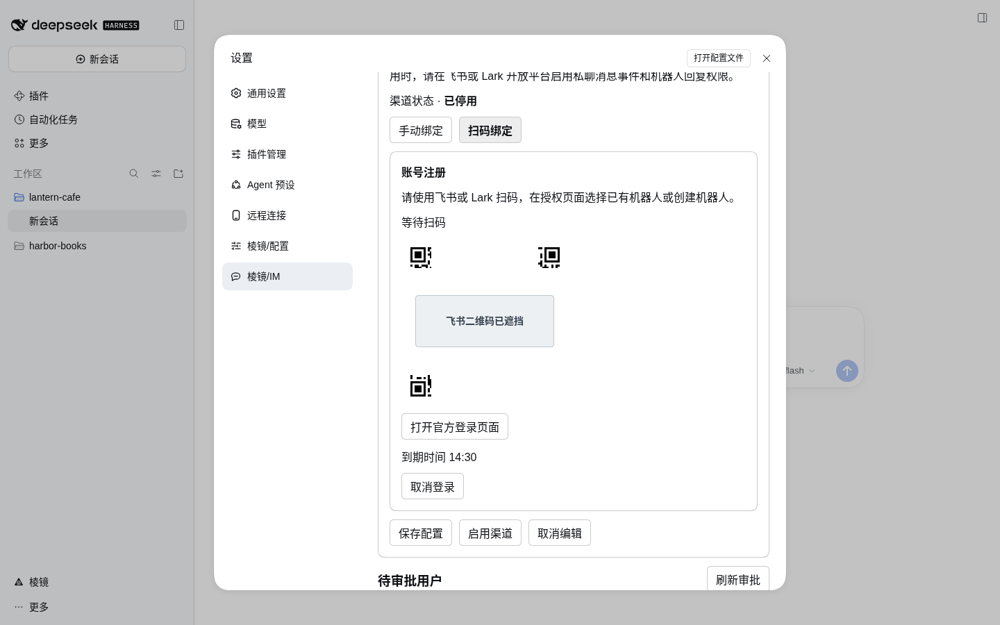
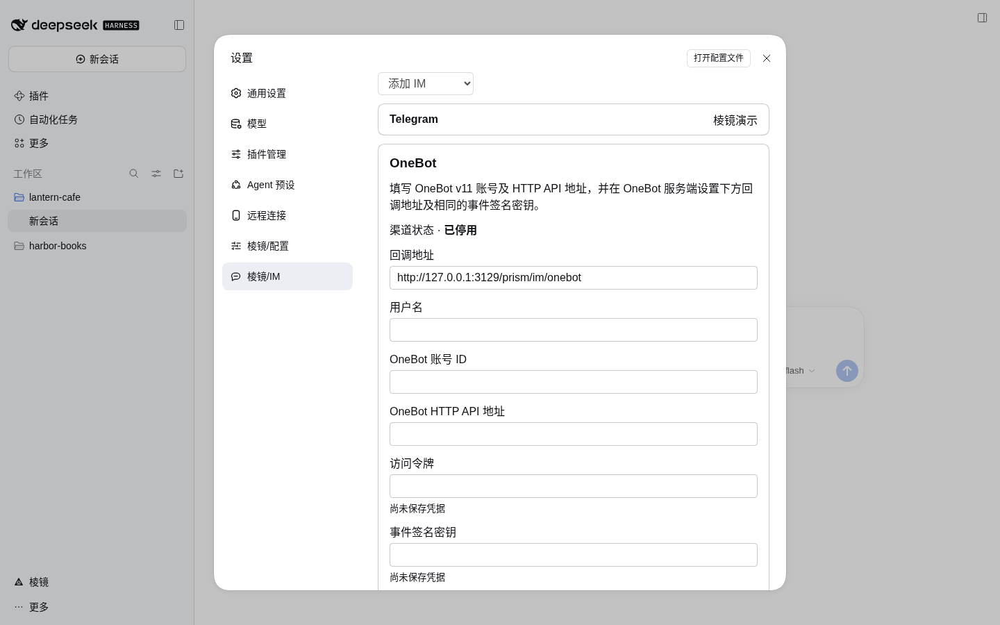
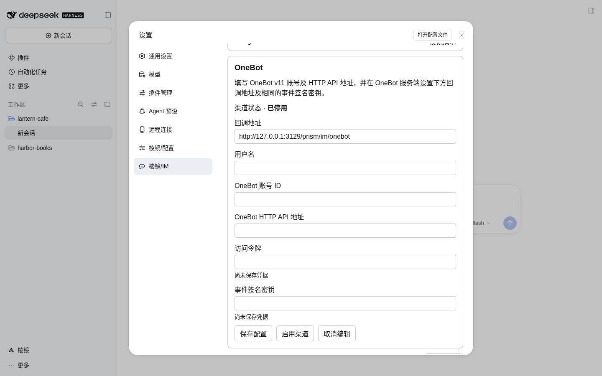

# 在 DSH 中配置 IM 账号

以 DSH 所有者身份打开 **设置 → 棱镜/IM**。点击 **添加 IM** 可选择渠道类型。保存后会出现一张账号卡片，点开可以编辑账号或启停连接。**待审批用户** 列出向已接通的机器人申请私聊的人。

飞书/Lark 以外的渠道先填 **用户名**，方便识别保存的卡片。**保存配置** 会保存当前账号的设置，准备好凭据或完成注册后可点 **启用渠道** 来启动连接。再次打开账号时，密钥字段显示保存状态，留空可保留原有密钥。

本次演示依次打开七个渠道的配置，连接均保持停用；另保存一个未填写机器人令牌的 Telegram 账号并重新打开核对。

## Telegram

在 **添加 IM** 中选 **Telegram**，填写账号名称和 BotFather 提供的 **机器人令牌**。保存后，需要开始接收私信时再启用。网关使用长轮询，如果该机器人此前设置了 webhook，请先在 Telegram 端清除。

如需先核对保存流程，可将用户名填为 **棱镜演示**，保持令牌为空，点 **保存配置**。重新加载渠道后展开已保存的账号卡，可看到之前的用户名，渠道状态为 **已停用**。

## 微信

选择 **微信**，在 **账号注册** 下点 **生成登录二维码**。当宿主可以访问微信官方 iLink 服务时，用微信扫描二维码，并按提示完成平台验证。保存设置，准备好后启用渠道。

本次环境请求微信官方 iLink 服务失败。页面显示 **登录失败**，并提供 **重新生成二维码** 入口。

## 飞书 / Lark

选择 **飞书 / Lark**。在 **手动绑定** 标签中，可以为已有机器人应用选择 **服务平台**，填写 **App ID（应用 ID）** 和 **App Secret（应用密钥）**。请在对应开放平台开启私聊消息事件订阅与机器人回复权限。

如需使用官方授权页，切到 **扫码绑定**，点 **生成登录二维码**。实际接入时，用飞书或 Lark 扫码，在授权页面选择已有机器人或创建机器人。完成绑定后仍需单独启用渠道，才会接收私聊。

网关取得了飞书官方二维码，操作人员在手机授权前取消了登录。为保护登录会话，截图中的码面已遮挡。

## 企业微信

选择 **企业微信**。填写用户名，以及支持长连接的企业微信智能机器人的 **Bot ID（机器人 ID）** 和 **机器人密钥**。先保存配置，再按需启用连接。

## QQ 机器人

选择 **QQ 机器人**，填写用户名、**App ID（应用 ID）** 和 **App Secret（应用密钥）**。在 QQ 开放平台，将签名回调设置为外部可达的 DSH 宿主 HTTPS 地址，以 `/prism/im/qq` 结尾；表单会显示当前宿主对应的回调地址。保存后按需启用。

## OneBot

选择 **OneBot**，填写用户名，以及 OneBot v11 服务的 **OneBot 账号 ID**、**OneBot HTTP API 地址**、**访问令牌** 和 **事件签名密钥**。在 OneBot 服务端把事件回调指向 DSH 宿主的 `/prism/im/onebot` 地址，使用相同的签名密钥。保存后按需启用。

## Discord

选择 **Discord**，填写用户名，再将 Discord Developer Portal 中的应用令牌填入 **机器人令牌**。保存配置，需要机器人接收私信时启用渠道。

## 审批第一次私聊

当有人首次向已启动的机器人发送私信时，打开 **待审批用户**，核对渠道、用户名和平台用户 ID。点 **同意** 后会授权该私聊并处理之前收到的第一条消息，也可点 **拒绝**。每个已批准的私聊拥有独立历史。使用 DSH 原生工作区发现时，获准的用户可以查询本机已登记的工作区。[工作区访问规则](../develop/models.md)

本次展示没有连接真实 IM 账号，实拍验证了待审批列表的空状态。

## 获批私聊中可用的命令

用 `/models` 列出对话模型，`/model 模型ID` 选择模型。用 `/tasks` 查看当前私聊的任务，再用 `/inspect 任务ID` 阅读只读记录。`/language zh` 可将私聊语言切换为中文。

[使用网页对话](./chat.md) · [安装插件并运行双工作区任务](./start.md)
