# 在网页中配置消息渠道

棱镜 0.1.2 的入口是 **设置 → 棱镜/IM**，点 **添加 IM** 后选择渠道。以下图解记录棱镜 0.1.1 的设置界面和操作。[当前安装指南](./start.md)

## 棱镜 0.1.1 操作图解

以 DSH 所有者身份打开 **设置 → 棱镜**，找到 **消息渠道**，选择平台即可查看其设置。每个私聊都保留独立的消息身份和对话历史。

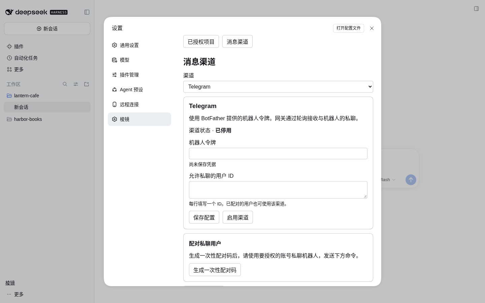

渠道授权决定哪些账号可以私聊。项目访问权限在 **设置 → 棱镜 → 已授权项目** 中单独管理，本例的 `web:owner` 授权属于 DSH 网页用户。要另外向某个私聊开放项目，在该项目的 **编辑 → 高级设置** 下，将完整的 IM 身份单独粘贴在 **授权身份** 的一行，保留这一行内的引号、逗号和方括号，再点 **保存**。

**保存配置** 会记录当前渠道的设置，**启用渠道** 才会启动连接。在 **允许私聊的用户 ID** 中每行填写一个平台用户 ID。再次打开页面后，密钥字段显示保存状态。输入框留空可以保留原有密钥，也可用 **清除已保存的凭据** 移除密钥。

本次展示依次打开七个配置表单，渠道保持停用。飞书示例取得了官方扫码授权入口，随后取消登录。实际收发消息需要使用自己的平台账号和凭据。

## Telegram

用 BotFather 创建机器人，在 **机器人令牌** 中填写其令牌，添加允许向机器人私聊的 Telegram 用户 ID，然后点 **保存配置**。准备好收发消息后点 **启用渠道**。网关采用长轮询接收更新，原有机器人如已设置 webhook，请先在 Telegram 端清除。

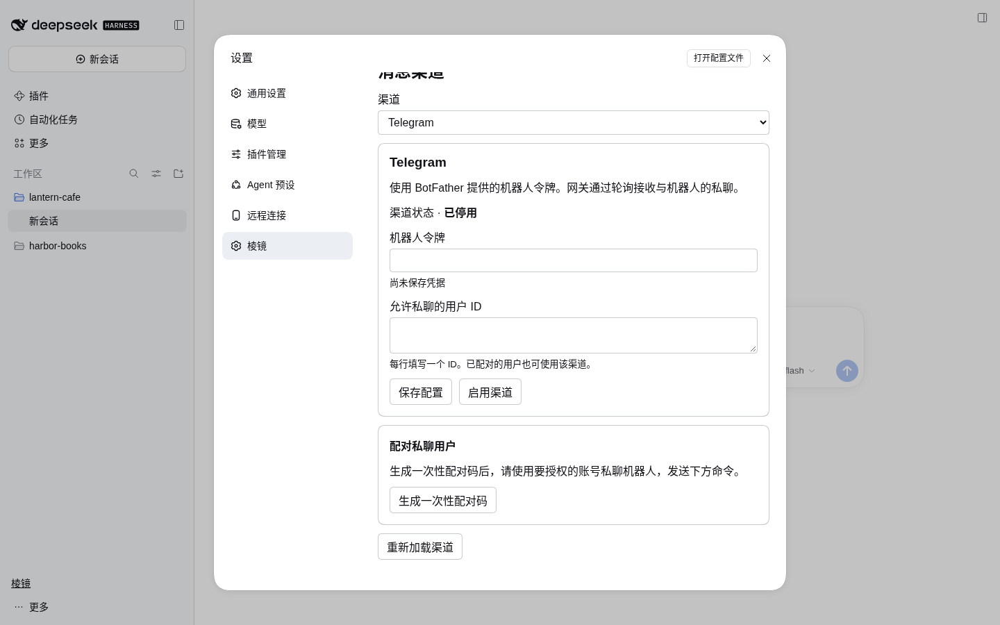

为验证停用时也能保存配置，本例保持 **机器人令牌** 为空，临时保存一条演示用户 ID，切换渠道并重新加载，再次打开 Telegram 核对该值，最后清空示例 ID 并保存。整个过程中 **渠道状态** 保持 **已停用**。

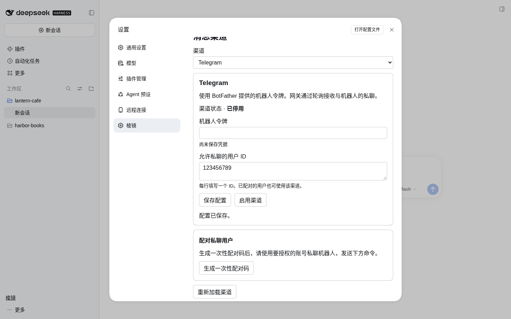

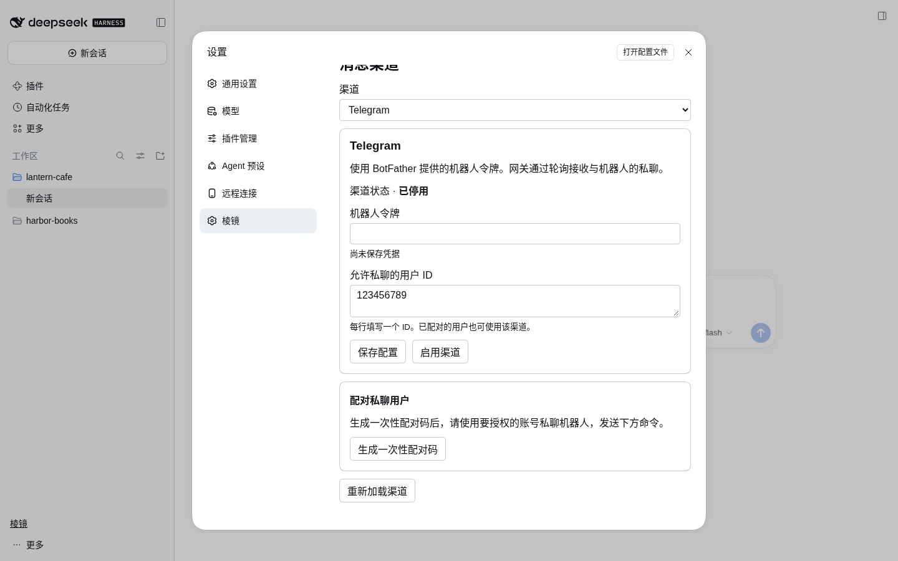

## 微信

选择 **微信**，在 **账号注册** 下点 **生成登录二维码**。当 DSH 宿主能够连接 iLink 时，用微信扫描返回的二维码，按平台提示完成验证并等待注册信息保存。准备使用该账号时再启用渠道。

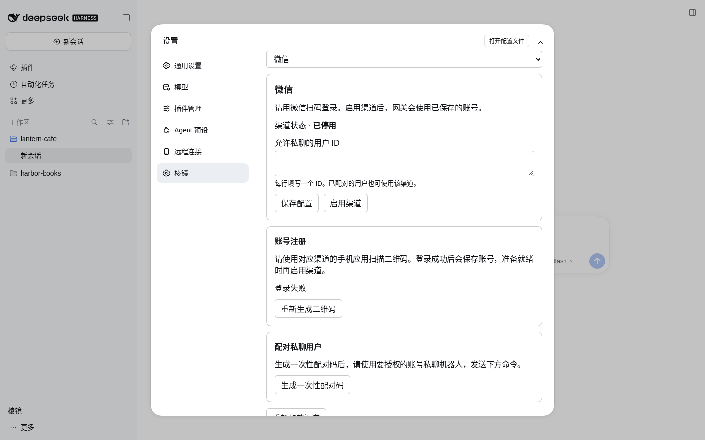

本次环境请求微信官方 iLink 服务失败，页面显示 **登录失败**，可点 **重新生成二维码**。本次微信演示止于此处。

## 飞书 / Lark

选择 **飞书 / Lark**，点 **生成登录二维码**。页面会显示平台提供的登录二维码与到期时间。正式接入时，用对应的手机应用扫码并完成平台授权。本次实测成功取得官方二维码，随后点击 **取消登录**。演示截图和录像都保留了二维码的三个定位角，中间区域标有“飞书二维码已遮挡”。

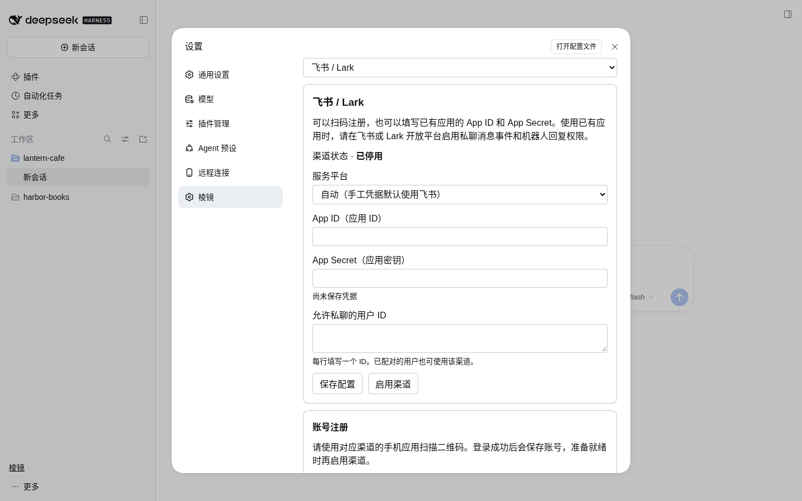

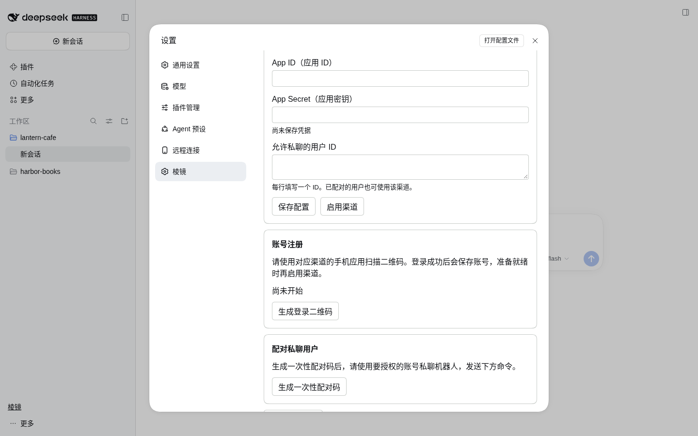

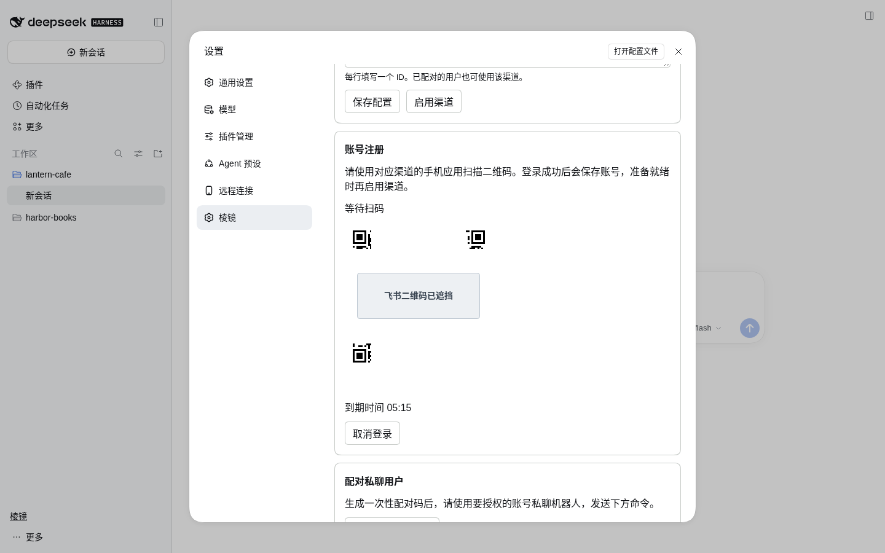

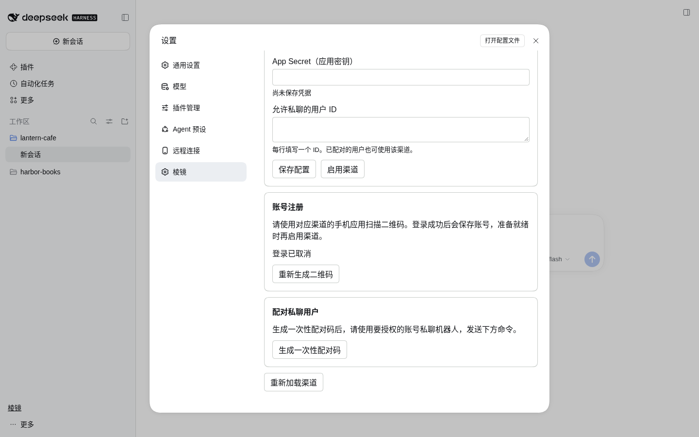

使用已有自建应用时，选择对应的 **服务平台**，填写 **App ID（应用 ID）** 和 **App Secret（应用密钥）**。在飞书或 Lark 开放平台开启私聊消息事件订阅与机器人回复权限，再保存配置。准备好后点 **启用渠道**。

## 企业微信

准备使用长连接的企业微信智能机器人，填写 **Bot ID（机器人 ID）** 和 **机器人密钥**，再添加允许私聊的平台用户 ID。保存后即可按需启用该连接。

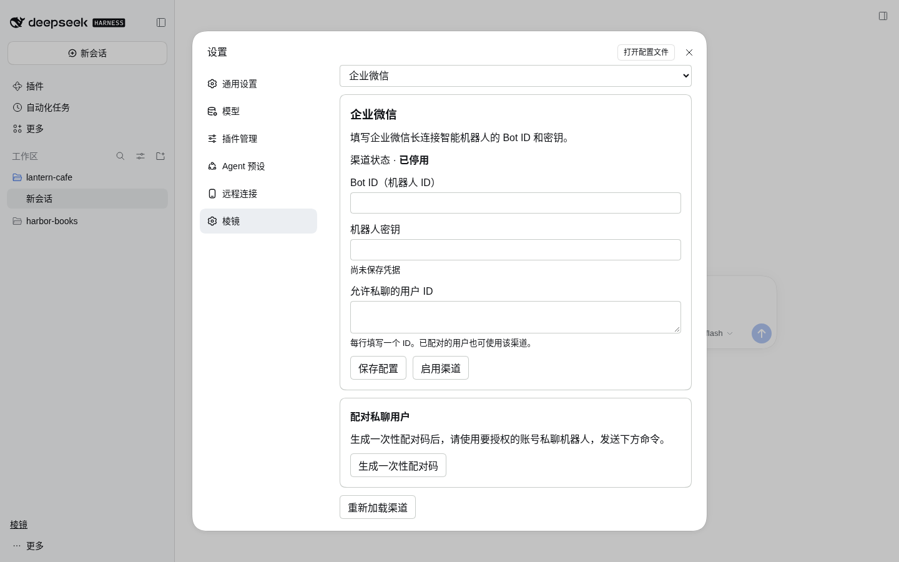

## QQ 机器人

填写机器人的 **App ID（应用 ID）** 和 **App Secret（应用密钥）**。页面显示以 `/prism/im/qq` 结尾的 **回调地址**。在 QQ 开放平台配置外部可达的 HTTPS 地址，让签名事件能送达该 DSH 宿主。保存后按需启用渠道。

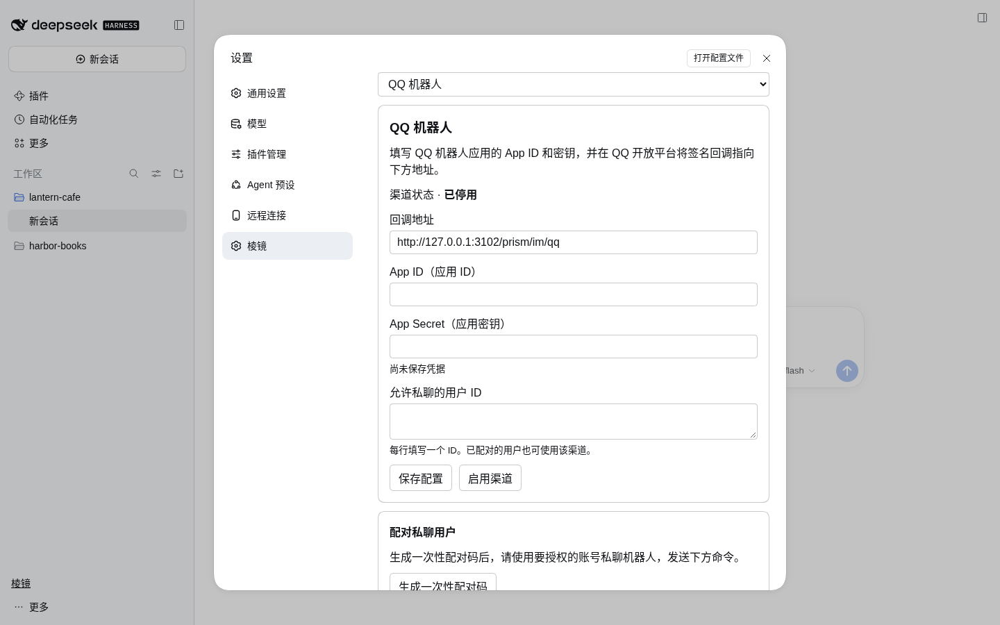

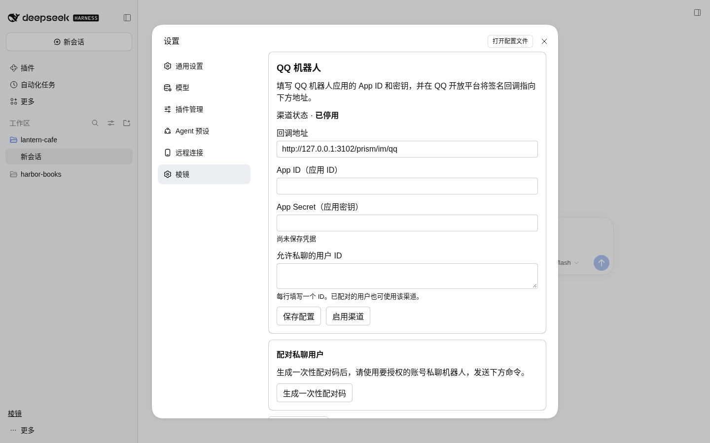

## OneBot

填写 OneBot v11 服务的 **OneBot 账号 ID**、**OneBot HTTP API 地址**、**访问令牌** 和 **事件签名密钥**。在 OneBot 服务端设置指向该 DSH 宿主的 `/prism/im/onebot` 回调地址，并使用相同的事件签名密钥。确认后保存，按需启用。

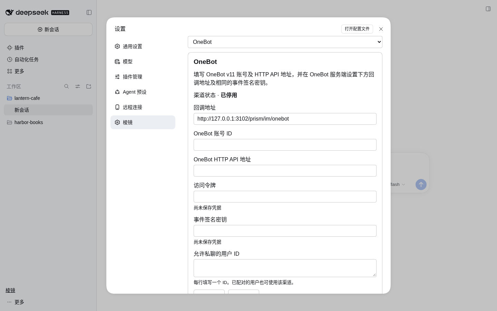

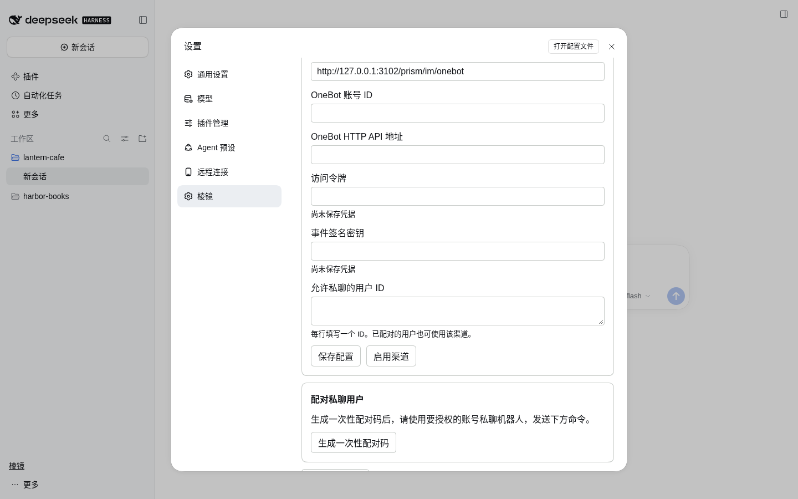

## Discord

从 Discord Developer Portal 获取机器人的令牌，填入 **机器人令牌**，添加允许使用该机器人的 Discord 用户 ID 并保存。准备接收机器人私信时再启用渠道。

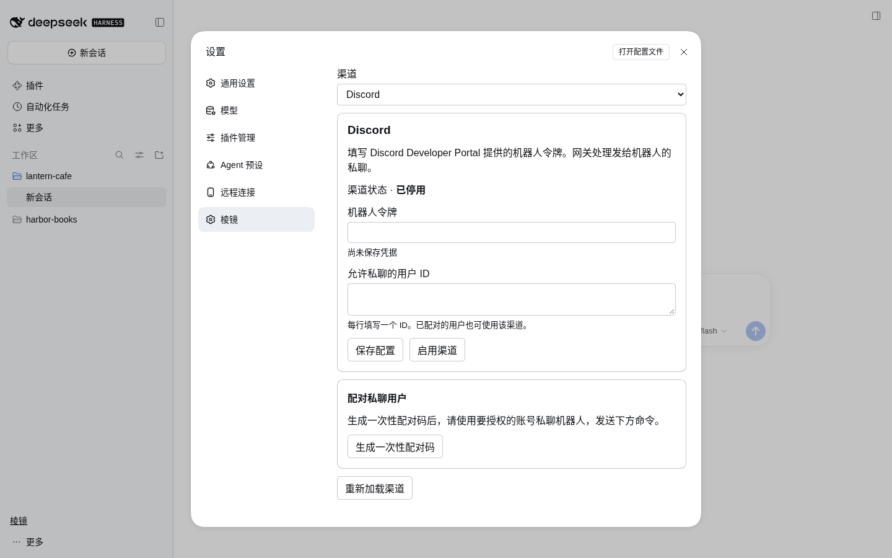

## 用一次性配对码授权私聊

要通过配对码授权，在相应渠道的配置页生成一次性配对码。接收者需要在十分钟内向机器人私聊发送 `/pair 配对码`。本次展示了各渠道的配对入口，未签发配对码。

## 接通后可用的私聊命令

| 命令 | 操作 |
| --- | --- |
| `/models` | 列出可用的对话模型及说明。 |
| `/model …` | 按模型 ID 或列表序号切换模型。 |
| `/tasks` | 查看当前私聊的任务。 |
| `/inspect …` | 按任务 ID 阅读底层会话。 |
| `/language …` | 选择语言，例如 `zh` 或 `en`。 |
| `/pair …` | 兑换为该渠道签发的一次性配对码。 |

[与棱镜对话](./chat.md) · [网关接口](../develop/api.md)
