# 快速开始：一句话同时查两个项目

用上棱镜之后，你不用再自己切换工作区、记住每个文件夹在哪。这篇指南带你从头完成一次配置，并在同一个聊天窗口里同时让两个项目（`harbor-books` 书店和 `lantern-cafe` 咖啡馆）各自核对活动信息，最后汇总给你。

本指南基于 DeepSeek Harness `0.2.3-alpha.2`。你可以直接使用自己的项目目录，也可以下载仓库自带的两个示例目录：[查看 GitHub 示例目录](https://github.com/dsh-plugins/dsh-prism/tree/main/docs/examples)。

## 1. 安装五个棱镜插件

打开 DeepSeek Harness。首次启动时，在预览版说明中点击 **继续**，如果弹出 **开始使用** 窗口可以直接关掉。


在左侧栏进入 **插件 → 添加插件**，在 **包名或地址** 中填入下表里的完整包名和版本，保持 **默认安装源** 不变，点击 **安装**，确认版本号无误后点 **立即启用**。请按顺序逐个安装并启用：

| 安装顺序 | npm 包名及版本 |
| --- | --- |
| 1 | `@dsh-prism/dsh-workspace-registry@0.1.2` |
| 2 | `@dsh-prism/dsh-orchestrator@0.2.0` |
| 3 | `@dsh-prism/dsh-mesh-node@0.2.1` |
| 4 | `@dsh-prism/dsh-im-gateway@0.2.0` |
| 5 | `@dsh-prism/dsh-concierge-ui@0.2.0` |

请使用表格中的当前包版本。截图展示的是早期版本中的相同安装控件。启用 Mesh 后，编排器会启动。


<details>
<summary>展开查看：五个插件的逐个安装截图</summary>

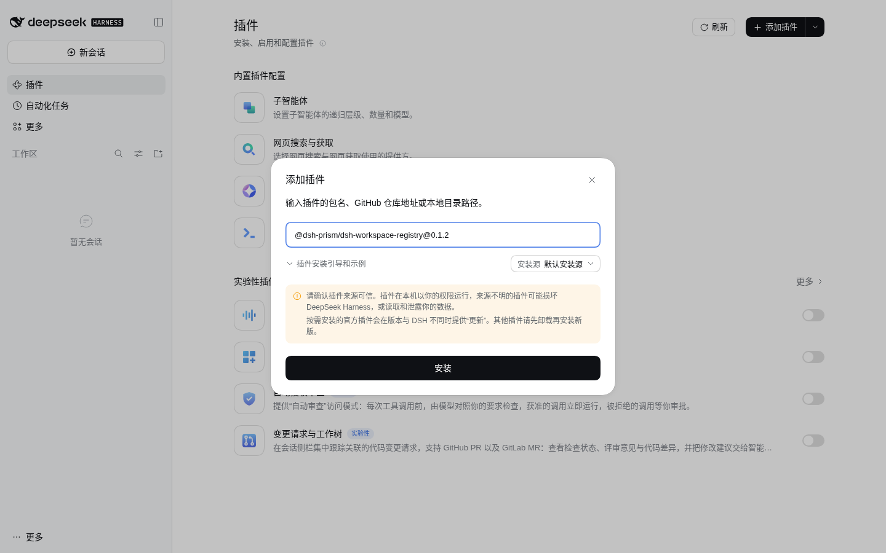

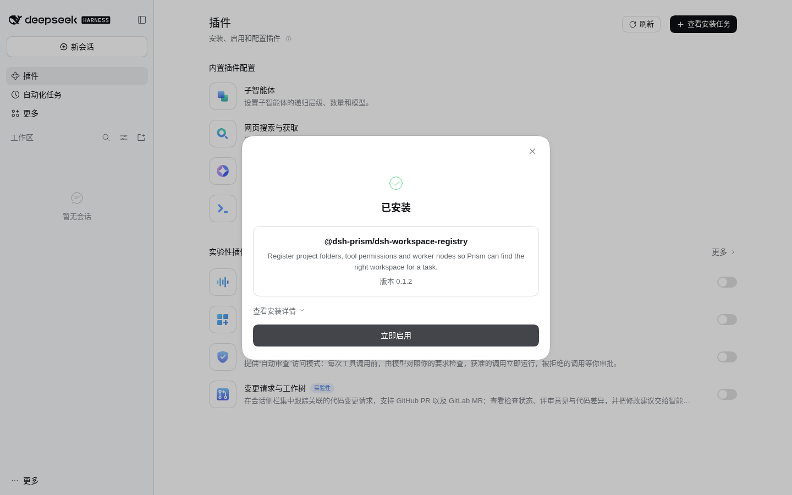


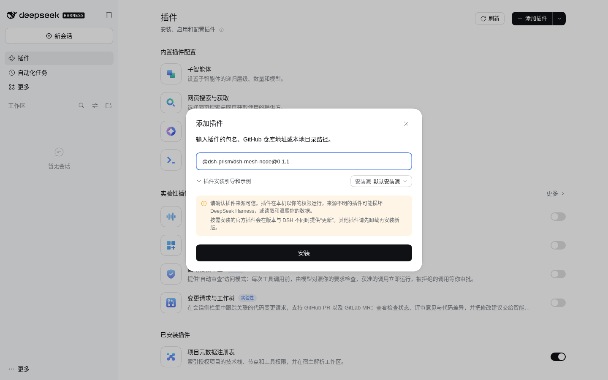


安装 IM 网关时，如果 DSH 提示需要确认运行依赖脚本，核对列出的依赖后点击 **允许这些脚本并重试** 即可。

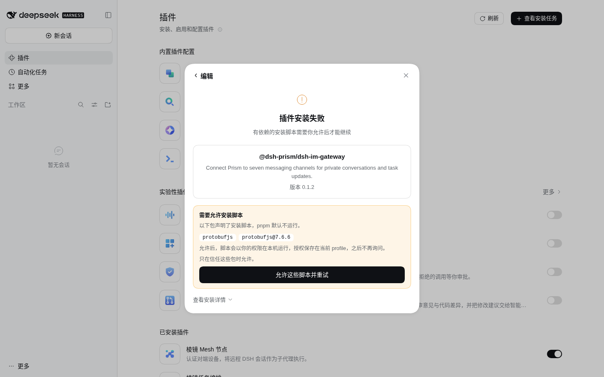

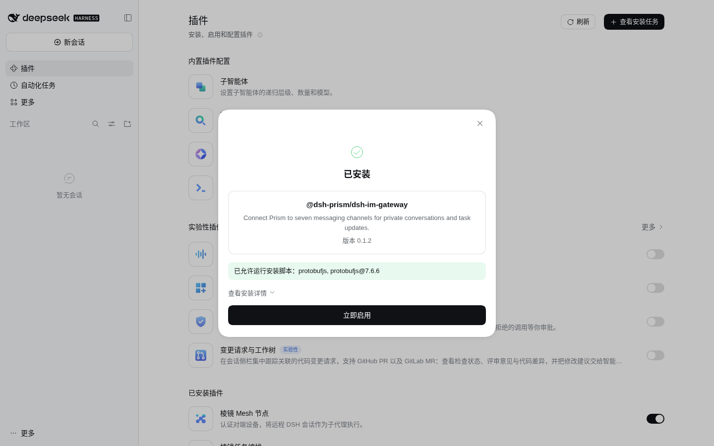


</details>


> [!TIP]
> 如果五个插件都启用后，左侧栏还没有出现 **棱镜** 入口，刷新一次浏览器页面即可。

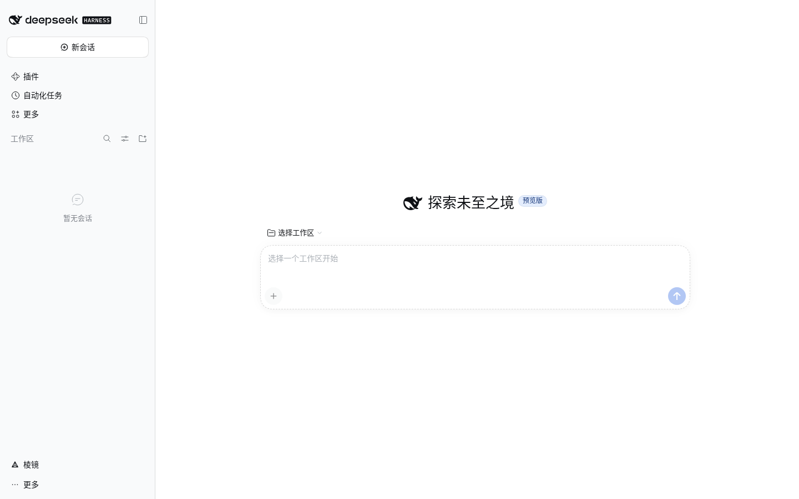

### 可选安装长期记忆和事件触发器 {#optional-plugins}

启用五个核心插件后，可在同一个 DSH 配置档中按需加装长期记忆和事件触发器。长期记忆支持资料保存和媒体附件，事件触发器支持定时提醒与外部事件。

在 **插件 → 添加插件** 中输入完整包名与版本，安装后选择 **立即启用**。也可以通过命令行安装到 `web` 配置档。

```sh
dsh plugin --profile web add "@dsh-prism/dsh-memory@0.2.0"
dsh plugin --profile web add "@dsh-prism/dsh-triggers@0.2.0"
```

## 2. 接入模型

打开账号菜单，进入 **设置 → 模型 → 添加模型提供商 → 自定义模型 API**。在 **API 协议** 中选择 **OpenAI Responses**，填入连接标识（如 `prism-responses`）和显示名称（如 **Prism Responses**）。

点击 **添加模型**，在 **模型 ID 1** 中输入 `deepseek-v4.1-flash`，填好你的 **API 地址** 和 **API 密钥** 后点击 **创建提供商**。

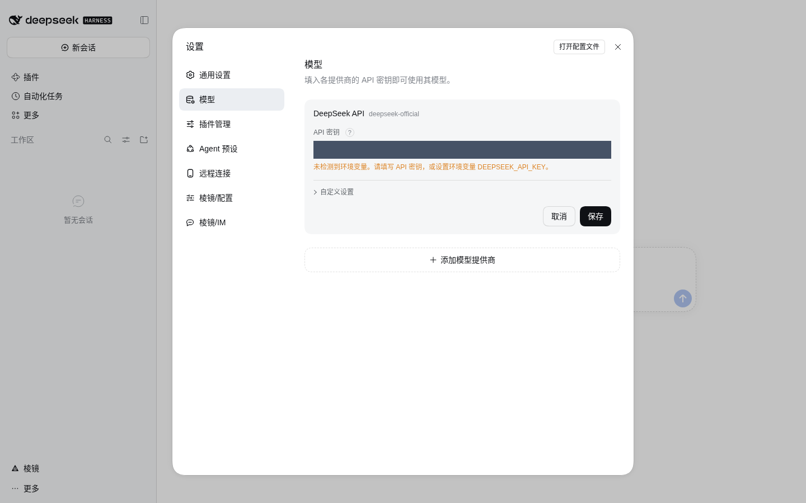


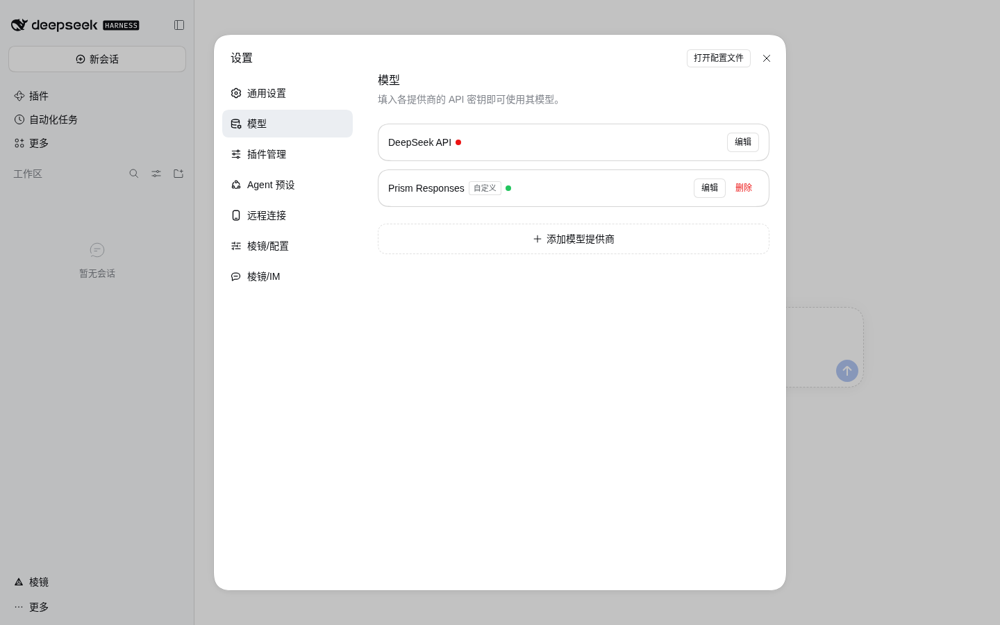

接着在 DSH 对话输入框旁的模型菜单里，选中 **Prism Responses → deepseek-v4.1-flash** 作为默认模型。


## 3. 添加项目目录

在侧栏 **工作区** 旁点击 **添加工作区**，选中第一个项目目录（如 `harbor-books`）并点击 **打开**（也可以点 **编辑路径** 直接粘贴绝对路径后回车）。用同样的方法添加第二个项目目录（`lantern-cafe`）。

棱镜会自动识别你在 DSH 里添加的所有本地工作区，之后你在对话里直接提项目名字，它就能找到对应的目录。


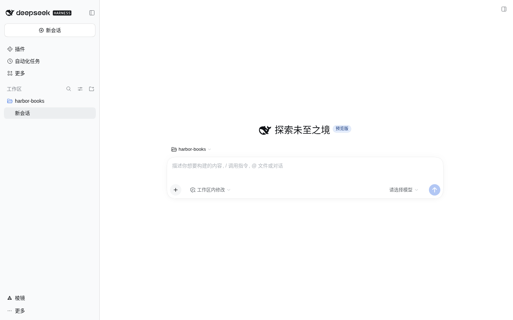

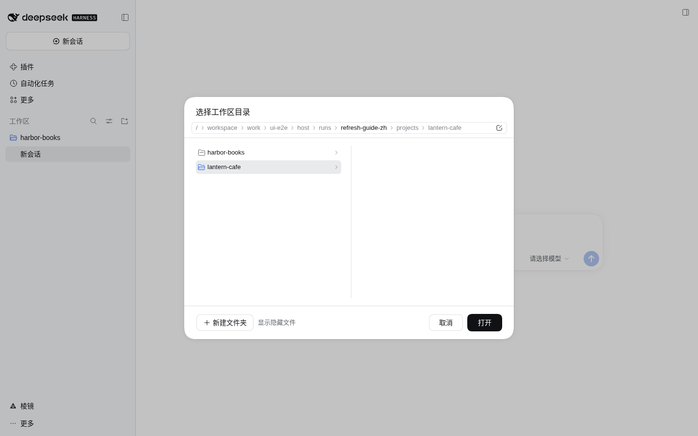


## 4. 为不同环节挑选模型（可选）

打开 **设置 → 棱镜/配置**，这里可以分别设置棱镜在三个环节中允许使用的模型：
- **L1（对话）**：负责和你沟通、理解需求并分派任务。
- **L2（规划）**：负责在具体项目里拆解步骤。
- **L3（执行）**：负责读取文件、核查资料和执行具体操作。

勾选某个环节允许使用的模型即可；如果某个环节不勾选，就会自动沿用 DSH 的默认模型。你还可以点击模型旁边的编辑按钮，写一段 **模型介绍**（帮棱镜判断什么时候适合派它上场）和 **模型提示词**，最后点击 **保存**。

在下面的示例里，我们为三个环节都勾选 `deepseek-v4.1-flash`，并填上对应的介绍与提示词：

| 环节 | 模型介绍 | 模型提示词 |
| --- | --- | --- |
| L1（对话） | 协调多个项目的任务 | 按照用户指定的语言和格式汇总已核实的结果。 |
| L2（规划） | 规划项目任务 | 复用已经核实的结果，并向协调者汇报已完成的工作。 |
| L3（执行） | 核查工作区资料 | 报告已核实的事实，并在需要时注明来源文件。 |

<details>
<summary>展开查看：配置各环节模型与规则的截图</summary>

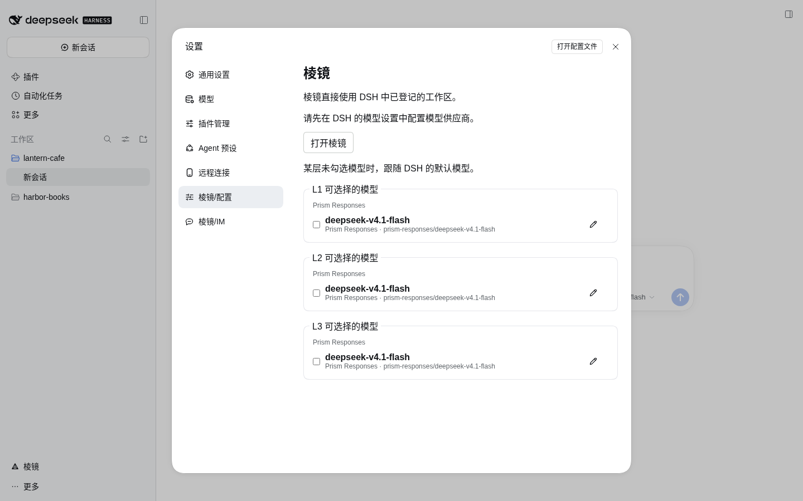

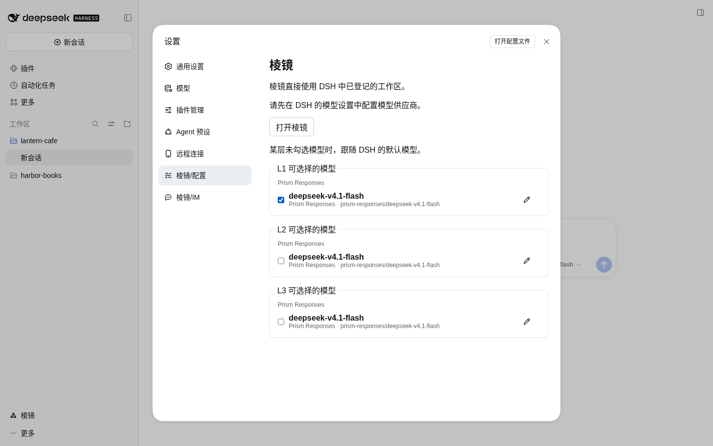

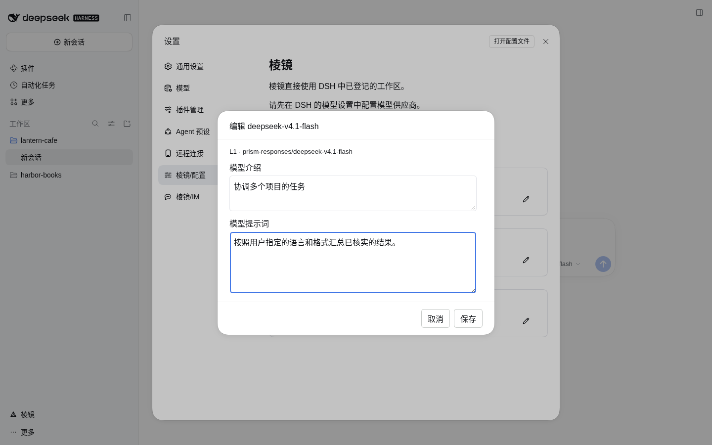


</details>

> [!NOTE]
> 如果你还想在微信、飞书/Lark、Telegram 等聊天软件里直接找棱镜办事，可以去 **设置 → 棱镜/IM** 里配置。详见[接入即时通讯指南](./im.md)。

## 5. 一句话向两个项目派发任务

关掉设置窗口，点击侧栏的 **棱镜**（或者在 **棱镜/配置** 里点 **打开棱镜**）。确认输入框旁显示的是 `deepseek-v4.1-flash`，发送下面的需求：

> 请分别给 harbor-books 和 lantern-cafe 分派一项任务，每项任务用对应的项目名作为标题。让每个项目的规划与执行流程读取各自工作区的 README.md，核对活动开始时间、场地和现场负责人。两个项目都核实后，请在这里用两行回复，每行以项目名开头。


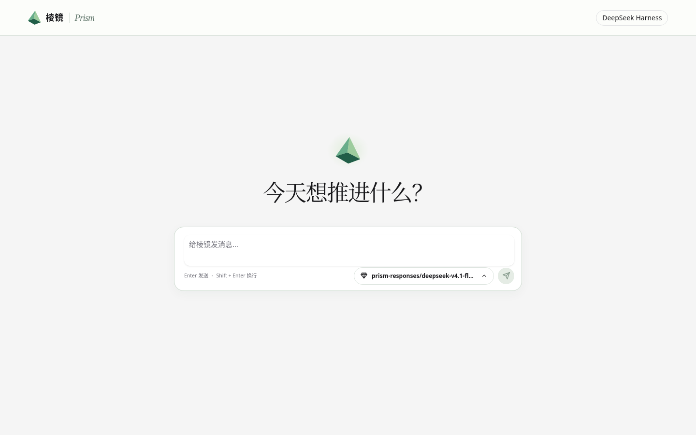

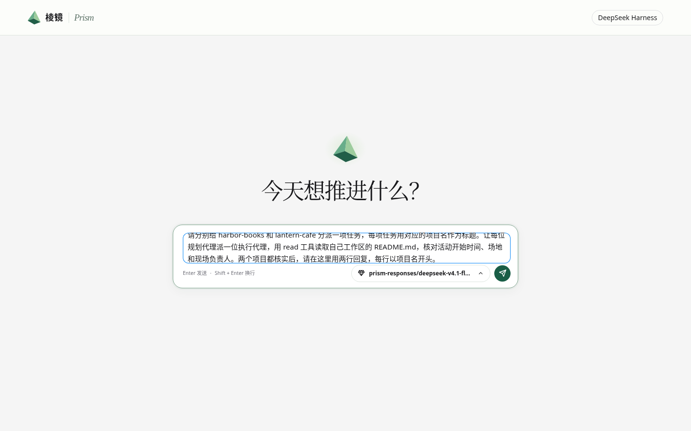

你会看到时间线里出现两张折叠任务卡，棱镜在后台分别核查完两个项目后，会直接给你汇总出两行结果：

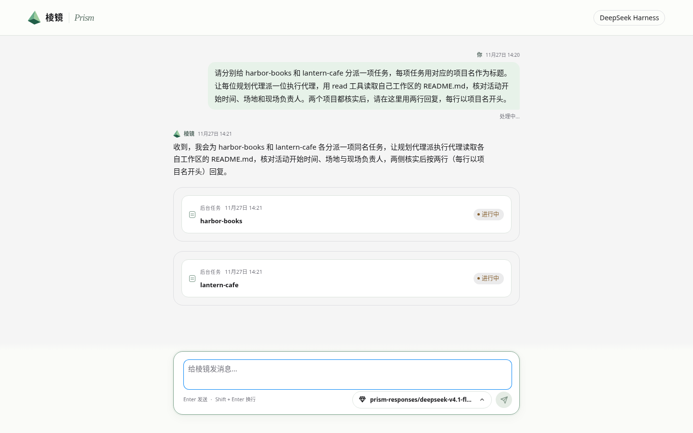

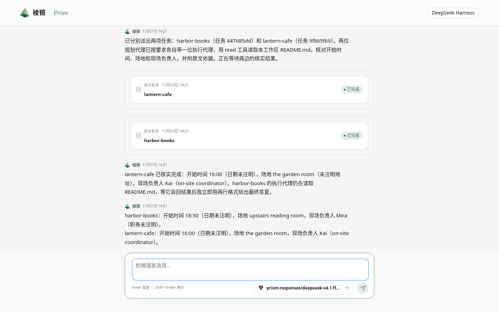

如果你使用的是仓库自带的示例目录，核对出的结果如下：

| 项目 | 开始时间 | 场地 | 现场负责人 |
| --- | --- | --- | --- |
| Harbor Books | 18:30 | 楼上阅览室（upstairs reading room） | Mira |
| Lantern Cafe | 16:00 | 花园房间（garden room） | Kai |

## 6. 按需回看底层过程（可选）

平时用棱镜不需要关心底层细节；只有当你想核对“它到底读了哪个文件、是怎么得出结论的”时，点击顶部的 **DeepSeek Harness** 就能切回工作区视图。

在左侧 **工作区** 里展开对应项目：**棱镜** 对应主对话，**棱镜 L2** 对应任务规划，**棱镜 L3** 对应具体执行。你可以随时点开这些只读记录查看原文和调用过程，看完后再点侧栏的 **棱镜** 就能回到聊天窗口。

<details>
<summary>展开查看：在 DSH 中查看只读会话记录</summary>


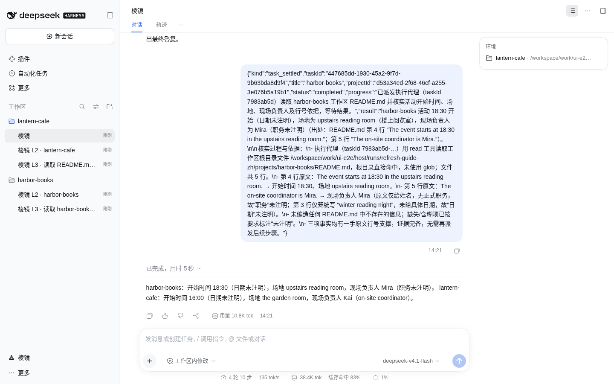


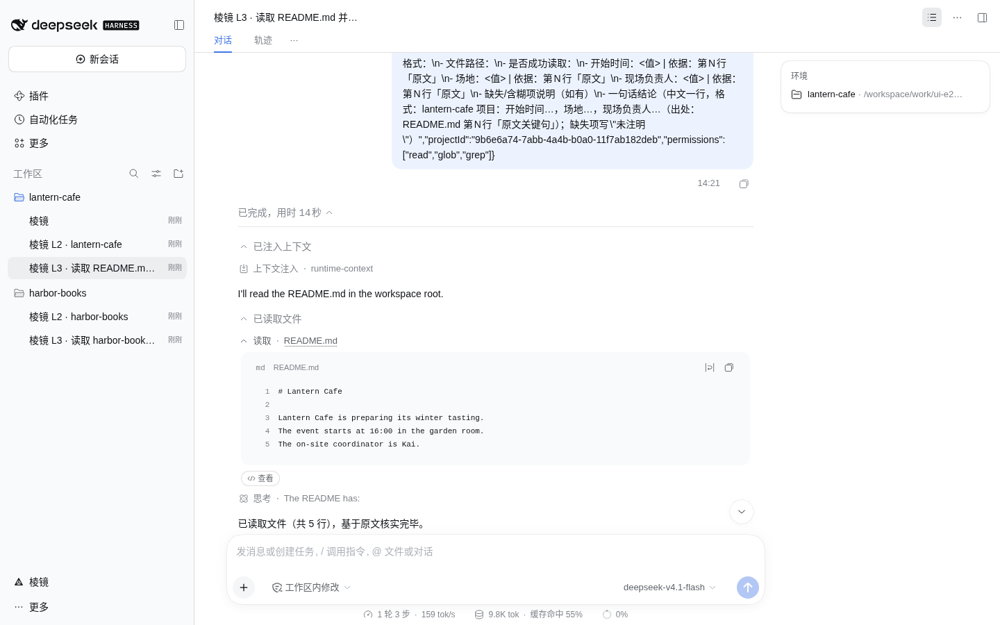

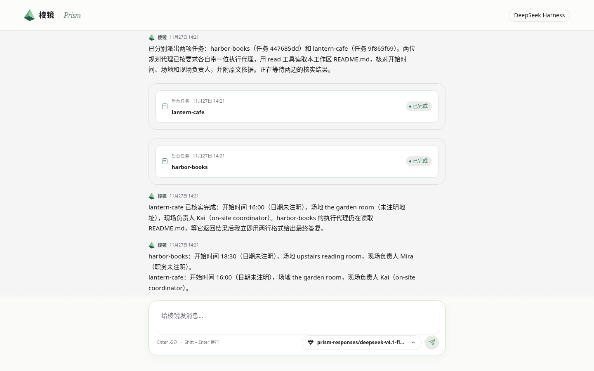

</details>

下一步：[与棱镜对话](./chat.md) · [接入即时通讯](./im.md)

## 常见问题

- **安装插件时提示“这个包没有声明组合包”**：请核对是否按第 1 步表格填写了带版本号的完整包名（例如 `@dsh-prism/dsh-workspace-registry@0.1.2`），并在每次安装后点击 **立即启用**。
- **五个插件都启用了，但侧栏找不到“棱镜”**：刷新一次 DSH 浏览器标签页即可。
- **在目录选择器输入路径后，页面仍停留在原目录**：再点一次 **编辑路径** 输入目标路径，确认路径栏末尾已经变成目标文件夹名后再点 **打开**。
