# 在一次对话中使用两个项目

在 DeepSeek Harness 0.2.3-alpha.2 的网页中安装下表列出的五个插件并接入 OpenAI Responses 模型后，可以让棱镜分别读取两个工作区的 README。截图来自 0.1.1 版演示，展示的是当时的插件版本和设置界面。

请准备支持 OpenAI Responses 协议及 `deepseek-v4.1-flash` 模型的服务地址和 API 密钥，以及 DSH 宿主可以读取的两个目录。要复现实例，可使用本仓库 `docs/examples` 下的 `harbor-books` 和 `lantern-cafe`。每个目录都有自己的 README，记录一场活动的信息。[GitHub 示例项目](https://github.com/dsh-plugins/dsh-prism/tree/main/docs/examples)

## 打开 DSH

打开你的 DSH 实例提供的登录链接。首次启动时，在预览版说明中点 **继续**。如果出现 **开始使用** 对话框，点 **关闭**。进入首页后，可从侧栏找到 **插件**、**工作区** 和账号菜单。

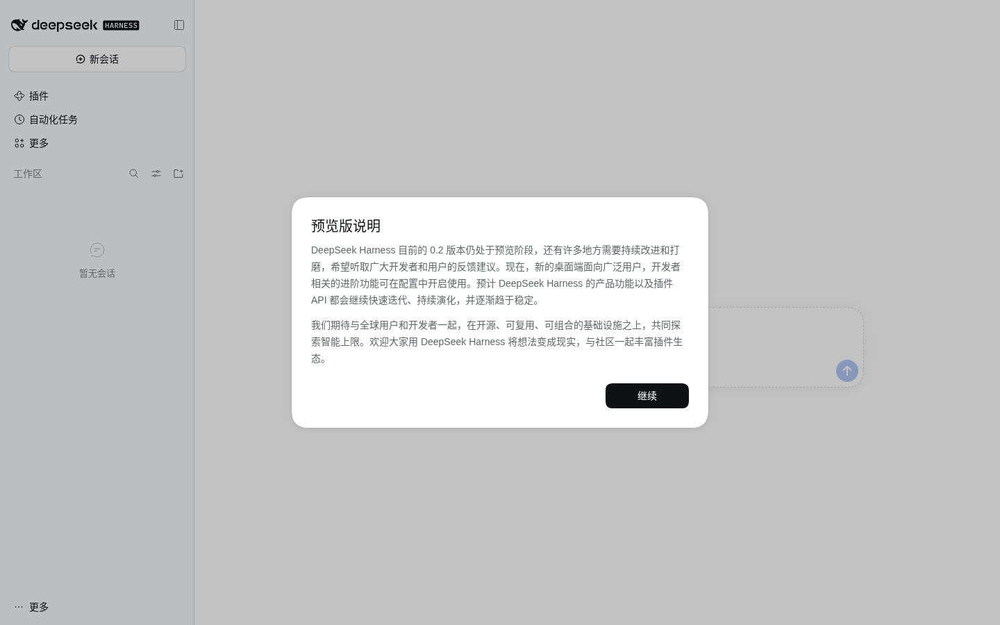

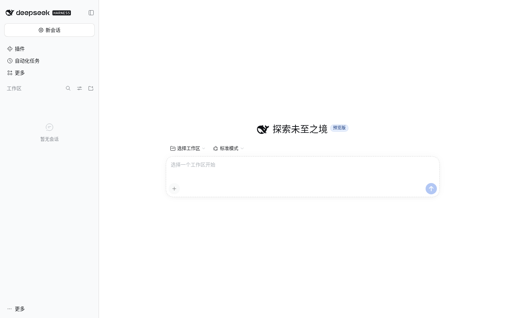

## 安装并启用五个插件

打开 **插件 → 添加插件**。在 **包名或地址** 中填写下表指定版本的 npm 包名，例如 `@dsh-prism/dsh-workspace-registry@0.1.2`。也可填写对应压缩包在 DSH 宿主上的路径。点 **安装**，确认安装的版本后点 **立即启用**，按下表顺序安装各插件。

| 顺序 | 包名 |
| --- | --- |
| 1 | `@dsh-prism/dsh-workspace-registry@0.1.2` |
| 2 | `@dsh-prism/dsh-mesh-node@0.1.1` |
| 3 | `@dsh-prism/dsh-orchestrator@0.1.2` |
| 4 | `@dsh-prism/dsh-im-gateway@0.1.2` |
| 5 | `@dsh-prism/dsh-concierge-ui@0.1.2` |

安装消息网关时，DSH 可能要求确认依赖的安装脚本。本次列出的依赖为 `protobufjs@7.6.6`。核对脚本后点 **允许这些脚本并重试**，继续安装。该许可会保存在当前 DSH 配置档中。

查看五个插件逐个安装成功的界面

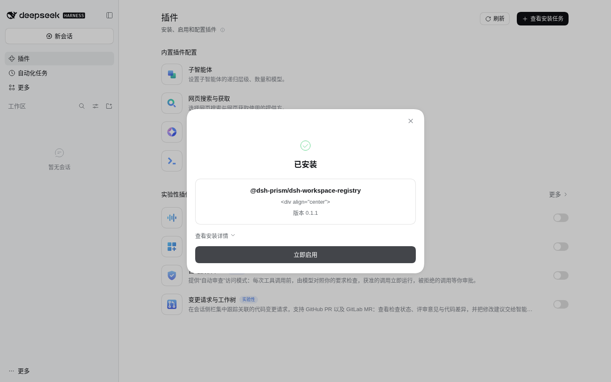

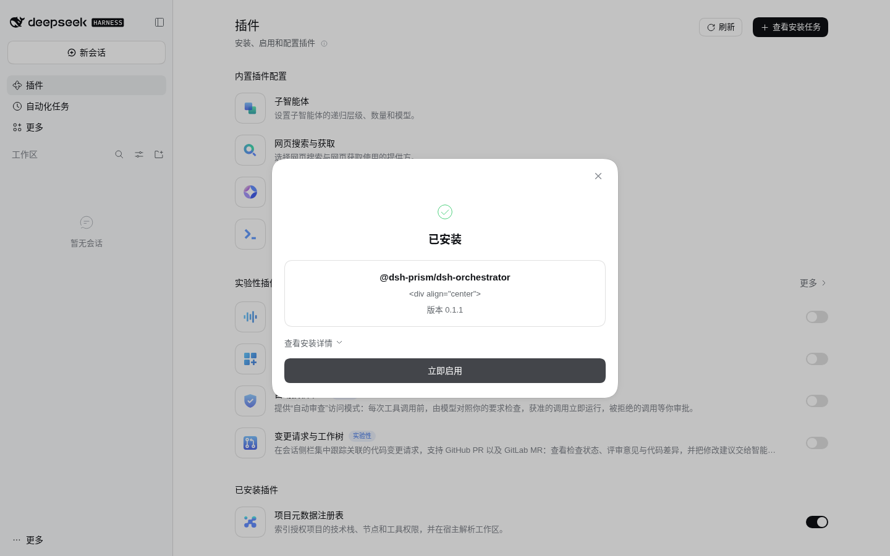

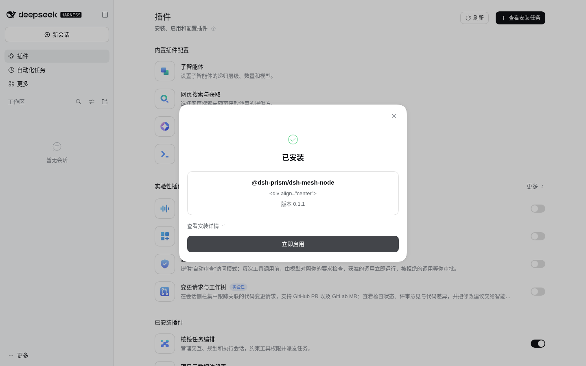

在 **已安装插件** 下确认五个插件均已列出。

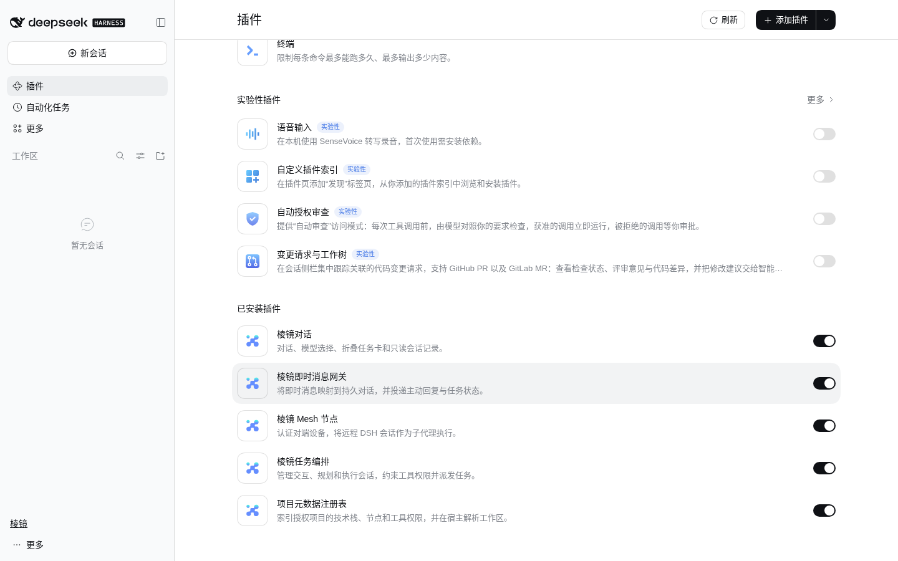

## 接入 OpenAI Responses 模型

打开账号菜单，进入 **设置 → 模型 → 添加模型提供商**，选择 **自定义模型 API**。下表给出示例使用的设置，服务地址和密钥请填自己的实际值。

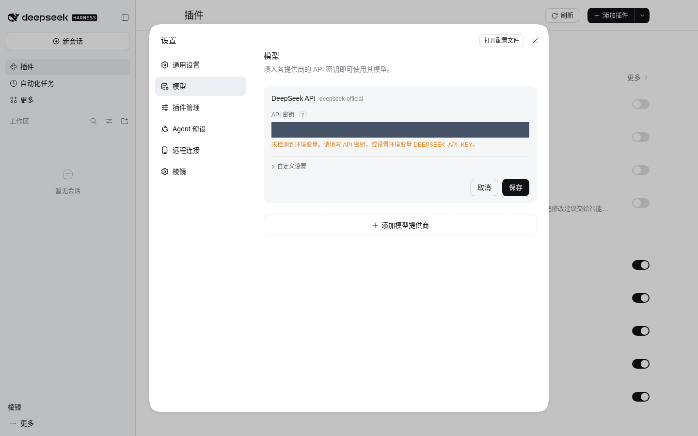

| 字段 | 填写内容 |
| --- | --- |
| Provider ID | `prism-responses` |
| 显示名称 | `Prism Responses` |
| API 地址 | 服务提供商给出的完整地址，即测试环境中的 `BASE_URL` 值 |
| API 协议 | **OpenAI Responses** |
| API 密钥 | 服务提供商的密钥，即测试环境中的 `API_KEY` 值 |
| 模型 ID | `deepseek-v4.1-flash` |

点 **添加模型**，在出现的 **模型 ID 1** 中填入 `deepseek-v4.1-flash`。

输入服务地址和密钥，然后点 **创建提供商**。回到列表，确认 `Prism Responses` 已创建并显示已配置 API 密钥。两张表单截图均已遮盖私密字段。

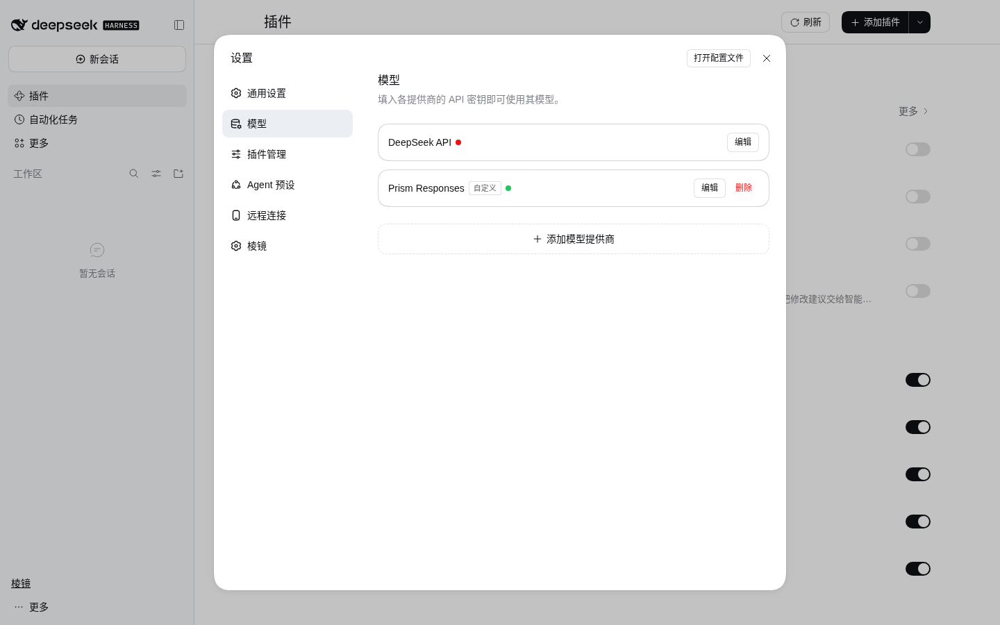

## 打开两个工作区并选用模型

在侧栏 **工作区** 旁点 **添加工作区**，选中第一个项目目录。也可在目录选择器中点 **编辑路径**，粘贴绝对路径，按回车后点 **打开**。重复一次打开第二个项目。本例中两个目录分别是 `harbor-books` 和 `lantern-cafe`。

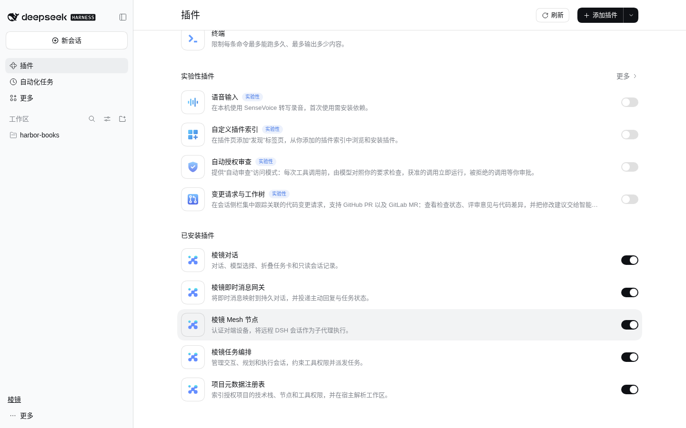

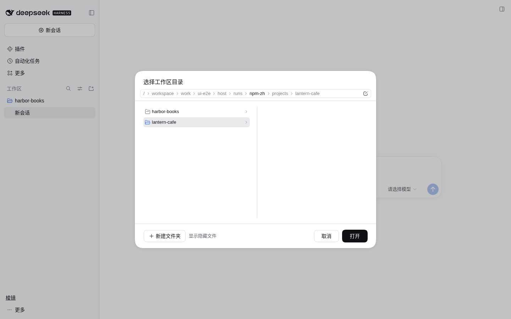

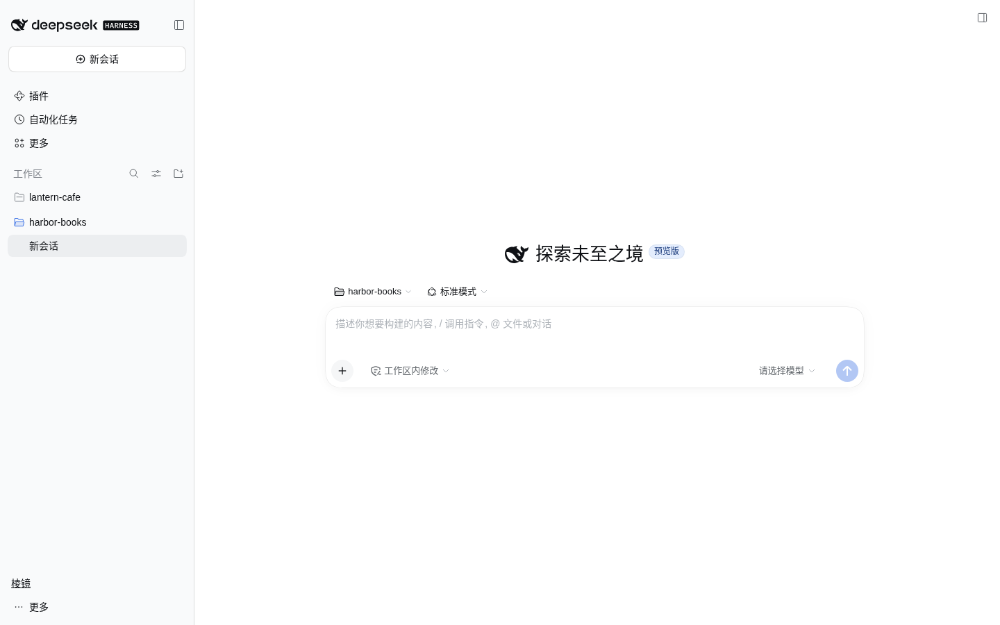

在 DSH 对话的输入区打开模型选择器，在 **Prism Responses** 下选 **deepseek-v4.1-flash**。未单独配置模型的层使用 DSH 默认模型。需要分别设置对话、规划和执行各层可用的模型时，打开 **设置 → 棱镜/配置**。

## 在棱镜中使用已登记的工作区

棱镜会自动发现 DSH 已登记的本机工作区。发送请求时可以直接使用工作区名称。本例让棱镜分别读取并核对两个工作区的 README。

0.1.1 版的项目登记及 IM 身份截图

旧版演示填写了两个项目的 ID 和绝对目录，并授予读取、列文件及搜索权限。操作者还保存并移除了用于演示的 IM 身份，以核对重新打开编辑器后记录是否完整。

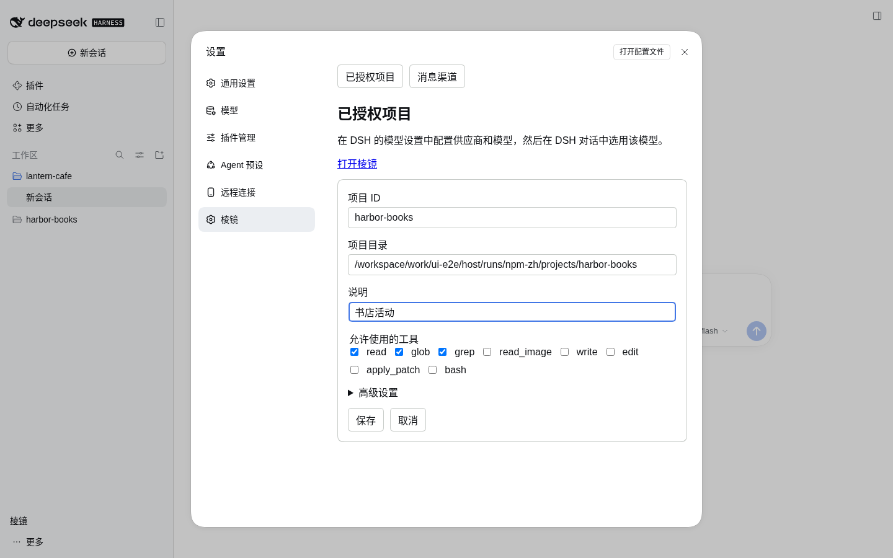

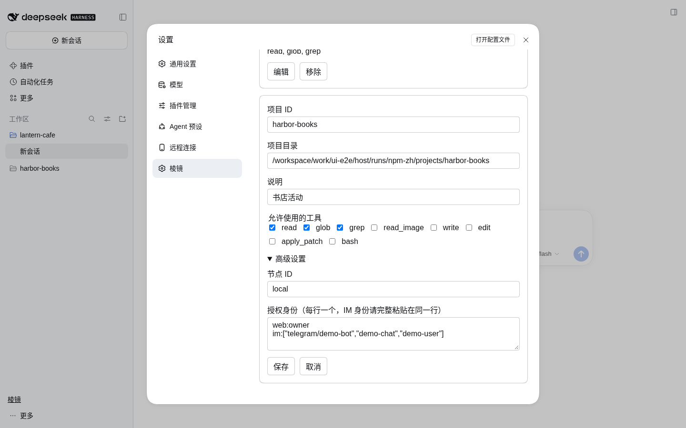

### 查看消息渠道

打开 **设置 → 棱镜/IM**，点 **添加 IM** 后选择账号类型。执行下面的网页对话示例时，各渠道可保持停用。[旧版消息渠道图解](./im.md)

## 向每个项目派发一个任务

首次进入时，点 DSH 侧栏中的 **棱镜**，或在 **设置 → 棱镜/配置** 点 **打开棱镜**。成功打开后，在同一浏览器再次访问 DSH 首页地址会直接进入棱镜。确认输入区显示 `deepseek-v4.1-flash`，再发送下面的请求。

> 请分别为 harbor-books 和 lantern-cafe 派发任务，以工作区名称作为任务标题。让每个执行代理读取自己工作区的 README.md，核对活动开始时间、场地和现场负责人。两个工作区都核实后，在这里用两行汇总各自的结果。

## 核对两个项目的结果

将回复与两个 README 分别对照。本例中的时间、场地与联系人各不相同。

| 项目 | 开始时间 | 场地 | 现场负责人 |
| --- | --- | --- | --- |
| Harbor Books | 18:30 | 楼上阅览室（upstairs reading room） | Mira |
| Lantern Cafe | 16:00 | 花园房间（garden room） | Kai |

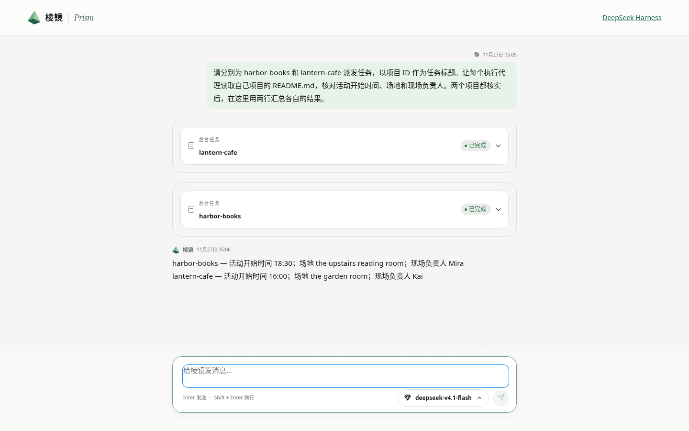

点 **DeepSeek Harness** 返回 DSH。在 **工作区** 侧栏打开对话（**棱镜**）、规划（**棱镜 L2**）和执行（**棱镜 L3**）的只读历史。对照两个项目的执行记录，核对 `read` 工具读取的 README 路径与返回内容。

0.1.1 版的执行记录截图

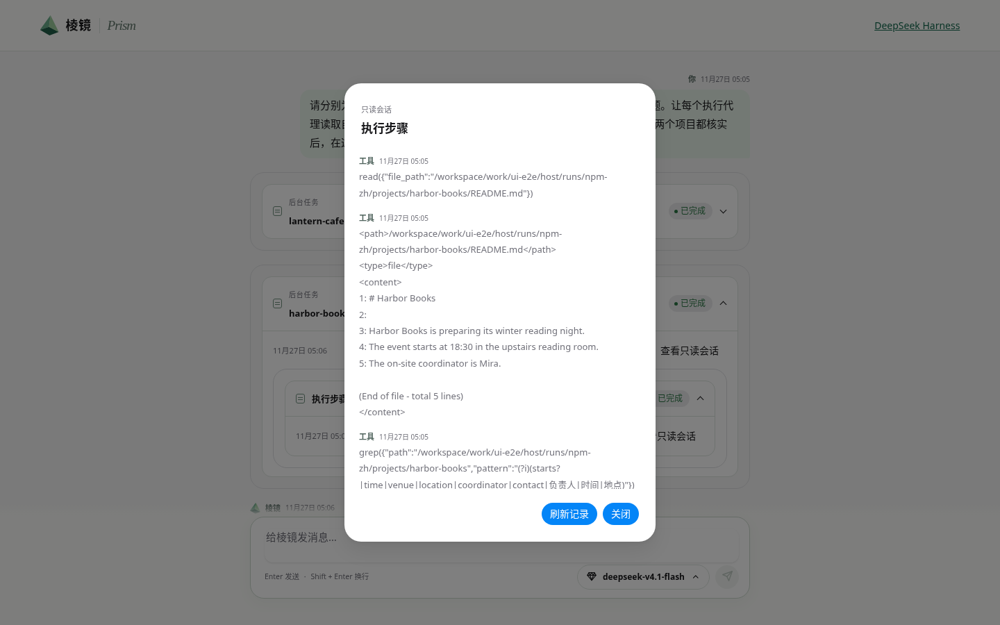

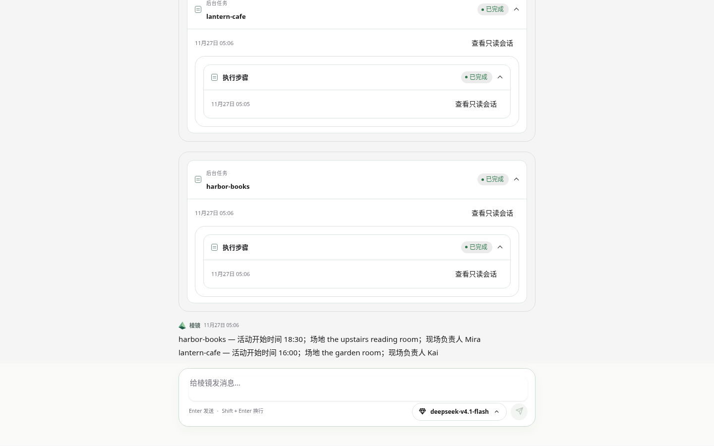

## 安装时提示“这个包没有声明组合包”

在 DSH 中安装 `@dsh-prism/dsh-workspace-registry@0.1.0` 曾出现此错误。该压缩包缺少插件管理器所需的 DSH 组合包声明。返回 **编辑**，填写本指南安装清单中的版本，安装后点 **立即启用**。

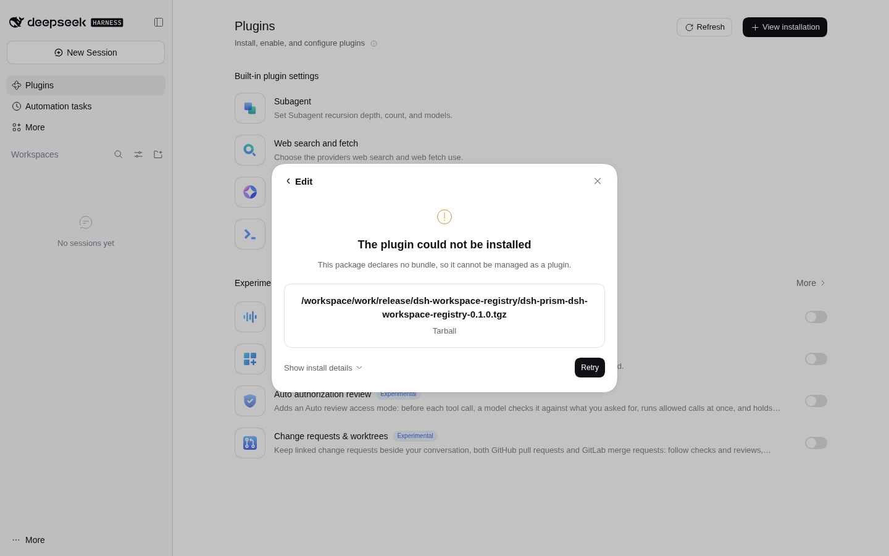

[与棱镜对话](./chat.md) · [模型与项目](../develop/models.md)
