# 在一次对话中使用两个项目

本指南从新的 DeepSeek Harness 0.2.3-alpha.2 会话开始，在网页里安装五个 0.1.1 版棱镜插件，接入 OpenAI Responses 模型，再让棱镜分别读取两个项目各自的 README。

请准备支持 OpenAI Responses 协议及 `deepseek-v4.1-flash` 模型的服务地址和 API 密钥，以及 DSH 宿主可以读取的两个目录。要复现实例，可使用本仓库 `docs/examples` 下的 `harbor-books` 和 `lantern-cafe`。每个目录都有自己的 README，记录一场活动的信息。[GitHub 示例项目](https://github.com/dsh-plugins/dsh-prism/tree/main/docs/examples)

## 打开 DSH

打开你的 DSH 实例提供的登录链接。首次启动时，在预览版说明中点 **继续**。如果出现 **开始使用** 对话框，点 **关闭**。进入首页后，可从侧栏找到 **插件**、**工作区** 和账号菜单。

## 安装并启用五个插件

打开 **插件 → 添加插件**。在 **包名或地址** 中填写含版本的 npm 包名，例如 `@dsh-prism/dsh-workspace-registry@0.1.1`。同一输入框也可填写压缩包在 DSH 宿主上的路径。点 **安装**，等安装完成并确认版本后点 **立即启用**。回到 **添加插件** 安装下一个包。按下表的顺序操作，先启用后续插件要用到的依赖。

| 顺序 | 包名 |
| --- | --- |
| 1 | `@dsh-prism/dsh-workspace-registry@0.1.1` |
| 2 | `@dsh-prism/dsh-orchestrator@0.1.1` |
| 3 | `@dsh-prism/dsh-mesh-node@0.1.1` |
| 4 | `@dsh-prism/dsh-im-gateway@0.1.1` |
| 5 | `@dsh-prism/dsh-concierge-ui@0.1.1` |

安装消息网关时，DSH 可能要求确认依赖的安装脚本。本次列出的依赖为 `protobufjs@7.6.6`。核对脚本后点 **允许这些脚本并重试**，继续安装。该许可会保存在当前 DSH 配置档中。

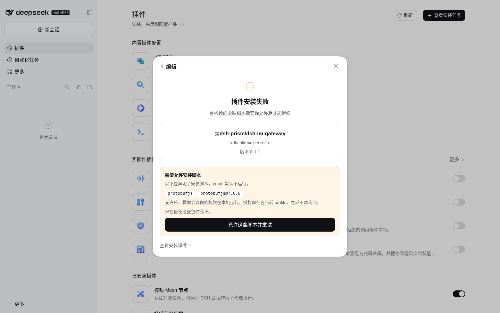

查看五个插件逐个安装成功的界面

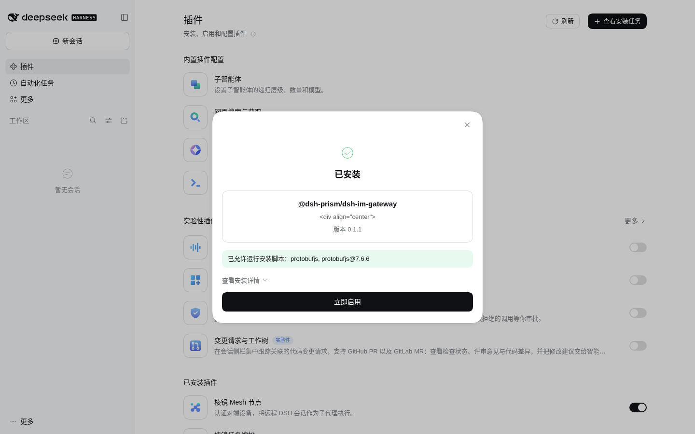

在 **已安装插件** 下确认五个插件均已列出。

## 接入 OpenAI Responses 模型

打开账号菜单，进入 **设置 → 模型 → 添加模型提供商**，选择 **自定义模型 API**。下表给出示例使用的设置，服务地址和密钥请填自己的实际值。

| 字段 | 填写内容 |
| --- | --- |
| Provider ID | `prism-responses` |
| 显示名称 | `Prism Responses` |
| API 地址 | 服务提供商给出的完整地址，即测试环境中的 `BASE_URL` 值 |
| API 协议 | **OpenAI Responses** |
| API 密钥 | 服务提供商的密钥，即测试环境中的 `API_KEY` 值 |
| 模型 ID | `deepseek-v4.1-flash` |

点 **添加模型**，在出现的 **模型 ID 1** 中填入 `deepseek-v4.1-flash`。

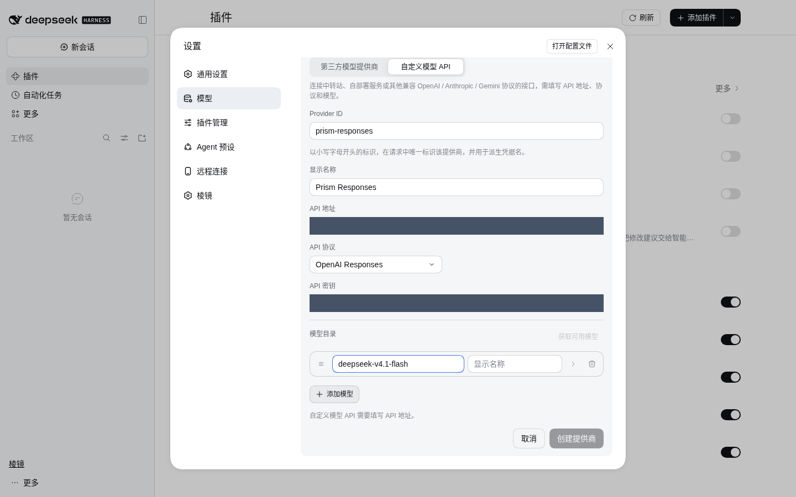

输入服务地址和密钥，然后点 **创建提供商**。回到列表，确认 `Prism Responses` 已创建并显示已配置 API 密钥。两张表单截图均已遮盖私密字段。

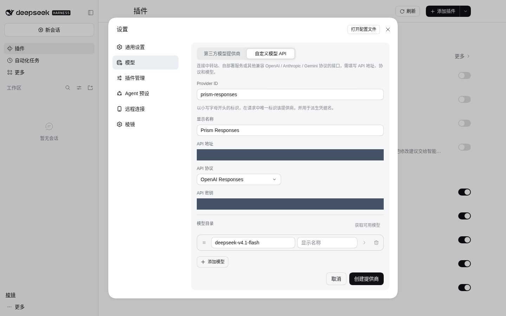

## 打开两个工作区并选用模型

在侧栏 **工作区** 旁点 **添加工作区**，选中第一个项目目录。也可在目录选择器中点 **编辑路径**，粘贴绝对路径，按回车后点 **打开**。重复一次打开第二个项目。本例中两个目录分别是 `harbor-books` 和 `lantern-cafe`。

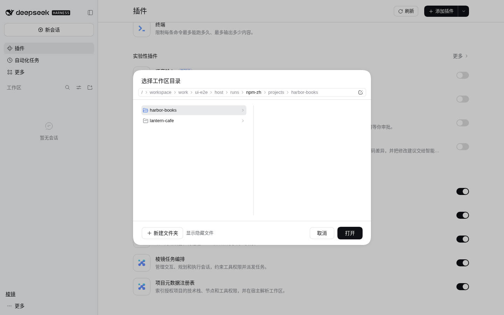

在 DSH 原生对话的输入区打开模型选择器，在 **Prism Responses** 下选 **deepseek-v4.1-flash**。插件安装模式下，棱镜的对话、规划和执行三个角色跟随 DSH 选定的模型。

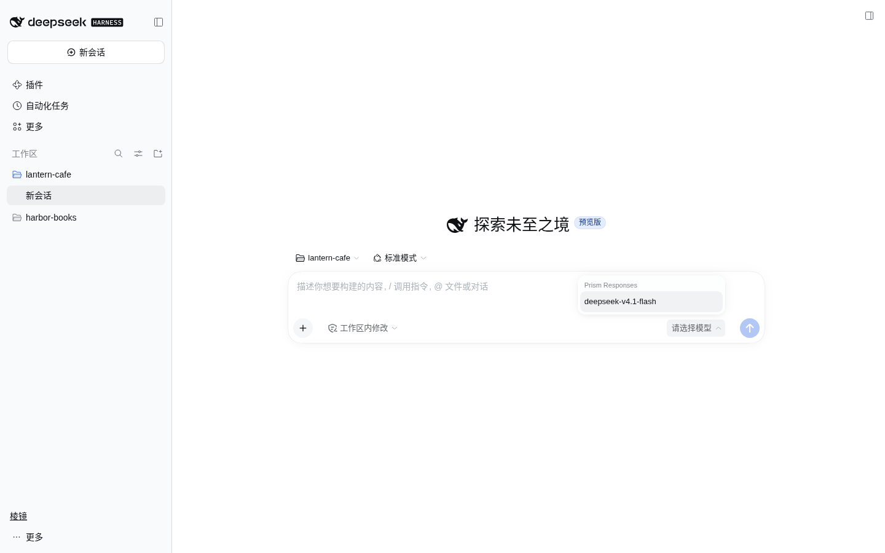

## 向棱镜授权两个项目

在 **设置 → 棱镜** 点 **添加项目**。填入唯一的 **项目 ID** 和 DSH 宿主上的 **项目目录** 绝对路径，可补充简短 **说明** 帮助对话代理区分项目。DSH 工作区用于打开目录。棱镜根据这里保存的项目和工具授权来派发任务。

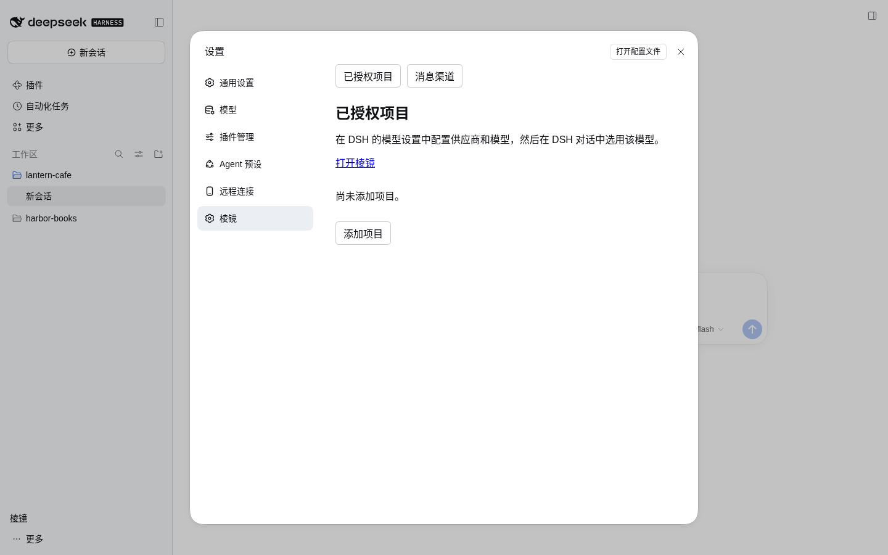

先保存 `harbor-books`，再添加并保存 `lantern-cafe`。在 **项目目录** 中分别粘贴对应工作区的绝对路径。本例使用本地节点和 `web:owner` 身份，保留 **read**、**glob** 和 **grep** 三项读取、列文件与搜索权限。核对 **已授权项目** 中的两个项目 ID。

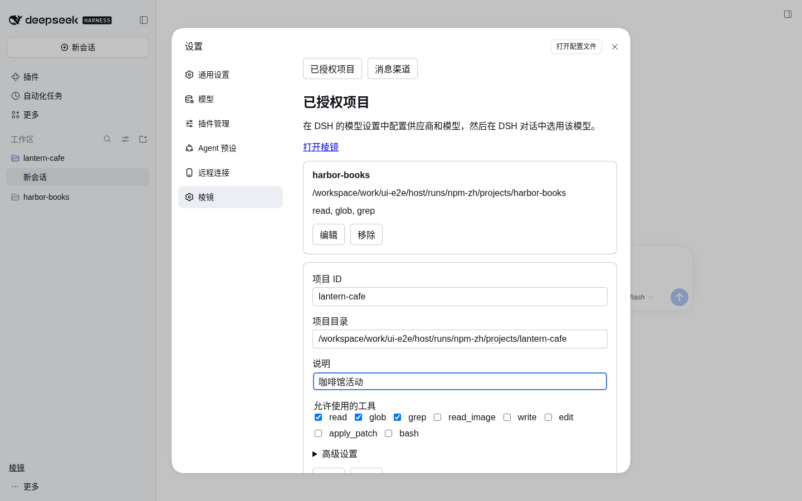

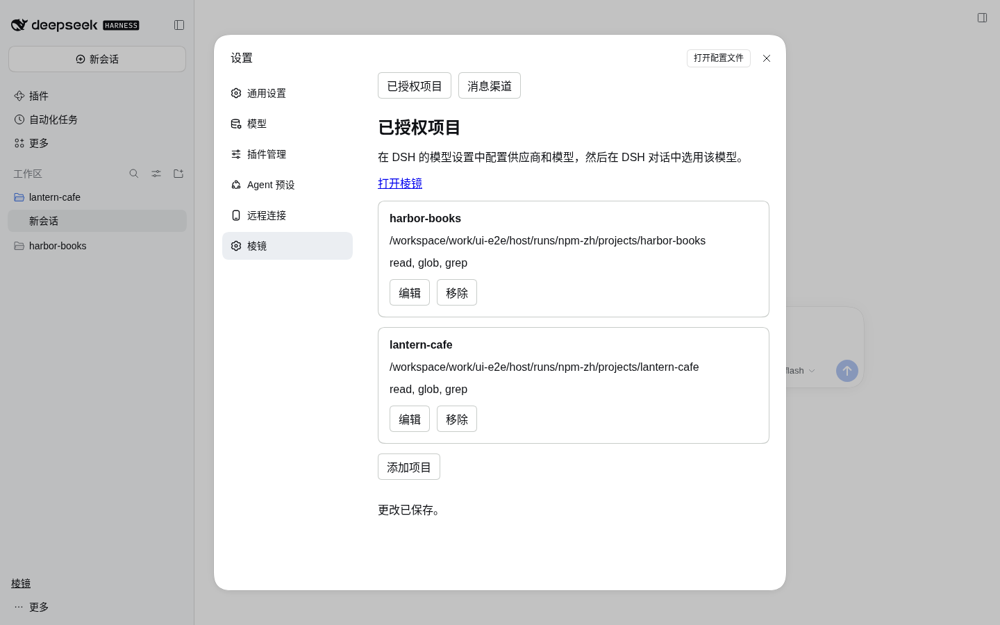

### 给一个项目单独授权 IM 身份

在 **已授权项目** 中点 Harbor Books 的 **编辑**，展开 **高级设置**。在 **授权身份** 中每行填写一个身份。本例第一行为 `web:owner`，第二行为 `im:["telegram/demo-bot","demo-chat","demo-user"]`。其中三项占位字符串分别表示渠道、会话和用户。实际授权时请使用目标私聊的真实身份，并在该渠道通过允许列表或配对码授权私聊用户。

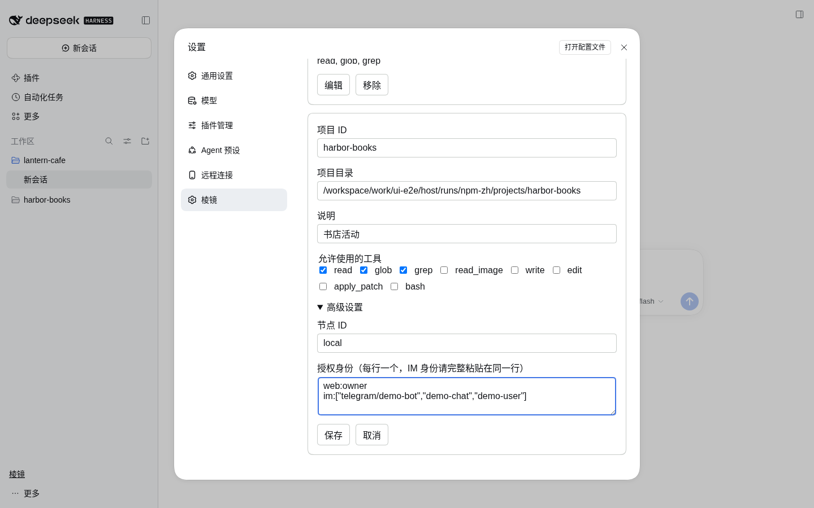

点 **保存**，重新打开编辑器，确认完整 IM 身份仍在同一行。本次演示随后移除示例身份、保存，再次核对书店项目保留了网页所有者授权。

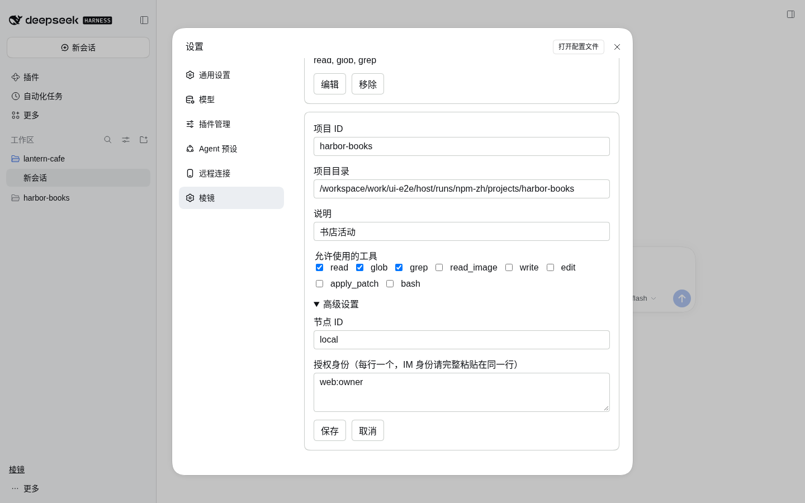

### 查看消息渠道

同一设置页还有 **消息渠道**，可在停用连接时检查表单或保存草稿。消息配置指南展示全部七个渠道、Telegram 草稿重开验证及飞书扫码入口。继续下面的网页对话时，各渠道可保持停用。[消息渠道配置图解](./im.md)

## 向每个项目派发一个任务

查看消息渠道后，先切回 **已授权项目**，点 **打开棱镜**，确认输入区显示 `deepseek-v4.1-flash`，再发送下面的请求。

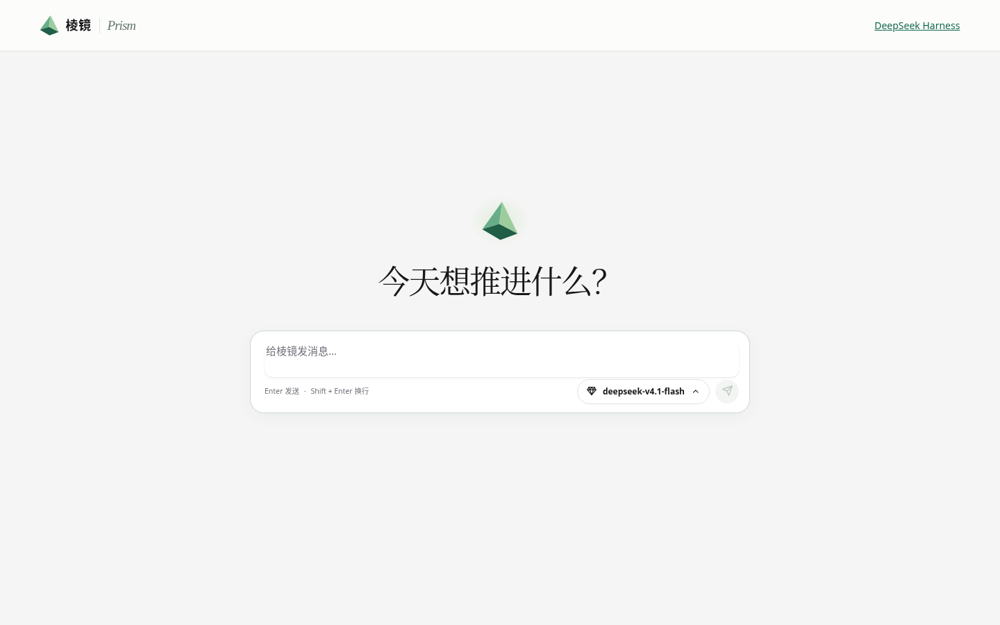

> 请分别为 harbor-books 和 lantern-cafe 派发任务，以项目 ID 作为任务标题。让每个执行代理读取自己项目的 README.md，核对活动开始时间、场地和现场负责人。两个项目都核实后，在这里用两行汇总各自的结果。

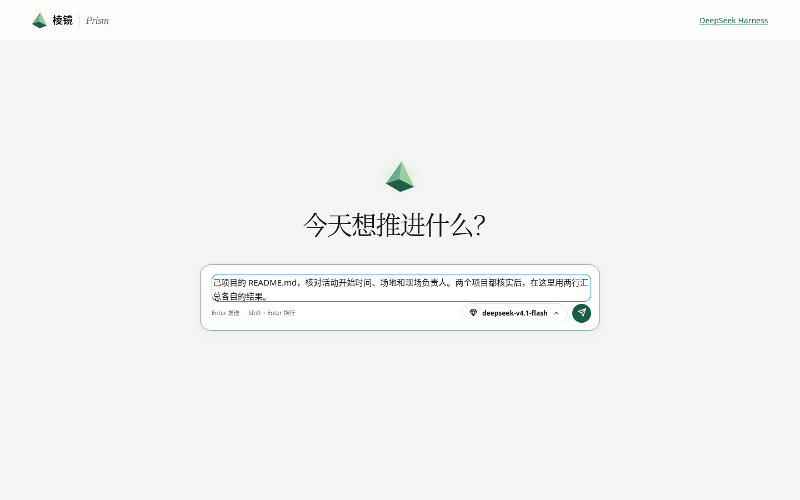

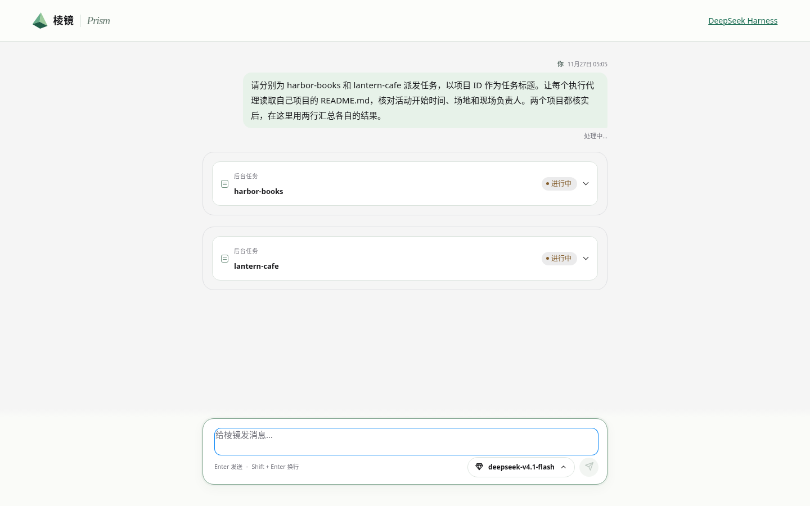

## 核对两个项目的结果

将回复与两个 README 分别对照。本例中的时间、场地与联系人各不相同。

| 项目 | 开始时间 | 场地 | 现场负责人 |
| --- | --- | --- | --- |
| Harbor Books | 18:30 | 楼上阅览室（upstairs reading room） | Mira |
| Lantern Cafe | 16:00 | 花园房间（garden room） | Kai |

展开某个项目的任务卡，再展开执行步骤，打开该步骤的只读会话。`read` 工具记录会显示实际读取的 README 路径和内容。对另一个项目重复操作，核对两个工作目录各不相同。关闭查看器可回到原对话。

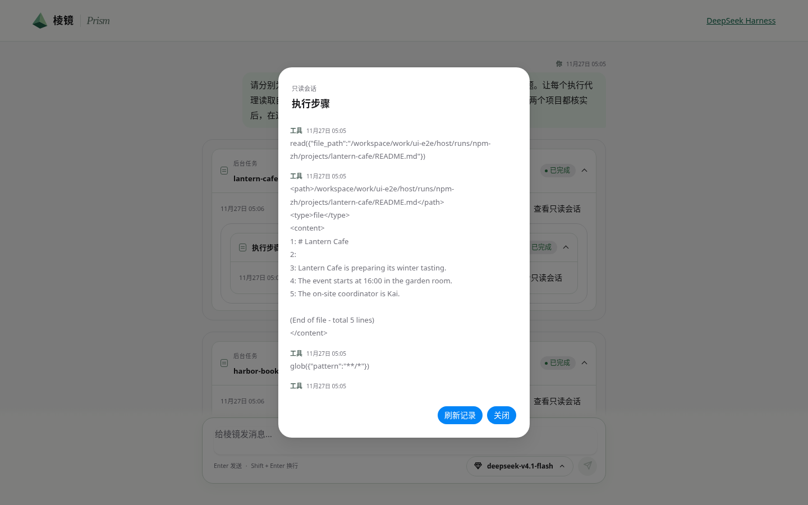

## 安装时提示“这个包没有声明组合包”

在 DSH 中安装 `@dsh-prism/dsh-workspace-registry@0.1.0` 可复现此错误。该压缩包缺少插件管理器所需的 DSH 组合包声明。返回 **编辑**，选择 0.1.1 版安装，待安装完成后点 **立即启用**。

[与棱镜对话](./chat.md) · [模型与项目](../develop/models.md)
