# 让棱镜在两个 DSH 工作区分别查证

在同一次对话中，让棱镜分别读取书店和咖啡馆的活动安排，并汇总两份结果。本指南从全新的 DeepSeek Harness 0.2.3-alpha.2 环境开始。请准备能读取两个项目目录的 DSH 宿主，以及支持 OpenAI Responses 和 `deepseek-v4.1-flash` 的模型服务。仓库提供了用于核对结果的两份 README。[查看 GitHub 示例目录](https://github.com/dsh-plugins/dsh-prism/tree/main/docs/examples)

## 安装棱镜插件

打开 DSH 提供的登录链接。首次启动时，在预览版说明中点 **继续**。如出现 **开始使用** 对话框，关闭它。

从侧栏进入 **插件 → 添加插件**，在 **包名或地址** 中填写完整 npm 包名和版本，保留 **默认安装源**。点 **安装**，确认成功卡上的版本，再点 **立即启用**。请依表中顺序逐个安装。

| 安装顺序 | npm 包名及版本 |
| --- | --- |
| 1 | `@dsh-prism/dsh-workspace-registry@0.1.2` |
| 2 | `@dsh-prism/dsh-mesh-node@0.1.1` |
| 3 | `@dsh-prism/dsh-orchestrator@0.1.2` |
| 4 | `@dsh-prism/dsh-im-gateway@0.1.2` |
| 5 | `@dsh-prism/dsh-concierge-ui@0.1.3` |

下方截图来自 0.1.2 版验收。安装时请填写表中的版本。

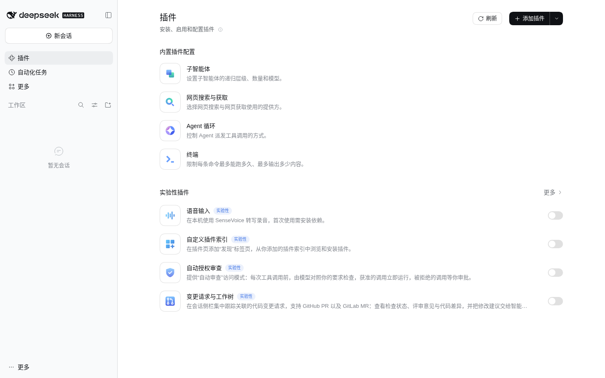

1. 安装 dsh-workspace-registry@0.1.2

2. 安装 dsh-mesh-node@0.1.1

3. 安装 dsh-orchestrator@0.1.2

4. 安装 dsh-im-gateway@0.1.2

本次安装时，DSH 要求确认依赖脚本。核对提示中列出的依赖后，点 **允许这些脚本并重试**。

5. 0.1.2 版网页界面的安装截图

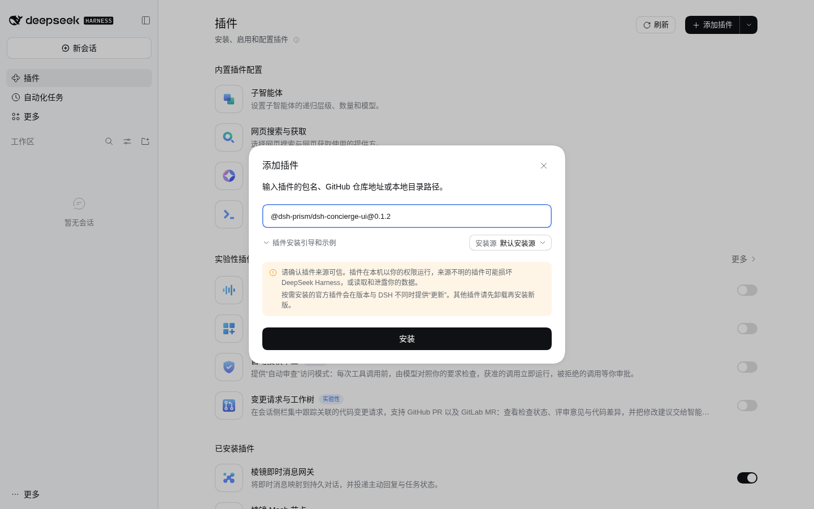

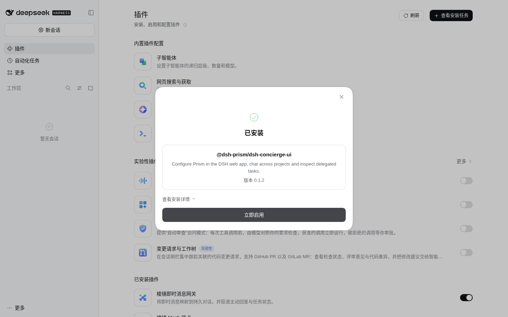

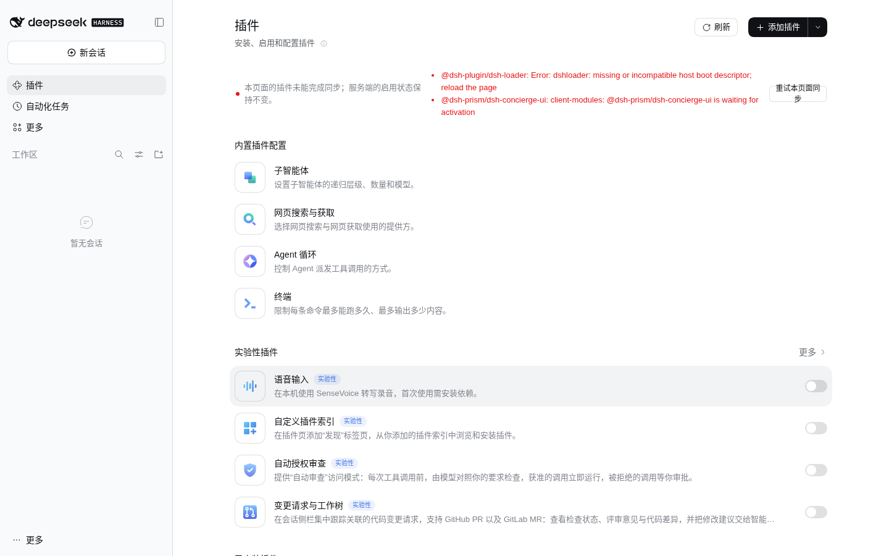

五包均启用后，如侧栏仍未出现棱镜，请刷新 DSH 标签页。本次刷新后入口可见。

## 接入 OpenAI Responses 模型

打开账号菜单，进入 **设置 → 模型 → 添加模型提供商 → 自定义模型 API**。在 **API 协议** 中选 **OpenAI Responses**。**Provider ID** 是连接标识，**显示名称** 会出现在模型菜单。本例分别使用 `prism-responses` 和 **Prism Responses**。

点 **添加模型**，在 **模型 ID 1** 输入 `deepseek-v4.1-flash`。在 **API 地址** 和 **API 密钥** 中填写模型服务提供的值，本次使用环境中的 `BASE_URL` 和 `API_KEY` 原值。点 **创建提供商**，回到列表确认配置已经保存。图中的私密字段均已遮挡。

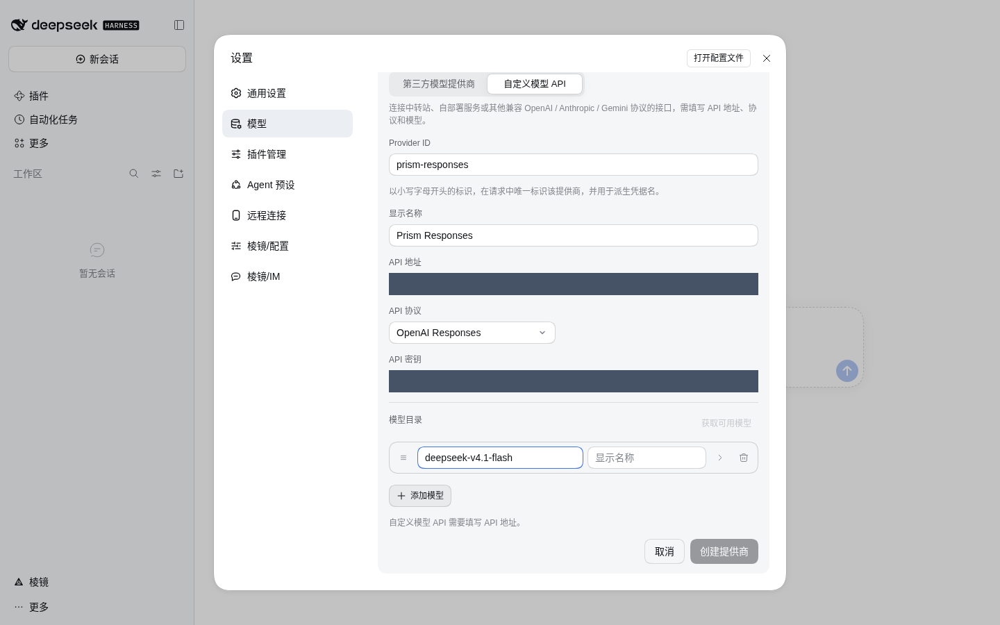

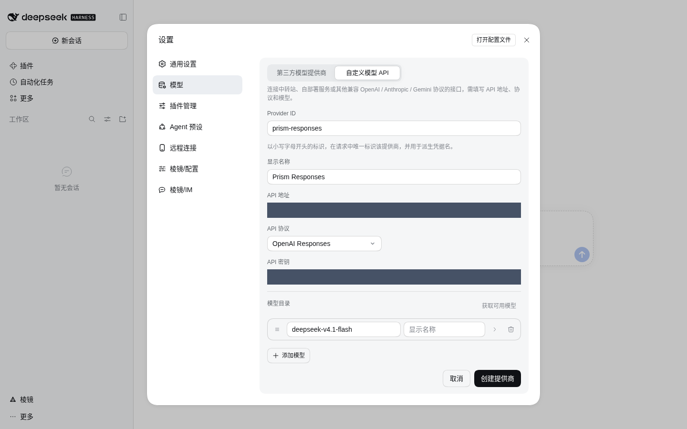

## 打开两个工作区

在侧栏 **工作区** 旁点 **添加工作区**，选中第一个项目目录并点 **打开**。也可点 **编辑路径**，输入绝对路径并按回车，进入该目录后再打开。为第二个目录重复上述操作。本例打开 `harbor-books` 和 `lantern-cafe`。

棱镜会发现 DSH 已登记的本地工作区。发任务时可用工作区显示名称指明项目。执行代理在这些工作区默认可以用 `read` 读文件、用 `glob` 查找路径、用 `grep` 搜索文本。网页所有者及已经获准私聊的 IM 用户可以查询这些工作区。

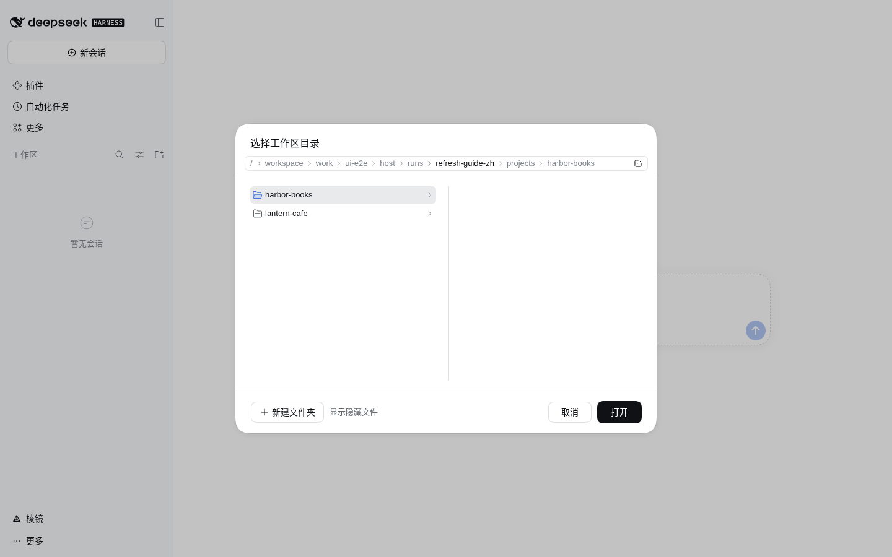

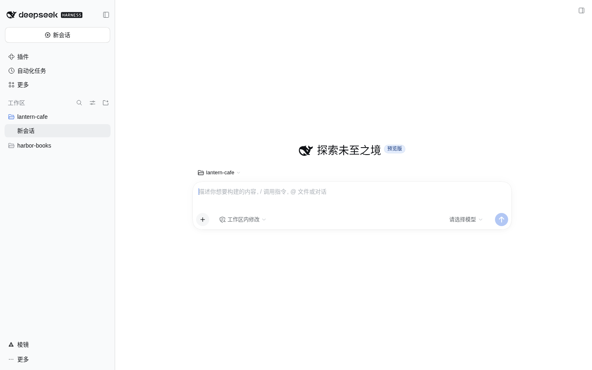

在 DSH 原生对话的输入框旁打开模型选择器，选 **Prism Responses → deepseek-v4.1-flash**。

## 为对话、规划和执行选择模型

打开 **设置 → 棱镜/配置**。页面分别列出 **L1**（对话）、**L2**（规划）、**L3**（执行）可用的模型。勾选模型即可允许该层使用。某层没有勾选时跟随 DSH 默认模型。点模型旁的编辑按钮可修改该层的 **模型介绍** 和 **模型提示词**，完成后点 **保存**。

本例为三层分别勾选 **Prism Responses / deepseek-v4.1-flash**，填写下表的介绍和附加提示词，然后保存并重新打开核对。

| 层级 | 模型介绍 | 模型提示词 |
| --- | --- | --- |
| L1 | 协调多个项目的任务 | 按照用户指定的语言和格式汇总已核实的结果。 |
| L2 | 规划项目任务 | 复用已经核实的结果，并向协调者汇报已完成的工作。 |
| L3 | 核查工作区资料 | 报告已核实的事实，并在需要时注明来源文件。 |

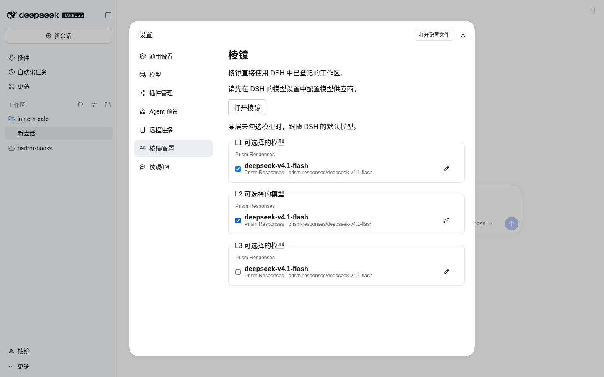

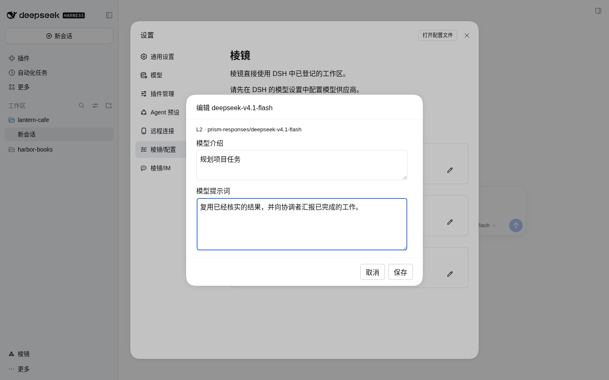

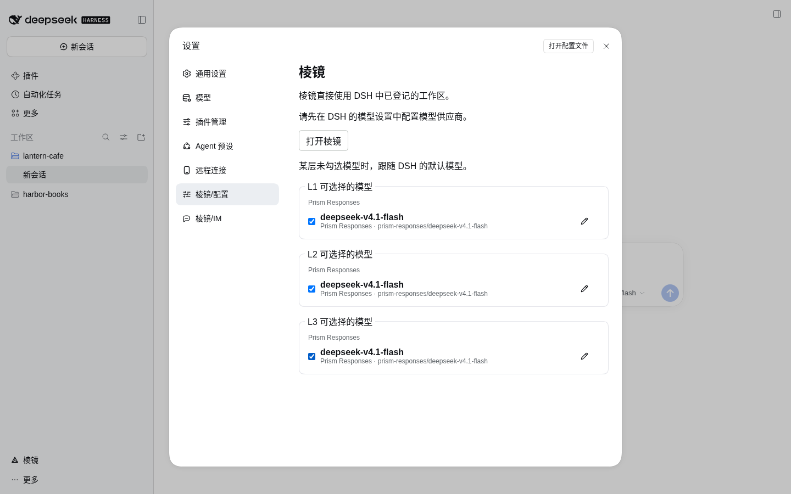

如需设置私聊，进入 **设置 → 棱镜/IM**。消息渠道指南展示 Telegram、微信、飞书/Lark、企业微信、QQ 机器人、OneBot 和 Discord。继续网页对话时，这些渠道可保持停用。[配置消息渠道](./im.md)

## 分别核对两个项目的活动资料

关闭设置，从 DSH 侧栏点 **棱镜**，也可以从 **棱镜/配置** 点 **打开棱镜**。确认输入框中显示 `deepseek-v4.1-flash`，发送下面的请求。

> 请分别给 harbor-books 和 lantern-cafe 分派一项任务，每项任务用对应的项目名作为标题。让每位规划代理派一位执行代理，用 read 工具读取自己工作区的 README.md，核对活动开始时间、场地和现场负责人。两个项目都核实后，请在这里用两行回复，每行以项目名开头。

将棱镜回复中的两条记录分别与示例 README 对照。两个项目有各自的活动时间、场地和负责人。

| 工作区 | 开始时间 | 场地 | 现场负责人 |
| --- | --- | --- | --- |
| Harbor Books | 18:30 | 楼上阅览室（upstairs reading room） | Mira |
| Lantern Cafe | 16:00 | 花园房间（garden room） | Kai |

## 在 DSH 查看各层会话

点 **DeepSeek Harness** 返回 DSH。展开 **工作区** 侧栏中的项目。**棱镜** 对应对话会话，**棱镜 L2** 对应规划，**棱镜 L3** 对应执行。规划会话会记录派发的工作。在两个工作区各打开执行会话，展开处理过程，再点开 `read` 工具详情，核对 README 路径和返回的内容。

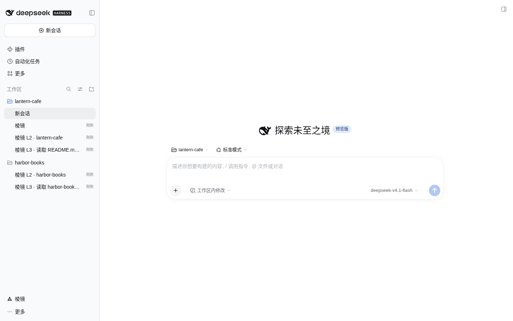

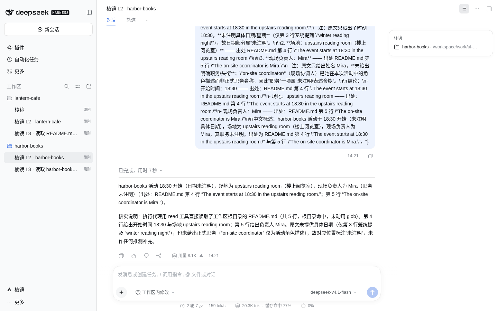

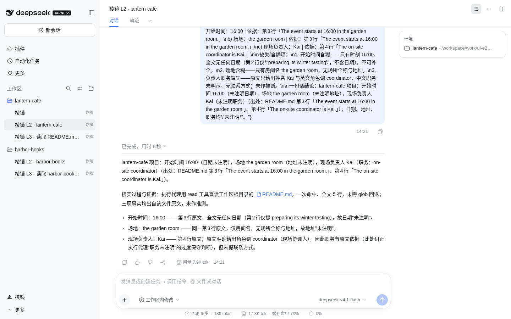

浏览器标签页会显示棱镜图标。首次进入后，在同一浏览器访问 DSH 首页地址会返回棱镜。可从顶部的 **DeepSeek Harness** 回到 DSH 原生工作区，再通过侧栏的 **棱镜** 打开对话。[使用棱镜对话](./chat.md) · [模型设置与工作区发现](../develop/models.md)

## 遇到安装或工作区选择问题

若 DSH 提示 **这个包没有声明组合包**，请核对安装表中的完整包名和版本。旧版 `@dsh-prism/dsh-workspace-registry@0.1.0` 能复现该问题。使用表中的已发布版本安装，成功后点 **立即启用**。Mesh 0.1.1 安装成功卡可能将一行 README 的 HTML 显示为包说明，可通过包名和版本识别。

在目录选择器输入路径后，如果仍显示原来的目录，再次点 **编辑路径** 确认路径。请先核对面包屑末尾的目录名，再点 **打开**。[实测问题记录](https://github.com/dsh-plugins/dsh-prism/blob/main/docs/TECH.md)
